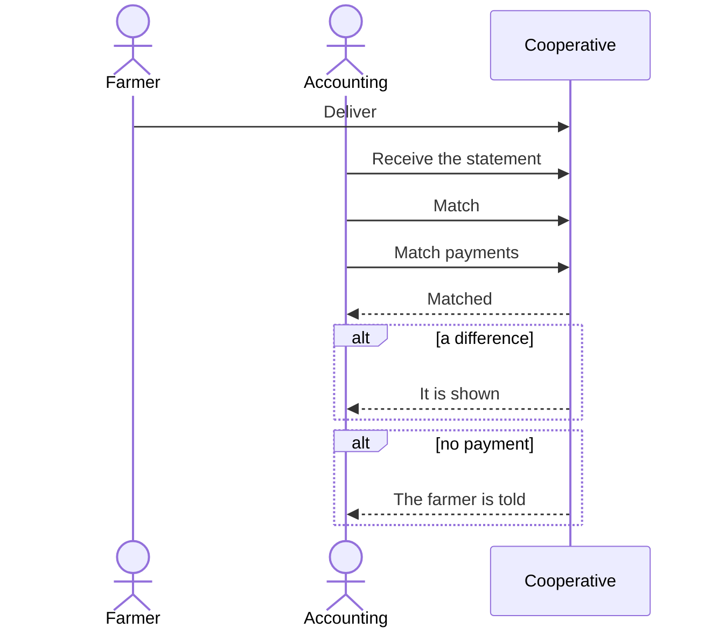

🏠 [Specs](../../../../README.md) › 🏷️ [Sectors](../../../README.md) › 🌾 [SC13 Agriculture and food](../../README.md) ›
📝 [Use cases](../README.md) › 📝 [Use cases: FL-SC13-04 Sales and certification](README.md) ›
📝 UC-SC13-11 Deliver to the cooperative and follow payments

# 📝 UC-SC13-11 Deliver to the cooperative and follow payments

**Status:** ✅ specified

## Summary

The farmer delivers to the cooperative; accounting matches its statements and payments.

## Personas

- [U40 Farmer](../../../../01-users/personas/u40-farmer.md)
- [U05 Accounting](../../../../01-users/personas/u05-accounting.md)

## Goal

Deliveries paid as stated.

## Trigger

A delivery.

## Frequency

Seasonally.

## Preconditions

- The SC13 sector pack is installed for the company,
  [UC-F14-02](../../../../02-functional/f14-plugin-store/use-cases/01-find-and-install/uc-f14-02-install-a-plugin-or-sector-pack.md),
  and its users have their roles,
  [UC-F1-06](../../../../02-functional/f01-administration/use-cases/04-edit-a-role/uc-f01-06-edit-a-role-and-its-record-rules.md).

## Postconditions

- **Success:** statements and payments match.
- **Failed:** differences are shown.

## Main flow

1. The farmer records the delivery on
   [S-SC13-11 Cooperative](../../screens/04-sales-and-certification/s-sc13-11-cooperative.md).
2. The statement is imported.
3. Statements are matched to deliveries
   ([BR-SC13-13](../../business-rules/br-sc13-13-cooperative-deliveries-matched.md)).
4. Payments are matched,
   [UC-F8-06](../../../../02-functional/f08-accounting/use-cases/03-bank-and-collect/uc-f08-06-connect-banks-and-reconcile.md).

## Alternative flows

- 4a. Advance payments: advances are deducted at the final price.

## Error flows

- 3e. A difference: it is shown.
- 4e. No payment: the farmer is told.
- Any step: a call to a service or an outside system fails: it is retried first
  ([BR-F3-32](../../../../02-functional/f03-assistant/business-rules/br-f03-32-retry-before-an-error.md)), then the
  error message pattern ([D122](../../../../06-decisions/ux/d122-error-message-standard.md)) says what failed; what was
  typed is kept.

## Business rules

- [BR-SC13-13 Cooperative deliveries matched](../../business-rules/br-sc13-13-cooperative-deliveries-matched.md)

## Entities

- [E-SC13-10 Cooperative statement](../../data/e-sc13-10-cooperative-statement.md)

## Permissions

The farmer and accounting roles; the record rules of their role and site apply,
[UC-F1-06](../../../../02-functional/f01-administration/use-cases/04-edit-a-role/uc-f01-06-edit-a-role-and-its-record-rules.md).

## Notifications

None beyond the in-app updates of the records concerned.

## Audit events

Every creation, change and state change of cooperative statement records, with who, when and the values before and after
(T3).

## AI involvement

The AI assistant answers questions on the cooperative statement records of this use case, with links, and prepares them
as drafts the user confirms. It works within the user's rights,
[BR-F3-34](../../../../02-functional/f03-assistant/business-rules/br-f03-34-every-capability-is-reachable-from-the-assistant.md),
and never deletes or does anything irreversible without the user's confirmation,
[BR-F3-07](../../../../02-functional/f03-assistant/business-rules/br-f03-07-no-deletes-no-irreversible-acts.md).

## API, MCP and A2A exposure

Through the API and webhooks (T5) and the MCP and A2A gateway (T6), with the caller's rights,
[BR-F3-34](../../../../02-functional/f03-assistant/business-rules/br-f03-34-every-capability-is-reachable-from-the-assistant.md),
reading, creating and changing the records of this use case; nothing irreversible without a person's confirmation.

## Screens

- [S-SC13-11 Cooperative](../../screens/04-sales-and-certification/s-sc13-11-cooperative.md)

## Flowchart

See [FL-SC13-04 Sales and certification](../../flows/fl-sc13-04-sales-and-certification.md#flowchart).

## Sequence diagram

## Acceptance criteria

1. **Given** the example farm's 30 t delivered on 12 July at 210 EUR **when** the statement matches **then** 6,300 EUR
   is expected.
2. **Given** 30 t delivered on 12 July and 29 t stated **when** the statement is matched **then** it is shown.

## Non-functional notes

[D408](../../../../06-decisions/technical/d408-performance-and-profiles.md)'s targets
([performance](../../../../05-non-functional/performance.md)): 95 % of screens within 1 second; lists paged on the
server, the first page within 1 second; reports within 5 seconds or in the background. WCAG 2.2 AA and RGAA
([D46](../../../../06-decisions/ux/d46-accessibility-standard.md)).

## Regulatory references

None specific to this use case; the sector's legal rules are listed in [SC13 regulatory](../../regulatory.md).

## Related use cases

- [UC-SC13-18 Follow costs per crop, herd and product](../03-farm-business/uc-sc13-18-follow-costs-per-crop-herd-and-product.md)

## Open questions

None.

---

⬅️ [UC-SC13-10 Sell directly](uc-sc13-10-sell-directly.md) · ⬆️ [Up](README.md) ·
➡️ [UC-SC13-12 Keep organic certification records](uc-sc13-12-keep-organic-certification-records.md)
