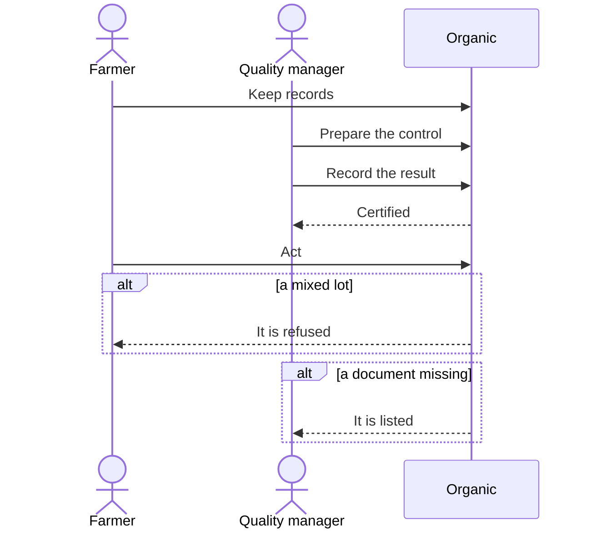

🏠 [Specs](../../../../README.md) › 🏷️ [Sectors](../../../README.md) › 🌾 [SC13 Agriculture and food](../../README.md) ›
📝 [Use cases](../README.md) › 📝 [Use cases: FL-SC13-04 Sales and certification](README.md) ›
📝 UC-SC13-12 Keep organic certification records

# 📝 UC-SC13-12 Keep organic certification records

**Status:** ✅ specified

## Summary

The farmer keeps organic records, prepares the yearly control with the quality manager, and records the result.

## Personas

- [U40 Farmer](../../../../01-users/personas/u40-farmer.md)
- [U27 Quality manager](../../../../01-users/personas/u27-quality-manager.md)

## Goal

The control passed.

## Trigger

The yearly control.

## Frequency

Yearly.

## Preconditions

- The SC13 sector pack is installed for the company,
  [UC-F14-02](../../../../02-functional/f14-plugin-store/use-cases/01-find-and-install/uc-f14-02-install-a-plugin-or-sector-pack.md),
  and its users have their roles,
  [UC-F1-06](../../../../02-functional/f01-administration/use-cases/04-edit-a-role/uc-f01-06-edit-a-role-and-its-record-rules.md).

## Postconditions

- **Success:** the result is recorded.
- **Failed:** non-conformities are followed.

## Main flow

1. Records are kept on [S-SC13-12 Organic](../../screens/04-sales-and-certification/s-sc13-12-organic.md)
   ([BR-SC13-08](../../business-rules/br-sc13-08-organic-kept-apart.md)).
2. The quality manager prepares the file.
3. The result is recorded.
4. Non-conformities are acted on.

## Alternative flows

- 1a. A conversion period: products are sold as in conversion.

## Error flows

- 1e. A mixed lot: it is refused.
- 2e. A document missing: it is listed.
- Any step: a call to a service or an outside system fails: it is retried first
  ([BR-F3-32](../../../../02-functional/f03-assistant/business-rules/br-f03-32-retry-before-an-error.md)), then the
  error message pattern ([D122](../../../../06-decisions/ux/d122-error-message-standard.md)) says what failed; what was
  typed is kept.

## Business rules

- [BR-SC13-08 Organic kept apart](../../business-rules/br-sc13-08-organic-kept-apart.md)

## Entities

- [E-SC13-11 Organic record](../../data/e-sc13-11-organic-record.md)

## Permissions

The farmer and quality manager roles; the record rules of their role and site apply,
[UC-F1-06](../../../../02-functional/f01-administration/use-cases/04-edit-a-role/uc-f01-06-edit-a-role-and-its-record-rules.md).

## Notifications

None beyond the in-app updates of the records concerned.

## Audit events

Every creation, change and state change of organic record records, with who, when and the values before and after (T3).

## AI involvement

The AI assistant answers questions on the organic record records of this use case, with links, and prepares them as
drafts the user confirms. It works within the user's rights,
[BR-F3-34](../../../../02-functional/f03-assistant/business-rules/br-f03-34-every-capability-is-reachable-from-the-assistant.md),
and never deletes or does anything irreversible without the user's confirmation,
[BR-F3-07](../../../../02-functional/f03-assistant/business-rules/br-f03-07-no-deletes-no-irreversible-acts.md).

## API, MCP and A2A exposure

Through the API and webhooks (T5) and the MCP and A2A gateway (T6), with the caller's rights,
[BR-F3-34](../../../../02-functional/f03-assistant/business-rules/br-f03-34-every-capability-is-reachable-from-the-assistant.md),
reading, creating and changing the records of this use case; nothing irreversible without a person's confirmation.

## Screens

- [S-SC13-12 Organic](../../screens/04-sales-and-certification/s-sc13-12-organic.md)

## Flowchart

See [FL-SC13-04 Sales and certification](../../flows/fl-sc13-04-sales-and-certification.md#flowchart).

## Sequence diagram

## Acceptance criteria

1. **Given** the example farm's Les Prés with its seed invoice **when** the control is prepared **then** the invoice is
   in the file.
2. **Given** an organic lot mixed with conventional wheat **when** it is created **then** it is refused.

## Non-functional notes

[D408](../../../../06-decisions/technical/d408-performance-and-profiles.md)'s targets
([performance](../../../../05-non-functional/performance.md)): 95 % of screens within 1 second; lists paged on the
server, the first page within 1 second; reports within 5 seconds or in the background. WCAG 2.2 AA and RGAA
([D46](../../../../06-decisions/ux/d46-accessibility-standard.md)).

## Regulatory references

Legal values from the France country pack:
[CR-FR-166 Organic certification](../../../../10-country-packs/france/agriculture/cr-fr-166-organic-certification.md).

## Related use cases

- [UC-SC13-04 Record harvests, yields and lots](../01-crops/uc-sc13-04-record-harvests-yields-and-lots.md)

## Open questions

None.

---

⬅️ [UC-SC13-11](uc-sc13-11-deliver-to-the-cooperative-and-follow-payments.md) · ⬆️ [Up](README.md) ·
➡️ [UC-SC13-13](../05-food-processing/uc-sc13-13-manage-recipes-and-batches-for-processing.md)
