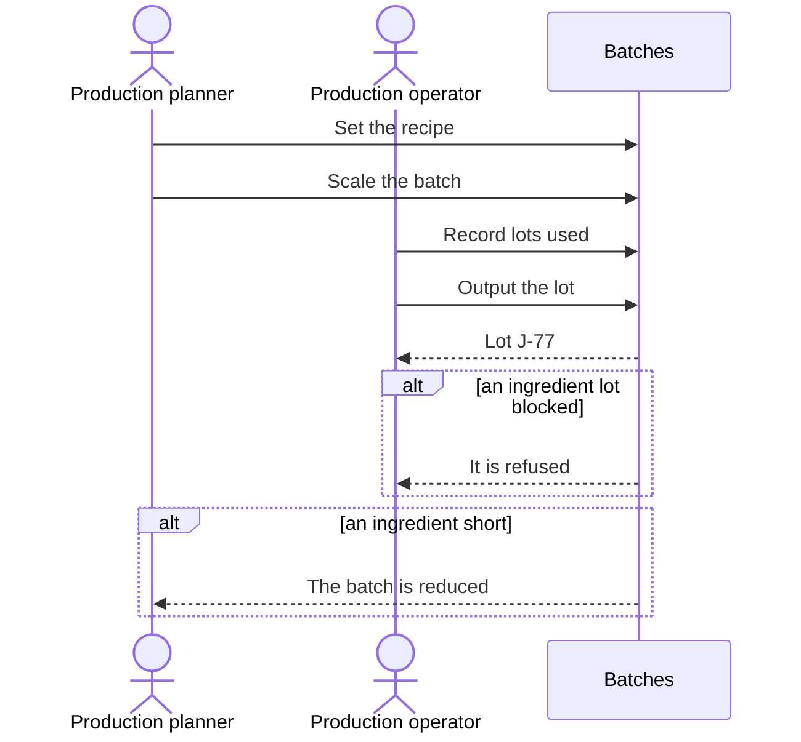

🏠 [Specs](../../../../README.md) › 🏷️ [Sectors](../../../README.md) › 🌾 [SC13 Agriculture and food](../../README.md) ›
📝 [Use cases](../README.md) › 📝 [Use cases: FL-SC13-05 Food processing](README.md) ›
📝 UC-SC13-13 Manage recipes and batches for processing

# 📝 UC-SC13-13 Manage recipes and batches for processing

**Status:** ✅ specified

## Summary

The production planner sets the recipe with the shared recipes capability and produces batches, recording the farm's
lots used.

## Personas

- [U21 Production planner](../../../../01-users/personas/u21-production-planner.md)
- [U40 Farmer](../../../../01-users/personas/u40-farmer.md)
- [U20 Production operator](../../../../01-users/personas/u20-production-operator.md)

## Goal

Batches traced to the farm's lots.

## Trigger

A production day.

## Frequency

Weekly.

## Preconditions

- The SC13 sector pack is installed for the company,
  [UC-F14-02](../../../../02-functional/f14-plugin-store/use-cases/01-find-and-install/uc-f14-02-install-a-plugin-or-sector-pack.md),
  and its users have their roles,
  [UC-F1-06](../../../../02-functional/f01-administration/use-cases/04-edit-a-role/uc-f01-06-edit-a-role-and-its-record-rules.md).

## Postconditions

- **Success:** the batch's output lot is in stock.
- **Failed:** the batch is refused.

## Main flow

1. The planner sets the recipe on [S-SC13-13 Batches](../../screens/05-food-processing/s-sc13-13-batches.md),
   [UC-F12-31](../../../../02-functional/f12-manufacturing/use-cases/09-recipes-and-batches/uc-f12-31-define-a-recipe-and-produce-in-batches.md).
2. The batch is scaled,
   [BR-F12-26](../../../../02-functional/f12-manufacturing/business-rules/br-f12-26-recipes-scale-to-the-batch-and-keep-their-tolerances.md).
3. Lots used are recorded ([BR-SC13-06](../../business-rules/br-sc13-06-lots-traced-field-to-customer.md)).
4. The output lot goes to stock.

## Alternative flows

- 1a. A seasonal recipe: it is active between its dates.

## Error flows

- 3e. An ingredient lot blocked: it is refused.
- 2e. An ingredient short: the batch is reduced.
- Any step: a call to a service or an outside system fails: it is retried first
  ([BR-F3-32](../../../../02-functional/f03-assistant/business-rules/br-f03-32-retry-before-an-error.md)), then the
  error message pattern ([D122](../../../../06-decisions/ux/d122-error-message-standard.md)) says what failed; what was
  typed is kept.

## Business rules

- [BR-SC13-06 Lots traced from field to customer](../../business-rules/br-sc13-06-lots-traced-field-to-customer.md)
- [BR-F12-26 Recipes scale to the batch and keep their tolerances](../../../../02-functional/f12-manufacturing/business-rules/br-f12-26-recipes-scale-to-the-batch-and-keep-their-tolerances.md)

## Entities

- [E-SC13-12 Batch](../../data/e-sc13-12-batch.md)
- [E-SC13-04 Lot](../../data/e-sc13-04-lot.md)
- [E-F12-25 Recipe](../../../../02-functional/f12-manufacturing/data/e-f12-25-recipe.md)

## Permissions

The production planner, farmer and production operator roles; the record rules of their role and site apply,
[UC-F1-06](../../../../02-functional/f01-administration/use-cases/04-edit-a-role/uc-f01-06-edit-a-role-and-its-record-rules.md).

## Notifications

None beyond the in-app updates of the records concerned.

## Audit events

Every creation, change and state change of batch, lot, recipe records, with who, when and the values before and after
(T3).

## AI involvement

The AI assistant answers questions on the batch, lot, recipe records of this use case, with links, and prepares them as
drafts the user confirms. It works within the user's rights,
[BR-F3-34](../../../../02-functional/f03-assistant/business-rules/br-f03-34-every-capability-is-reachable-from-the-assistant.md),
and never deletes or does anything irreversible without the user's confirmation,
[BR-F3-07](../../../../02-functional/f03-assistant/business-rules/br-f03-07-no-deletes-no-irreversible-acts.md).

## API, MCP and A2A exposure

Through the API and webhooks (T5) and the MCP and A2A gateway (T6), with the caller's rights,
[BR-F3-34](../../../../02-functional/f03-assistant/business-rules/br-f03-34-every-capability-is-reachable-from-the-assistant.md),
reading, creating and changing the records of this use case; nothing irreversible without a person's confirmation.

## Screens

- [S-SC13-13 Batches](../../screens/05-food-processing/s-sc13-13-batches.md)

## Flowchart

See [FL-SC13-05 Food processing](../../flows/fl-sc13-05-food-processing.md#flowchart).

## Sequence diagram

## Acceptance criteria

1. **Given** the example farm's jam batch from apples A-3 **when** it is produced **then** lot J-77 links A-3.
2. **Given** apples A-3 blocked **when** the batch uses them **then** it is refused.

## Non-functional notes

[D408](../../../../06-decisions/technical/d408-performance-and-profiles.md)'s targets
([performance](../../../../05-non-functional/performance.md)): 95 % of screens within 1 second; lists paged on the
server, the first page within 1 second; reports within 5 seconds or in the background. WCAG 2.2 AA and RGAA
([D46](../../../../06-decisions/ux/d46-accessibility-standard.md)).

## Regulatory references

None specific to this use case; the sector's legal rules are listed in [SC13 regulatory](../../regulatory.md).

## Related use cases

- [UC-SC13-14 Trace lots from field to customer](uc-sc13-14-trace-lots-from-field-to-customer.md)

## Open questions

None.

---

⬅️ [UC-SC13-12](../04-sales-and-certification/uc-sc13-12-keep-organic-certification-records.md) · ⬆️ [Up](README.md) ·
➡️ [UC-SC13-14 Trace lots from field to customer](uc-sc13-14-trace-lots-from-field-to-customer.md)
