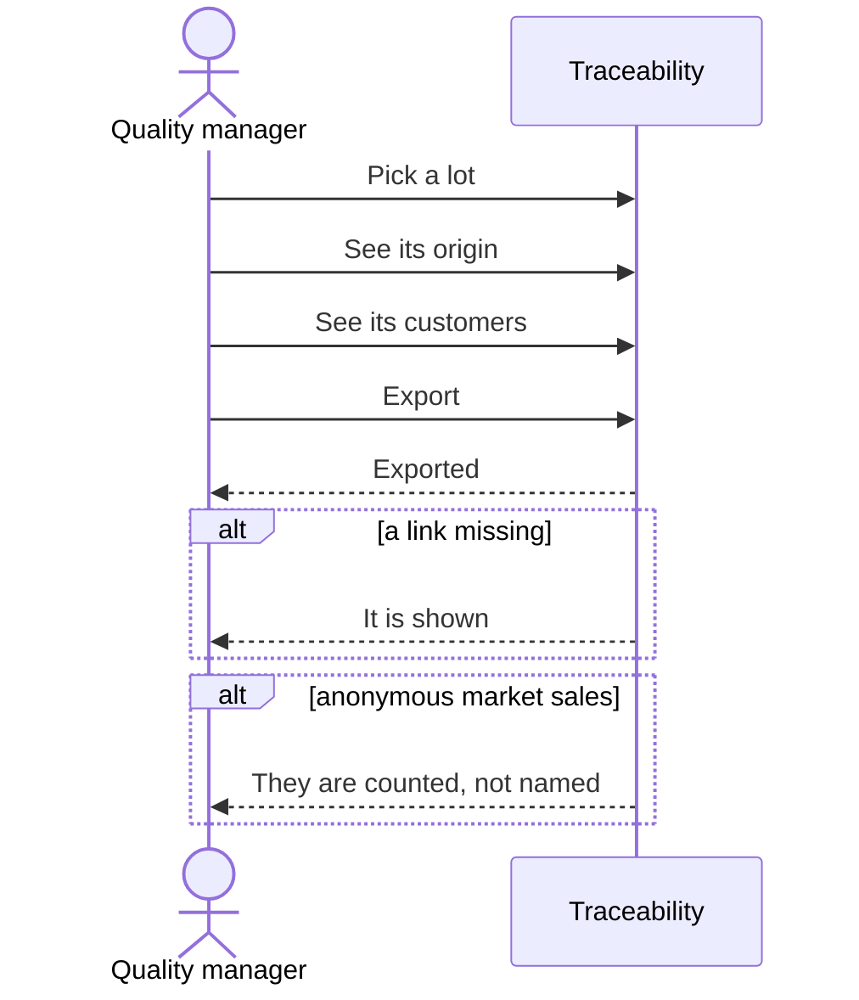

🏠 [Specs](../../../../README.md) › 🏷️ [Sectors](../../../README.md) › 🌾 [SC13 Agriculture and food](../../README.md) ›
📝 [Use cases](../README.md) › 📝 [Use cases: FL-SC13-05 Food processing](README.md) ›
📝 UC-SC13-14 Trace lots from field to customer

# 📝 UC-SC13-14 Trace lots from field to customer

**Status:** ✅ specified

## Summary

The quality manager picks a lot and sees its origin up to the plots and its customers down to the last sale.

## Personas

- [U27 Quality manager](../../../../01-users/personas/u27-quality-manager.md)
- [U40 Farmer](../../../../01-users/personas/u40-farmer.md)

## Goal

Every lot traced both ways.

## Trigger

A question or a recall drill.

## Frequency

Monthly drill.

## Preconditions

- The SC13 sector pack is installed for the company,
  [UC-F14-02](../../../../02-functional/f14-plugin-store/use-cases/01-find-and-install/uc-f14-02-install-a-plugin-or-sector-pack.md),
  and its users have their roles,
  [UC-F1-06](../../../../02-functional/f01-administration/use-cases/04-edit-a-role/uc-f01-06-edit-a-role-and-its-record-rules.md).

## Postconditions

- **Success:** origin and customers are listed.
- **Failed:** missing links are shown.

## Main flow

1. The quality manager picks a lot on
   [S-SC13-14 Traceability](../../screens/05-food-processing/s-sc13-14-traceability.md).
2. Origin is shown,
   [UC-F7-08](../../../../02-functional/f07-purchasing-and-stock/use-cases/05-count-trace-and-analyse/uc-f07-08-trace-lots-and-serials-recall.md).
3. Customers are listed.
4. The trace is exported.

## Alternative flows

- 1a. A recall drill: the time to trace is recorded.

## Error flows

- 2e. A link missing: it is shown.
- 3e. Anonymous market sales: they are counted, not named.
- Any step: a call to a service or an outside system fails: it is retried first
  ([BR-F3-32](../../../../02-functional/f03-assistant/business-rules/br-f03-32-retry-before-an-error.md)), then the
  error message pattern ([D122](../../../../06-decisions/ux/d122-error-message-standard.md)) says what failed; what was
  typed is kept.

## Business rules

- [BR-SC13-06 Lots traced from field to customer](../../business-rules/br-sc13-06-lots-traced-field-to-customer.md)
- [BR-SC13-11 Recalls block and trace](../../business-rules/br-sc13-11-recalls-block-and-trace.md)

## Entities

- [E-SC13-04 Lot](../../data/e-sc13-04-lot.md)
- [E-SC13-12 Batch](../../data/e-sc13-12-batch.md)

## Permissions

The quality manager and farmer roles; the record rules of their role and site apply,
[UC-F1-06](../../../../02-functional/f01-administration/use-cases/04-edit-a-role/uc-f01-06-edit-a-role-and-its-record-rules.md).

## Notifications

None beyond the in-app updates of the records concerned.

## Audit events

Every creation, change and state change of lot, batch records, with who, when and the values before and after (T3).

## AI involvement

The AI assistant answers questions on the lot, batch records of this use case, with links, and prepares them as drafts
the user confirms. It works within the user's rights,
[BR-F3-34](../../../../02-functional/f03-assistant/business-rules/br-f03-34-every-capability-is-reachable-from-the-assistant.md),
and never deletes or does anything irreversible without the user's confirmation,
[BR-F3-07](../../../../02-functional/f03-assistant/business-rules/br-f03-07-no-deletes-no-irreversible-acts.md).

## API, MCP and A2A exposure

Through the API and webhooks (T5) and the MCP and A2A gateway (T6), with the caller's rights,
[BR-F3-34](../../../../02-functional/f03-assistant/business-rules/br-f03-34-every-capability-is-reachable-from-the-assistant.md),
reading, creating and changing the records of this use case; nothing irreversible without a person's confirmation.

## Screens

- [S-SC13-14 Traceability](../../screens/05-food-processing/s-sc13-14-traceability.md)

## Flowchart

See [FL-SC13-05 Food processing](../../flows/fl-sc13-05-food-processing.md#flowchart).

## Sequence diagram

## Acceptance criteria

1. **Given** the example farm's lot J-77 **when** it is traced **then** it shows apples A-3 and 14 customers.
2. **Given** J-77 without its apple lot **when** the trace runs **then** it is shown.

## Non-functional notes

[D408](../../../../06-decisions/technical/d408-performance-and-profiles.md)'s targets
([performance](../../../../05-non-functional/performance.md)): 95 % of screens within 1 second; lists paged on the
server, the first page within 1 second; reports within 5 seconds or in the background. WCAG 2.2 AA and RGAA
([D46](../../../../06-decisions/ux/d46-accessibility-standard.md)).

## Regulatory references

Legal values from the France country pack:
[CR-FR-061 Food traceability](../../../../10-country-packs/france/products/cr-fr-061-food-traceability.md).

## Related use cases

- [UC-SC13-17 Manage shelf life, rotation and recalls](uc-sc13-17-manage-shelf-life-rotation-and-recalls.md)

## Open questions

None.

---

⬅️ [UC-SC13-13 Manage recipes and batches for processing](uc-sc13-13-manage-recipes-and-batches-for-processing.md) ·
⬆️ [Up](README.md) · ➡️ [UC-SC13-15 Run HACCP and hygiene records](uc-sc13-15-run-haccp-and-hygiene-records.md)
