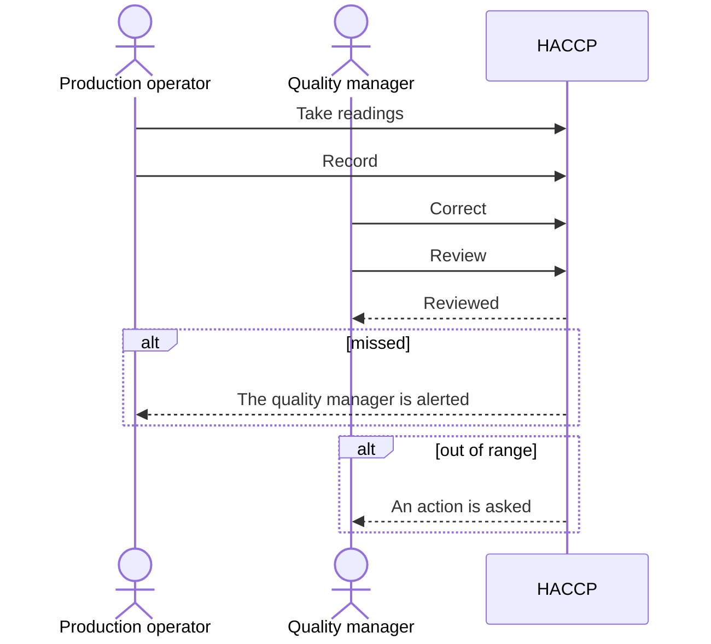

🏠 [Specs](../../../../README.md) › 🏷️ [Sectors](../../../README.md) › 🌾 [SC13 Agriculture and food](../../README.md) ›
📝 [Use cases](../README.md) › 📝 [Use cases: FL-SC13-05 Food processing](README.md) ›
📝 UC-SC13-15 Run HACCP and hygiene records

# 📝 UC-SC13-15 Run HACCP and hygiene records

**Status:** ✅ specified

## Summary

The production operator takes hygiene readings and records cleaning on schedule; the quality manager corrects
deviations.

## Personas

- [U20 Production operator](../../../../01-users/personas/u20-production-operator.md)
- [U27 Quality manager](../../../../01-users/personas/u27-quality-manager.md)

## Goal

Hygiene records complete.

## Trigger

The schedule.

## Frequency

Daily.

## Preconditions

- The SC13 sector pack is installed for the company,
  [UC-F14-02](../../../../02-functional/f14-plugin-store/use-cases/01-find-and-install/uc-f14-02-install-a-plugin-or-sector-pack.md),
  and its users have their roles,
  [UC-F1-06](../../../../02-functional/f01-administration/use-cases/04-edit-a-role/uc-f01-06-edit-a-role-and-its-record-rules.md).

## Postconditions

- **Success:** readings are recorded.
- **Failed:** a missed reading alerts.

## Main flow

1. The operator takes readings on [S-SC13-15 HACCP](../../screens/05-food-processing/s-sc13-15-haccp.md).
2. They are recorded ([BR-SC13-09](../../business-rules/br-sc13-09-hygiene-records-on-schedule.md)).
3. The quality manager corrects deviations.
4. The day is reviewed.

## Alternative flows

- 1a. A sensor import: readings come through the connector (T12).

## Error flows

- 2e. Missed: the quality manager is alerted.
- 3e. Out of range: an action is asked.
- Any step: a call to a service or an outside system fails: it is retried first
  ([BR-F3-32](../../../../02-functional/f03-assistant/business-rules/br-f03-32-retry-before-an-error.md)), then the
  error message pattern ([D122](../../../../06-decisions/ux/d122-error-message-standard.md)) says what failed; what was
  typed is kept.

## Business rules

- [BR-SC13-09 Hygiene records on schedule](../../business-rules/br-sc13-09-hygiene-records-on-schedule.md)

## Entities

- [E-SC13-13 Hygiene reading](../../data/e-sc13-13-hygiene-reading.md)

## Permissions

The production operator and quality manager roles; the record rules of their role and site apply,
[UC-F1-06](../../../../02-functional/f01-administration/use-cases/04-edit-a-role/uc-f01-06-edit-a-role-and-its-record-rules.md).

## Notifications

None beyond the in-app updates of the records concerned.

## Audit events

Every creation, change and state change of hygiene reading records, with who, when and the values before and after (T3).

## AI involvement

The AI assistant answers questions on the hygiene reading records of this use case, with links, and prepares them as
drafts the user confirms. It works within the user's rights,
[BR-F3-34](../../../../02-functional/f03-assistant/business-rules/br-f03-34-every-capability-is-reachable-from-the-assistant.md),
and never deletes or does anything irreversible without the user's confirmation,
[BR-F3-07](../../../../02-functional/f03-assistant/business-rules/br-f03-07-no-deletes-no-irreversible-acts.md).

## API, MCP and A2A exposure

Through the API and webhooks (T5) and the MCP and A2A gateway (T6), with the caller's rights,
[BR-F3-34](../../../../02-functional/f03-assistant/business-rules/br-f03-34-every-capability-is-reachable-from-the-assistant.md),
reading, creating and changing the records of this use case; nothing irreversible without a person's confirmation.

## Screens

- [S-SC13-15 HACCP](../../screens/05-food-processing/s-sc13-15-haccp.md)

## Flowchart

See [FL-SC13-05 Food processing](../../flows/fl-sc13-05-food-processing.md#flowchart).

## Sequence diagram

## Acceptance criteria

1. **Given** the example farm's cold room at 3 °C at 08:00 **when** it is recorded **then** the reading is in range.
2. **Given** the cold room's 08:00 reading missed **when** it is 08:30 **then** the quality manager is alerted.

## Non-functional notes

[D408](../../../../06-decisions/technical/d408-performance-and-profiles.md)'s targets
([performance](../../../../05-non-functional/performance.md)): 95 % of screens within 1 second; lists paged on the
server, the first page within 1 second; reports within 5 seconds or in the background. WCAG 2.2 AA and RGAA
([D46](../../../../06-decisions/ux/d46-accessibility-standard.md)).

## Regulatory references

Legal values from the France country pack:
[CR-FR-110 Food hygiene and its records](../../../../10-country-packs/france/hospitality/cr-fr-110-food-hygiene-records.md).

## Related use cases

- [UC-SC13-16 Label products](uc-sc13-16-label-products.md)

## Open questions

None.

---

⬅️ [UC-SC13-14 Trace lots from field to customer](uc-sc13-14-trace-lots-from-field-to-customer.md) ·
⬆️ [Up](README.md) · ➡️ [UC-SC13-16 Label products](uc-sc13-16-label-products.md)
