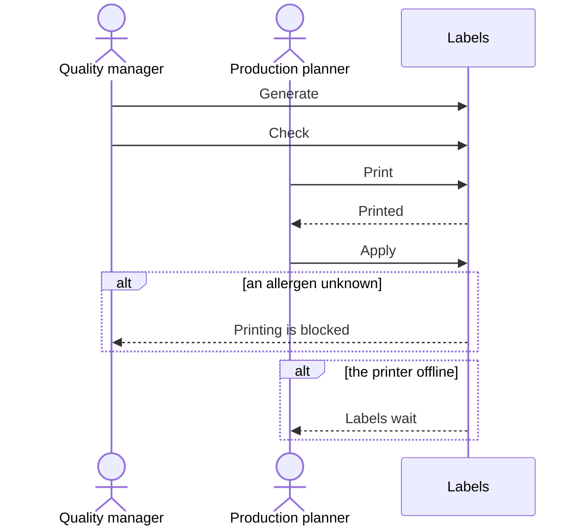

🏠 [Specs](../../../../README.md) › 🏷️ [Sectors](../../../README.md) › 🌾 [SC13 Agriculture and food](../../README.md) ›
📝 [Use cases](../README.md) › 📝 [Use cases: FL-SC13-05 Food processing](README.md) › 📝 UC-SC13-16 Label products

# 📝 UC-SC13-16 Label products

**Status:** ✅ specified

## Summary

The quality manager generates labels from the recipe, checks them and prints them.

## Personas

- [U27 Quality manager](../../../../01-users/personas/u27-quality-manager.md)
- [U21 Production planner](../../../../01-users/personas/u21-production-planner.md)

## Goal

Labels with the right ingredients and allergens.

## Trigger

A batch to pack.

## Frequency

Per batch.

## Preconditions

- The SC13 sector pack is installed for the company,
  [UC-F14-02](../../../../02-functional/f14-plugin-store/use-cases/01-find-and-install/uc-f14-02-install-a-plugin-or-sector-pack.md),
  and its users have their roles,
  [UC-F1-06](../../../../02-functional/f01-administration/use-cases/04-edit-a-role/uc-f01-06-edit-a-role-and-its-record-rules.md).

## Postconditions

- **Success:** labels are printed.
- **Failed:** printing is blocked.

## Main flow

1. Labels come from the recipe on [S-SC13-16 Labels](../../screens/05-food-processing/s-sc13-16-labels.md)
   ([BR-SC13-07](../../business-rules/br-sc13-07-labels-from-the-recipe.md)).
2. The quality manager checks.
3. Labels are printed with lot and date.
4. They are applied to the batch.

## Alternative flows

- 1a. Several languages: labels are generated per language.

## Error flows

- 1e. An allergen unknown: printing is blocked.
- 3e. The printer offline: labels wait.
- Any step: a call to a service or an outside system fails: it is retried first
  ([BR-F3-32](../../../../02-functional/f03-assistant/business-rules/br-f03-32-retry-before-an-error.md)), then the
  error message pattern ([D122](../../../../06-decisions/ux/d122-error-message-standard.md)) says what failed; what was
  typed is kept.

## Business rules

- [BR-SC13-07 Labels from the recipe](../../business-rules/br-sc13-07-labels-from-the-recipe.md)

## Entities

- [E-SC13-14 Product label](../../data/e-sc13-14-product-label.md)

## Permissions

The quality manager and production planner roles; the record rules of their role and site apply,
[UC-F1-06](../../../../02-functional/f01-administration/use-cases/04-edit-a-role/uc-f01-06-edit-a-role-and-its-record-rules.md).

## Notifications

None beyond the in-app updates of the records concerned.

## Audit events

Every creation, change and state change of product label records, with who, when and the values before and after (T3).

## AI involvement

The AI assistant answers questions on the product label records of this use case, with links, and prepares them as
drafts the user confirms. It works within the user's rights,
[BR-F3-34](../../../../02-functional/f03-assistant/business-rules/br-f03-34-every-capability-is-reachable-from-the-assistant.md),
and never deletes or does anything irreversible without the user's confirmation,
[BR-F3-07](../../../../02-functional/f03-assistant/business-rules/br-f03-07-no-deletes-no-irreversible-acts.md).

## API, MCP and A2A exposure

Through the API and webhooks (T5) and the MCP and A2A gateway (T6), with the caller's rights,
[BR-F3-34](../../../../02-functional/f03-assistant/business-rules/br-f03-34-every-capability-is-reachable-from-the-assistant.md),
reading, creating and changing the records of this use case; nothing irreversible without a person's confirmation.

## Screens

- [S-SC13-16 Labels](../../screens/05-food-processing/s-sc13-16-labels.md)

## Flowchart

See [FL-SC13-05 Food processing](../../flows/fl-sc13-05-food-processing.md#flowchart).

## Sequence diagram

## Acceptance criteria

1. **Given** the example farm's walnut cake **when** its label is generated **then** it shows nuts as an allergen.
2. **Given** the walnut cake's flour without allergens **when** labels are generated **then** printing is blocked.

## Non-functional notes

[D408](../../../../06-decisions/technical/d408-performance-and-profiles.md)'s targets
([performance](../../../../05-non-functional/performance.md)): 95 % of screens within 1 second; lists paged on the
server, the first page within 1 second; reports within 5 seconds or in the background. WCAG 2.2 AA and RGAA
([D46](../../../../06-decisions/ux/d46-accessibility-standard.md)).

## Regulatory references

Legal values from the France country pack:
[CR-FR-165 Labelling of prepacked food](../../../../10-country-packs/france/consumer/cr-fr-165-prepacked-food-labelling.md).

## Related use cases

- [UC-SC13-17 Manage shelf life, rotation and recalls](uc-sc13-17-manage-shelf-life-rotation-and-recalls.md)

## Open questions

None.

---

⬅️ [UC-SC13-15 Run HACCP and hygiene records](uc-sc13-15-run-haccp-and-hygiene-records.md) · ⬆️ [Up](README.md) ·
➡️ [UC-SC13-17 Manage shelf life, rotation and recalls](uc-sc13-17-manage-shelf-life-rotation-and-recalls.md)
