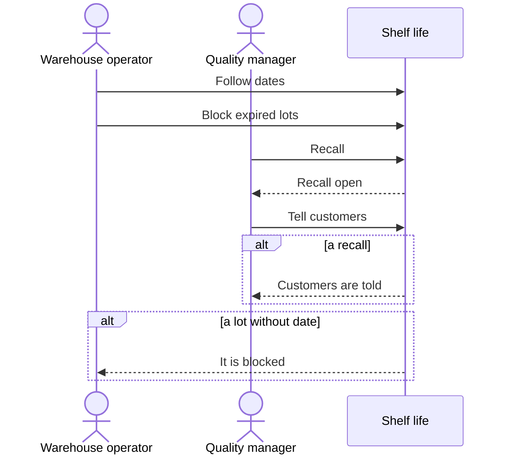

🏠 [Specs](../../../../README.md) › 🏷️ [Sectors](../../../README.md) › 🌾 [SC13 Agriculture and food](../../README.md) ›
📝 [Use cases](../README.md) › 📝 [Use cases: FL-SC13-05 Food processing](README.md) ›
📝 UC-SC13-17 Manage shelf life, rotation and recalls

# 📝 UC-SC13-17 Manage shelf life, rotation and recalls

**Status:** ✅ specified

## Summary

The quality manager and warehouse follow dates, use stock first expired first out, block expired lots and recall lots
when needed.

## Personas

- [U27 Quality manager](../../../../01-users/personas/u27-quality-manager.md)
- [U15 Warehouse operator](../../../../01-users/personas/u15-warehouse-operator.md)

## Goal

Nothing expired sold; recalls fast.

## Trigger

Daily, or a recall.

## Frequency

Daily.

## Preconditions

- The SC13 sector pack is installed for the company,
  [UC-F14-02](../../../../02-functional/f14-plugin-store/use-cases/01-find-and-install/uc-f14-02-install-a-plugin-or-sector-pack.md),
  and its users have their roles,
  [UC-F1-06](../../../../02-functional/f01-administration/use-cases/04-edit-a-role/uc-f01-06-edit-a-role-and-its-record-rules.md).

## Postconditions

- **Success:** expired lots are blocked; recalls reach customers.
- **Failed:** customers are told.

## Main flow

1. Dates are followed on [S-SC13-17 Shelf life](../../screens/05-food-processing/s-sc13-17-shelf-life.md)
   ([BR-SC13-10](../../business-rules/br-sc13-10-shelf-life-and-rotation.md)).
2. Expired lots are blocked.
3. A recall blocks lots and lists customers ([BR-SC13-11](../../business-rules/br-sc13-11-recalls-block-and-trace.md)).
4. Customers are told.

## Alternative flows

- 2a. Unsold food donated: it goes to a food-aid partner.

## Error flows

- 3e. A recall: customers are told.
- 1e. A lot without date: it is blocked.
- Any step: a call to a service or an outside system fails: it is retried first
  ([BR-F3-32](../../../../02-functional/f03-assistant/business-rules/br-f03-32-retry-before-an-error.md)), then the
  error message pattern ([D122](../../../../06-decisions/ux/d122-error-message-standard.md)) says what failed; what was
  typed is kept.

## Business rules

- [BR-SC13-10 Shelf life and rotation](../../business-rules/br-sc13-10-shelf-life-and-rotation.md)
- [BR-SC13-11 Recalls block and trace](../../business-rules/br-sc13-11-recalls-block-and-trace.md)

## Entities

- [E-SC13-04 Lot](../../data/e-sc13-04-lot.md)
- [E-SC13-15 Recall](../../data/e-sc13-15-recall.md)

## Permissions

The quality manager and warehouse operator roles; the record rules of their role and site apply,
[UC-F1-06](../../../../02-functional/f01-administration/use-cases/04-edit-a-role/uc-f01-06-edit-a-role-and-its-record-rules.md).

## Notifications

None beyond the in-app updates of the records concerned.

## Audit events

Every creation, change and state change of lot, recall records, with who, when and the values before and after (T3).

## AI involvement

The AI assistant answers questions on the lot, recall records of this use case, with links, and prepares them as drafts
the user confirms. It works within the user's rights,
[BR-F3-34](../../../../02-functional/f03-assistant/business-rules/br-f03-34-every-capability-is-reachable-from-the-assistant.md),
and never deletes or does anything irreversible without the user's confirmation,
[BR-F3-07](../../../../02-functional/f03-assistant/business-rules/br-f03-07-no-deletes-no-irreversible-acts.md).

## API, MCP and A2A exposure

Through the API and webhooks (T5) and the MCP and A2A gateway (T6), with the caller's rights,
[BR-F3-34](../../../../02-functional/f03-assistant/business-rules/br-f03-34-every-capability-is-reachable-from-the-assistant.md),
reading, creating and changing the records of this use case; nothing irreversible without a person's confirmation.

## Screens

- [S-SC13-17 Shelf life](../../screens/05-food-processing/s-sc13-17-shelf-life.md)

## Flowchart

See [FL-SC13-05 Food processing](../../flows/fl-sc13-05-food-processing.md#flowchart).

## Sequence diagram

## Acceptance criteria

1. **Given** the example farm's recall of J-77 **when** it opens **then** J-77 is blocked and its 14 customers listed.
2. **Given** glass found in J-77 with 14 customers **when** the recall opens **then** customers are told.

## Non-functional notes

[D408](../../../../06-decisions/technical/d408-performance-and-profiles.md)'s targets
([performance](../../../../05-non-functional/performance.md)): 95 % of screens within 1 second; lists paged on the
server, the first page within 1 second; reports within 5 seconds or in the background. WCAG 2.2 AA and RGAA
([D46](../../../../06-decisions/ux/d46-accessibility-standard.md)).

## Regulatory references

Legal values from the France country pack:
[CR-FR-062 Product recall](../../../../10-country-packs/france/products/cr-fr-062-product-recall.md),
[CR-FR-095 Donation of unsold food](../../../../10-country-packs/france/environment/cr-fr-095-unsold-food-donation.md).

## Related use cases

- [UC-SC13-14 Trace lots from field to customer](uc-sc13-14-trace-lots-from-field-to-customer.md)

## Open questions

None.

---

⬅️ [UC-SC13-16 Label products](uc-sc13-16-label-products.md) · ⬆️ [Up](README.md) ·
➡️ [UC-SC13-18](../03-farm-business/uc-sc13-18-follow-costs-per-crop-herd-and-product.md)
