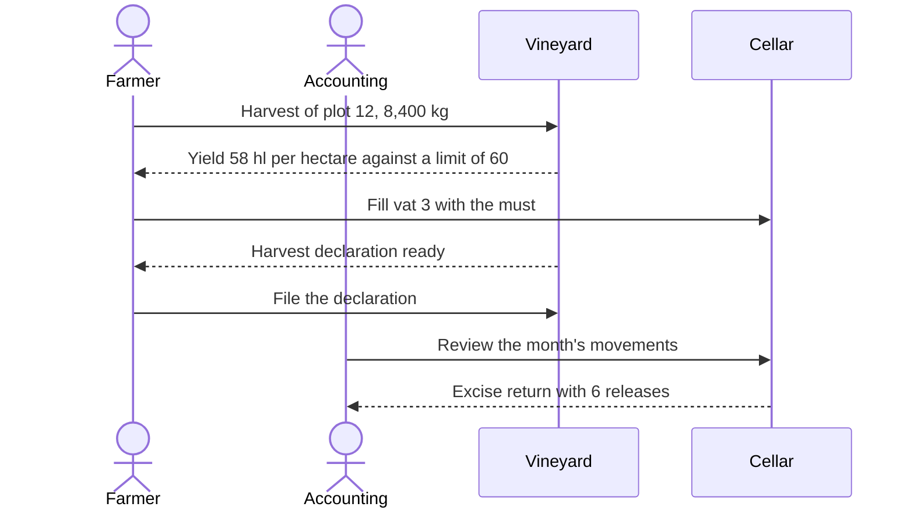

🏠 [Specs](../../../../README.md) › 🏷️ [Sectors](../../../README.md) › 🌾 [SC13 Agriculture and food](../../README.md) ›
📝 [Use cases](../README.md) ›
📝 [Use cases: FL-SC13-06 Vineyards, contractors, cooperatives, baskets, forests](README.md) ›
📝 UC-SC13-21 Run the vineyard and the cellar

# 📝 UC-SC13-21 Run the vineyard and the cellar

**Status:** ✅ specified, ⚖️ lawyer review before launch (D574)

## Summary

A wine estate follows each vine plot by grape variety, appellation and area, records the harvest of each plot with its
yield, makes the wine in the cellar by vat and by lot, and prepares the harvest declaration, the stock declaration and
the monthly excise declaration from those records. The farmer works at the desk and, in the vines and the cellar, on the
phone.

## Personas

- [U40 Farmer](../../../../01-users/personas/u40-farmer.md)

## Goal

Every harvest and every stock of wine is declared on time from the records, the yield of each plot is compared with the
limit of its appellation, and wine leaves the cellar only with its duty position known.

## Trigger

A plot is harvested, a vat is filled or emptied, wine leaves the cellar, or a declaration date approaches.

## Frequency

A few weeks of harvest a year, movements every week in the cellar, one excise declaration a month.

## Preconditions

- The plots are mapped with their area ([E-SC13-01 Plot](../../data/e-sc13-01-plot.md)) and their appellation and
  variety are entered.
- The cellar's lots are items with lots in stock
  ([E-F7-06 Item](../../../../02-functional/f07-purchasing-and-stock/data/e-f07-06-item.md),
  [E-F7-10](../../../../02-functional/f07-purchasing-and-stock/data/e-f07-10-lot-or-serial.md)).
- The yield limits and the declaration dates of the country pack are loaded for the campaign.

## Postconditions

- **Succeeded:** each plot is saved ([E-SC13-17 Vine plot](../../data/e-sc13-17-vine-plot.md)) with its harvest, its
  yield against the limit and the state of its declaration, and the wine stock by lot agrees with the declarations.
- **Failed:** a declaration is never closed with a plot missing its harvest, a yield above the limit is flagged before
  the declaration, and the gaps are listed.

## Main flow

1. The farmer opens the vineyard screen
   ([S-SC13-21](../../screens/06-vineyards-contractors-and-cooperatives/s-sc13-21-vineyard.md)) and sees the plots with
   variety, appellation, area and the state of the campaign.
2. At harvest the farmer records, from the phone in the vines, the weight or the volume picked for each plot and the
   date.
3. SimpleERP computes the yield per hectare of each plot and compares it with the limit of its appellation
   ([BR-SC13-16](../../business-rules/br-sc13-16-harvest-and-stock-declarations-are-filed-on-time.md)).
4. The must is received in a vat and the cellar lots are created with their volume and the plots they come from
   ([UC-SC13-14](../05-food-processing/uc-sc13-14-trace-lots-from-field-to-customer.md)).
5. When the harvest is complete, SimpleERP prepares the harvest declaration from the plots and the farmer checks and
   files it.
6. Each month and each year the farmer reviews the stock declaration and the excise declaration drawn from the cellar
   movements, and accounting posts the duty
   [UC-F8-07](../../../../02-functional/f08-accounting/use-cases/04-tax-assets-and-analytics/uc-f08-07-manage-vat-and-file-returns.md).

## Alternative flows

- 3a. A plot is above its yield limit: the excess volume is marked and cannot be sold under the appellation.
- 2a. Grapes are bought from another grower: the purchase is recorded with its origin and the wine is traced to it.
- 6a. Wine leaves the cellar under suspension of duty: the movement document is kept with the lot and no duty is added
  to the month.

## Error flows

- 2e. A plot has no appellation or variety: the harvest is refused and the plot sheet is opened.
- 5e. A plot has no harvest at the declaration date: the declaration stays in review and lists the plot.
- 6e. A movement has no document: the monthly declaration cannot be closed.
- Any step: a service does not answer; the call is retried first
  ([BR-F3-32](../../../../02-functional/f03-assistant/business-rules/br-f03-32-retry-before-an-error.md)), then the
  message follows the error pattern ([D122](../../../../06-decisions/ux/d122-error-message-standard.md)) and what the
  user typed stays on the screen.

## Business rules

- [BR-SC13-16](../../business-rules/br-sc13-16-harvest-and-stock-declarations-are-filed-on-time.md)
- [BR-SC13-06](../../business-rules/br-sc13-06-lots-traced-field-to-customer.md)

## Entities

- [E-SC13-17 Vine plot](../../data/e-sc13-17-vine-plot.md): created, changed, declared
- [E-SC13-01 Plot](../../data/e-sc13-01-plot.md): read, the mapped plot and its area
- [E-SC13-04 Lot](../../data/e-sc13-04-lot.md): created, the lot of must and wine
- [E-F7-10](../../../../02-functional/f07-purchasing-and-stock/data/e-f07-10-lot-or-serial.md): read, the stock of the
  cellar lots
- [E-F8-06 Tax return](../../../../02-functional/f08-accounting/data/e-f08-06-tax-return.md): created, the excise return
  of the month

## Permissions

Farmer records harvests and cellar movements and files the declarations; accounting reviews the duty and posts it.
Seasonal pickers see only the plot they pick and cannot see the yields.

## Notifications

The farmer, in the app and by email: a declaration is due in seven days, a plot is above its yield limit or a movement
has no document.

## Audit events

Each harvest entry, each yield and limit check, each declaration prepared, checked and filed, each cellar movement, who
and when.

## AI involvement

No AI step of its own. The AI assistant may open the screen and prefill it from the user's words; the user checks and
confirms
[BR-F3-07](../../../../02-functional/f03-assistant/business-rules/br-f03-07-no-deletes-no-irreversible-acts.md).

## API, MCP and A2A exposure

T5 operations of the capability for the personas above: create, read, update and list. The MCP tool of the
capability may read and propose, never confirm alone. No A2A skill.

## Screens

- [S-SC13-21](../../screens/06-vineyards-contractors-and-cooperatives/s-sc13-21-vineyard.md)

## Flowchart

See
[FL-SC13-06 Vineyards, contractors, cooperatives, baskets, forests](../../flows/fl-sc13-06-vineyards-contractors-and-cooperatives.md#flowchart).

## Sequence diagram

## Acceptance criteria

1. **Given** a plot of 2.0 hectares in an appellation limited to 60 hl per hectare **when** the farmer records 130 hl of
   must **then** the plot shows a yield of 65 hl per hectare and 10 hl are marked as excess.
2. **Given** a campaign with one plot not yet harvested **when** the farmer opens the harvest declaration **then** it
   stays in review and names that plot.
3. **Given** a plot without an appellation **when** the farmer records its harvest **then** the harvest is refused and
   the plot sheet is asked for the appellation.
4. **Given** a month with a movement that has no document **when** accounting opens the excise return **then** the
   return stays in review and lists that movement.

## Non-functional notes

The screen answers within 2 seconds for 10,000 records; every change is audited.

## Regulatory references

A grower declares the harvest after it, and declares the stock of wine on a fixed date each year, from
registers kept up to date. Wine sold or removed for consumption is liable to excise, declared each month by the
warehousekeeper, and the movement of wine under suspension travels with an accompanying document. Each appellation sets
a maximum yield per hectare and the grower declares the plots by area, variety and appellation. The harvest and
production declarations are due by 10 December for growers and 10 January for co-operatives and merchant-winemakers,
the stock held on 31 July is declared by 10 September, all online, and plantings, uprootings and re-graftings are
declared on PARCEL within one month of the works (CR-FR-249). The excise rate is per hectolitre of wine, not per volume
of pure alcohol (CR-FR-234). (⚖️ lawyer review before launch, D574) The yield limit of each appellation is still to read in its
specifications. Related:
[CR-FR-061](../../../../10-country-packs/france/products/cr-fr-061-food-traceability.md),
[CR-FR-165](../../../../10-country-packs/france/consumer/cr-fr-165-prepacked-food-labelling.md),
[CR-FR-007](../../../../10-country-packs/france/accounting/cr-fr-007-annual-stock-count.md).

- France-pack rule, (⚖️ lawyer review before launch, D574) for the yield limit of each appellation:
  [CR-FR-249 Harvest and stock declarations](../../../../10-country-packs/france/agriculture/cr-fr-249-vineyard-declarations.md)

## Related use cases

- [UC-SC13-22](uc-sc13-22-work-as-an-agricultural-contractor.md)
- [UC-SC13-04](../01-crops/uc-sc13-04-record-harvests-yields-and-lots.md)
- [UC-SC13-14](../05-food-processing/uc-sc13-14-trace-lots-from-field-to-customer.md)
- [UC-SC13-16 Label products](../05-food-processing/uc-sc13-16-label-products.md)

## Open questions

None.

---

⬅️ [UC-SC13-20 Ask the AI assistant](../03-farm-business/uc-sc13-20-ask-the-assistant.md) · ⬆️ [Up](README.md) ·
➡️ [UC-SC13-22 Work as an agricultural contractor](uc-sc13-22-work-as-an-agricultural-contractor.md)
