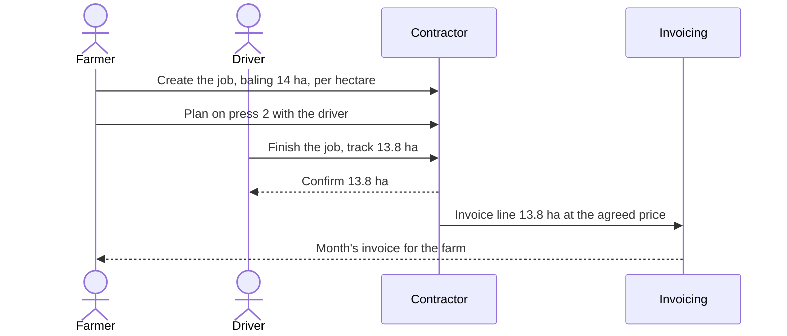

🏠 [Specs](../../../../README.md) › 🏷️ [Sectors](../../../README.md) › 🌾 [SC13 Agriculture and food](../../README.md) ›
📝 [Use cases](../README.md) ›
📝 [Use cases: FL-SC13-06 Vineyards, contractors, cooperatives, baskets, forests](README.md) ›
📝 UC-SC13-22 Work as an agricultural contractor

# 📝 UC-SC13-22 Work as an agricultural contractor

**Status:** ✅ specified

## Summary

An agricultural contractor works the fields of other farms with its machines and drivers: ploughing, sowing, spraying,
harvesting, baling. Each job is quoted by the hectare or by the hour, scheduled on a machine and a driver, recorded by
the driver on the phone, and invoiced to the farm as agreed.

## Personas

- [U40 Farmer](../../../../01-users/personas/u40-farmer.md)
- [U30 Driver](../../../../01-users/personas/u30-driver.md)

## Goal

Every job is billed on the basis the farm agreed, the hectares or the hours, from what the driver recorded, and the
machines and drivers are planned without clashes.

## Trigger

A farm asks for a job, a job is scheduled, a driver finishes a job, or the month ends.

## Frequency

Dozens of jobs a week in the season, almost none in winter.

## Preconditions

- The machines are entered with their rates ([E-SC13-07 Machine](../../data/e-sc13-07-machine.md)).
- The drivers are employees or seasonal workers
  ([E-F9-01](../../../../02-functional/f09-hr-and-projects/data/e-f09-01-employee-record.md)).
- The customer farm is a record with its fields
  ([E-F6-01](../../../../02-functional/f06-customers-and-sales/data/e-f06-01-customer-record.md)).

## Postconditions

- **Succeeded:** each job is saved ([E-SC13-18 Field job](../../data/e-sc13-18-field-job.md)) with its field, machine,
  driver, hectares or hours and the invoice line, and the machine's use is added to its maintenance counter.
- **Failed:** a job is not invoiced without its basis and its quantity, and a driver or machine is not booked twice at
  the same time.

## Main flow

1. The farmer opens the contractor screen
   ([S-SC13-22](../../screens/06-vineyards-contractors-and-cooperatives/s-sc13-22-farm-contractor.md)) and creates a job
   for a farm with the work, the field, the basis (hectare or hour) and the price.
2. The farmer plans it on a machine and a driver and sees the clashes.
3. On the day, the driver starts the job on the phone and the track is recorded.
4. The driver finishes the job: simple-ERP takes the hectares worked from the track or the hours from the meter and the
   driver confirms them.
5. simple-ERP prepares the invoice line from the agreed basis and the recorded quantity
   ([BR-SC13-17](../../business-rules/br-sc13-17-jobs-are-billed-by-hectare-or-hour-as-agreed.md)).
6. At month end the farmer invoices each farm with its jobs
   [UC-F6-06](../../../../02-functional/f06-customers-and-sales/use-cases/03-invoice-and-get-paid/uc-f06-06-invoice-deposits-progress-and-final.md).

## Alternative flows

- 4a. The recorded area differs from the field's area by more than the tolerance: the farmer chooses the agreed area or
  the measured one and the choice is kept.
- 3a. Bad weather stops the job: the hours so far are kept and the job is rescheduled.
- 5a. A plant-protection job also creates the treatment record of the farm
  ([UC-SC13-02](../01-crops/uc-sc13-02-record-treatments-and-inputs.md)).

## Error flows

- 2e. The machine or the driver is already booked: the plan is refused and the clash is shown.
- 5e. The job has no basis or no quantity: no invoice line is prepared.
- 4e. The driver's phone has no track: the hours or hectares are entered by hand and flagged.
- Any step: a service does not answer; the call is retried first
  ([BR-F3-32](../../../../02-functional/f03-assistant/business-rules/br-f03-32-retry-before-an-error.md)), then the
  message follows the error pattern ([D122](../../../../06-decisions/ux/d122-error-message-standard.md)) and what the
  user typed stays on the screen.

## Business rules

- [BR-SC13-17](../../business-rules/br-sc13-17-jobs-are-billed-by-hectare-or-hour-as-agreed.md)
- [BR-SC13-02](../../business-rules/br-sc13-02-every-treatment-recorded.md)

## Entities

- [E-SC13-18 Field job](../../data/e-sc13-18-field-job.md): created, changed, invoiced
- [E-SC13-07 Machine](../../data/e-sc13-07-machine.md): read and changed, the machine and its counter
- [E-F6-05 Invoice](../../../../02-functional/f06-customers-and-sales/data/e-f06-05-invoice.md): created, the invoice of
  the jobs
- [E-F9-01](../../../../02-functional/f09-hr-and-projects/data/e-f09-01-employee-record.md): read, the driver

## Permissions

Farmer plans, confirms and invoices jobs; driver starts and finishes the jobs assigned to them. A driver
cannot see the prices.

## Notifications

The driver, on the phone: a job is assigned or moved. The farmer, in the app: a job is finished with a difference above
the tolerance.

## Audit events

Each job created, planned, started, finished and invoiced, each basis and quantity change, who and when.

## AI involvement

No AI step of its own. The AI assistant may open the screen and prefill it from the user's words; the user checks and
confirms
[BR-F3-07](../../../../02-functional/f03-assistant/business-rules/br-f03-07-no-deletes-no-irreversible-acts.md).

## API, MCP and A2A exposure

T5 operations of the capability for the personas above: create, read, update and list. The MCP tool of the
capability may read and propose, never confirm alone. No A2A skill.

## Screens

- [S-SC13-22](../../screens/06-vineyards-contractors-and-cooperatives/s-sc13-22-farm-contractor.md)

## Flowchart

See
[FL-SC13-06 Vineyards, contractors, cooperatives, baskets, forests](../../flows/fl-sc13-06-vineyards-contractors-and-cooperatives.md#flowchart).

## Sequence diagram

## Acceptance criteria

1. **Given** a job quoted per hectare at 42.00 EUR for a field of 14 ha **when** the driver finishes it with a track of
   13.8 ha and confirms **then** the invoice line is 13.8 ha at 42.00 EUR, which is 579.60 EUR.
2. **Given** a job quoted per hour at 95.00 EUR **when** the driver finishes it with 6.5 engine hours **then** the
   invoice line is 6.5 hours, which is 617.50 EUR.
3. **Given** a machine already booked for the same morning **when** the farmer plans a second job on it **then** the
   plan is refused and the clash is shown.
4. **Given** a job with no recorded quantity **when** the farmer invoices the month **then** the job is left out and
   listed as missing its quantity.

## Non-functional notes

The screen answers within 2 seconds for 10,000 records; every change is audited.

## Regulatory references

A contractor who applies plant-protection products must hold the applicator certificate and records each
treatment in the farm's register, which is why the job can create the treatment record. Agricultural machines on the
road follow the highway code, and the drivers' hours follow the working time rules of agriculture. The invoice follows
the usual mentions and VAT rates of the France pack. Related:
[CR-FR-161](../../../../10-country-packs/france/agriculture/cr-fr-161-plant-protection-register.md),
[CR-FR-015](../../../../10-country-packs/france/invoicing/cr-fr-015-invoice-mandatory-mentions.md),
[CR-FR-008 VAT rates](../../../../10-country-packs/france/tax-and-vat/cr-fr-008-vat-rates.md).

## Related use cases

- [UC-SC13-21 Run the vineyard and the cellar](uc-sc13-21-run-the-vineyard-and-the-cellar.md)
- [UC-SC13-23 Run a cooperative](uc-sc13-23-run-a-cooperative.md)
- [UC-SC13-02](../01-crops/uc-sc13-02-record-treatments-and-inputs.md)
- [UC-SC13-08](../03-farm-business/uc-sc13-08-manage-machinery-fuel-and-maintenance.md)

## Open questions

None.

---

⬅️ [UC-SC13-21 Run the vineyard and the cellar](uc-sc13-21-run-the-vineyard-and-the-cellar.md) · ⬆️ [Up](README.md) ·
➡️ [UC-SC13-23 Run a cooperative](uc-sc13-23-run-a-cooperative.md)
