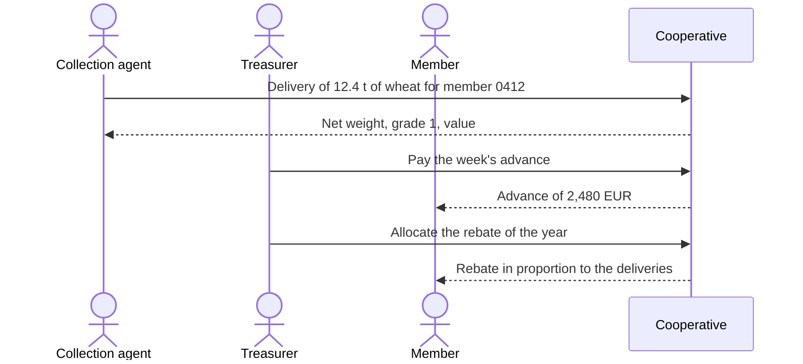

🏠 [Specs](../../../../README.md) › 🏷️ [Sectors](../../../README.md) › 🌾 [SC13 Agriculture and food](../../README.md) ›
📝 [Use cases](../README.md) ›
📝 [Use cases: FL-SC13-06 Vineyards, contractors, cooperatives, baskets, forests](README.md) ›
📝 UC-SC13-23 Run a cooperative

# 📝 UC-SC13-23 Run a cooperative

**Status:** ✅ specified

## Summary

An agricultural cooperative collects the harvest of its members, weighs and grades each delivery, pays an advance,
settles the balance when the product is sold and shares the year's surplus among the members as a rebate in proportion
to what each delivered. The treasurer runs the settlements and the member sees their deliveries on the phone.

## Personas

- [U31 Treasurer](../../../../01-users/personas/u31-treasurer.md)
- [U40 Farmer](../../../../01-users/personas/u40-farmer.md)

## Goal

Every member is paid for what they delivered at the grade of their delivery, and the rebate of the year follows the
deliveries and nothing else.

## Trigger

A member delivers, a lot is sold, or the financial year closes.

## Frequency

Hundreds of deliveries a day at harvest, a settlement per product and a rebate a year.

## Preconditions

- The members are customers and suppliers with their share capital
  ([E-F6-01](../../../../02-functional/f06-customers-and-sales/data/e-f06-01-customer-record.md),
  [E-F7-01](../../../../02-functional/f07-purchasing-and-stock/data/e-f07-01-supplier-record.md)).
- The grading grid and the advance rate of each product are entered in the settings.
- The collection point has a weighbridge or a scale that sends its weight.

## Postconditions

- **Succeeded:** each delivery is saved ([E-SC13-19 Member delivery](../../data/e-sc13-19-member-delivery.md)) with its
  weight, grade and value, the members are paid and the rebate of the year is allocated.
- **Failed:** no delivery is settled without its weight and grade, and a rebate is not allocated beyond the surplus the
  general meeting decided.

## Main flow

1. The collection agent records each delivery at the weighbridge: member, product, gross and tare weights, and the grade
   from the sample.
2. SimpleERP computes the net weight and the value from the grid and creates the delivery
   ([S-SC13-23](../../screens/06-vineyards-contractors-and-cooperatives/s-sc13-23-cooperative.md)).
3. The treasurer pays an advance on the deliveries of the week
   ([UC-F8-04](../../../../02-functional/f08-accounting/use-cases/02-purchase-to-pay/uc-f08-04-pay-suppliers.md)).
4. When the lot is sold, the treasurer settles the balance of each delivery from the price obtained.
5. At year end, the general meeting sets the surplus to share and the treasurer allocates the rebate
   ([BR-SC13-18](../../business-rules/br-sc13-18-rebates-follow-the-members-deliveries.md)).
6. The member sees on the phone their deliveries, their payments and their rebate.

## Alternative flows

- 2a. The grade is disputed: a second sample is taken and the delivery keeps both readings.
- 4a. The product is sold under a pool price for the season: every delivery of the pool gets the same price per grade.
- 5a. Part of the rebate is paid as shares in the capital: the share part is added to the member's capital.

## Error flows

- 1e. The tare is missing or the net weight is negative: the delivery is refused at the weighbridge.
- 5e. The rebates add up to more than the surplus decided: the allocation is refused.
- 4e. A delivery has no grade: it cannot be settled.
- Any step: a service does not answer; the call is retried first
  ([BR-F3-32](../../../../02-functional/f03-assistant/business-rules/br-f03-32-retry-before-an-error.md)), then the
  message follows the error pattern ([D122](../../../../06-decisions/ux/d122-error-message-standard.md)) and what the
  user typed stays on the screen.

## Business rules

- [BR-SC13-18](../../business-rules/br-sc13-18-rebates-follow-the-members-deliveries.md)
- [BR-SC13-13](../../business-rules/br-sc13-13-cooperative-deliveries-matched.md)

## Entities

- [E-SC13-19 Member delivery](../../data/e-sc13-19-member-delivery.md): created, changed, settled
- [E-SC13-10 Cooperative statement](../../data/e-sc13-10-cooperative-statement.md): created, the cooperative statement
  of the member
- [E-F7-01](../../../../02-functional/f07-purchasing-and-stock/data/e-f07-01-supplier-record.md): read, the member as
  supplier
- [E-F8-28 Payment run](../../../../02-functional/f08-accounting/data/e-f08-28-payment-run.md): created, the payment run
  of the advances and balances

## Permissions

Collection agent records deliveries; treasurer pays and settles and allocates the rebate; member reads their own
deliveries. A member never sees another member's deliveries.

## Notifications

The member, on the phone and by email: a delivery is recorded, an advance is paid or the rebate is allocated.

## Audit events

Each delivery, grade change, advance, settlement and rebate allocation, with the weights, the values, who and when.

## AI involvement

No AI step of its own. The AI assistant may open the screen and prefill it from the user's words; the user checks and
confirms
[BR-F3-07](../../../../02-functional/f03-assistant/business-rules/br-f03-07-no-deletes-no-irreversible-acts.md).

## API, MCP and A2A exposure

T5 operations of the capability for the personas above: create, read, update and list. The MCP tool of the
capability may read and propose, never confirm alone. No A2A skill.

## Screens

- [S-SC13-23](../../screens/06-vineyards-contractors-and-cooperatives/s-sc13-23-cooperative.md)

## Flowchart

See
[FL-SC13-06 Vineyards, contractors, cooperatives, baskets, forests](../../flows/fl-sc13-06-vineyards-contractors-and-cooperatives.md#flowchart).

## Sequence diagram

## Acceptance criteria

1. **Given** a delivery of 12.4 t net at grade 1, valued 230.00 EUR per tonne **when** the agent records it **then** the
   delivery shows a value of 2,852.00 EUR.
2. **Given** a surplus of 10,000.00 EUR and two members who delivered 60 percent and 40 percent of the value **when**
   the treasurer allocates the rebate **then** the members get 6,000.00 EUR and 4,000.00 EUR.
3. **Given** a member with no delivery in the year **when** the treasurer allocates the rebate **then** the member gets
   no rebate.
4. **Given** rebates that add up to more than the surplus **when** the treasurer validates **then** the allocation is
   refused.

## Non-functional notes

The screen answers within 2 seconds for 10,000 records; every change is audited.

## Regulatory references

A cooperative is run under its statutes: the members commit to deliver or buy for a period and subscribe
share capital, and the surplus is shared among the members as a rebate in proportion to the business each did with the
cooperative, after the legal reserves. The rebate cannot reward the capital. The statutes, the rates and the reserves
are data of the France pack, written later. Related:
[CR-FR-061](../../../../10-country-packs/france/products/cr-fr-061-food-traceability.md),
[CR-FR-164](../../../../10-country-packs/france/agriculture/cr-fr-164-cap-aid-declaration.md).

## Related use cases

- [UC-SC13-22](uc-sc13-22-work-as-an-agricultural-contractor.md)
- [UC-SC13-24 Sell basket subscriptions](uc-sc13-24-sell-basket-subscriptions.md)
- [UC-SC13-11](../04-sales-and-certification/uc-sc13-11-deliver-to-the-cooperative-and-follow-payments.md)
- [UC-SC13-14](../05-food-processing/uc-sc13-14-trace-lots-from-field-to-customer.md)

## Open questions

None.

---

⬅️ [UC-SC13-22 Work as an agricultural contractor](uc-sc13-22-work-as-an-agricultural-contractor.md) ·
⬆️ [Up](README.md) · ➡️ [UC-SC13-24 Sell basket subscriptions](uc-sc13-24-sell-basket-subscriptions.md)
