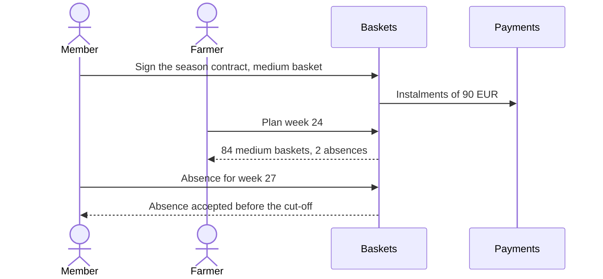

🏠 [Specs](../../../../README.md) › 🏷️ [Sectors](../../../README.md) › 🌾 [SC13 Agriculture and food](../../README.md) ›
📝 [Use cases](../README.md) ›
📝 [Use cases: FL-SC13-06 Vineyards, contractors, cooperatives, baskets, forests](README.md) ›
📝 UC-SC13-24 Sell basket subscriptions

# 📝 UC-SC13-24 Sell basket subscriptions

**Status:** ✅ specified

## Summary

A farm or a community-supported agriculture group sells baskets of its harvest by season contract. The member signs for
the season, pays in advance in instalments, chooses a basket size and a pick-up point, and receives a share of the
harvest each week. The farmer plans the baskets and the members manage their absences and swaps on the phone.

## Personas

- [U40 Farmer](../../../../01-users/personas/u40-farmer.md)
- [U09 Customer](../../../../01-users/personas/u09-customer.md)

## Goal

Every member gets the baskets of the season contract at the price fixed for the season, no basket is packed for a member
who is away, and the advance payments are followed.

## Trigger

A season opens, a member signs, a week's baskets are planned, or a member declares an absence.

## Frequency

One contract per member and season, a pick-up every week, dozens to hundreds of members.

## Preconditions

- The season is defined with its weeks, its basket sizes and its price
  ([E-SC13-02 Crop plan](../../data/e-sc13-02-crop-plan.md)).
- The pick-up points and their days are entered in the settings.
- The members are customers
  ([E-F6-01](../../../../02-functional/f06-customers-and-sales/data/e-f06-01-customer-record.md)).

## Postconditions

- **Succeeded:** each contract is saved ([E-SC13-20 Basket subscription](../../data/e-sc13-20-basket-subscription.md))
  with its basket size, pick-up point, price, instalments and absences, and each week's baskets are the ones of the
  active contracts.
- **Failed:** a basket is not planned for a contract that is not Active or whose week is declared as an absence, and an
  unpaid instalment is reminded.

## Main flow

1. The farmer opens the baskets screen
   ([S-SC13-24](../../screens/06-vineyards-contractors-and-cooperatives/s-sc13-24-baskets.md)) and sees the contracts of
   the season.
2. A member signs the season contract on the phone: basket size, pick-up point and the instalments
   [UC-F6-10](../../../../02-functional/f06-customers-and-sales/use-cases/04-subscriptions/uc-f06-10-manage-subscriptions.md).
3. Each week the farmer plans the baskets from the harvest: the content is set and the number of baskets of each size is
   counted from the Active contracts.
4. A member declares an absence or a swap for a week on the phone before the cut-off
   ([BR-SC13-19](../../business-rules/br-sc13-19-baskets-follow-the-seasons-contract.md)).
5. At each pick-up the baskets are handed over and ticked.
6. At the end of the season the contracts are Ended and the farmer opens the next season.

## Alternative flows

- 3a. The harvest is short: the content of the basket is reduced for all and the change is announced to the members.
- 4a. A member swaps with another member for the week: both contracts show the swap and the number of baskets is
  unchanged.
- 2a. A member joins mid-season: the price is pro-rated on the remaining weeks.

## Error flows

- 2e. The instalments do not add up to the season price: the contract is refused.
- 4e. An absence is declared after the cut-off: it is refused and the basket is packed.
- 3e. A basket is planned for a contract in state Pending: the plan refuses it.
- Any step: a service does not answer; the call is retried first
  ([BR-F3-32](../../../../02-functional/f03-assistant/business-rules/br-f03-32-retry-before-an-error.md)), then the
  message follows the error pattern ([D122](../../../../06-decisions/ux/d122-error-message-standard.md)) and what the
  user typed stays on the screen.

## Business rules

- [BR-SC13-19](../../business-rules/br-sc13-19-baskets-follow-the-seasons-contract.md)
- [BR-SC13-01](../../business-rules/br-sc13-01-agriculture-follows-the-country-pack.md)

## Entities

- [E-SC13-20 Basket subscription](../../data/e-sc13-20-basket-subscription.md): created, changed, ended
- [E-SC13-02 Crop plan](../../data/e-sc13-02-crop-plan.md): read, the season's crop plan
- [E-F6-07](../../../../02-functional/f06-customers-and-sales/data/e-f06-07-subscription-contract.md): read, the
  recurring contract the instalments follow
- [E-F6-06](../../../../02-functional/f06-customers-and-sales/data/e-f06-06-customer-payment.md): created, the payment
  of each instalment

## Permissions

Farmer plans the baskets and manages the contracts; member signs, pays and declares absences on their own contract.
Another member's name is never shown at the pick-up point.

## Notifications

The member, on the phone and by email: the week's basket content, an instalment is due, an absence is accepted or
refused. The farmer, in the app: the number of baskets of the week.

## Audit events

Each contract signed, each instalment paid, each absence and swap with its date, each week's plan and pick-up, who and
when.

## AI involvement

No AI step of its own. The AI assistant may open the screen and prefill it from the user's words; the user checks and
confirms
[BR-F3-07](../../../../02-functional/f03-assistant/business-rules/br-f03-07-no-deletes-no-irreversible-acts.md).

## API, MCP and A2A exposure

T5 operations of the capability for the personas above: create, read, update and list. The MCP tool of the
capability may read and propose, never confirm alone. No A2A skill.

## Screens

- [S-SC13-24](../../screens/06-vineyards-contractors-and-cooperatives/s-sc13-24-baskets.md)

## Flowchart

See
[FL-SC13-06 Vineyards, contractors, cooperatives, baskets, forests](../../flows/fl-sc13-06-vineyards-contractors-and-cooperatives.md#flowchart).

## Sequence diagram

## Acceptance criteria

1. **Given** a season of 24 weeks at 15.00 EUR per medium basket **when** a member signs for the season **then** the
   contract shows a price of 360.00 EUR and its instalments add up to it.
2. **Given** a week with 86 Active contracts and 2 absences **when** the farmer plans the baskets **then** 84 baskets
   are counted.
3. **Given** a cut-off on Monday evening **when** a member declares an absence on Tuesday **then** the absence is
   refused and the basket is packed.
4. **Given** a contract in state Pending **when** the farmer plans the week **then** no basket is counted for it.

## Non-functional notes

The screen answers within 2 seconds for 10,000 records; every change is audited.

## Regulatory references

A season contract between a farmer and a consumer fixes the price of the season and the weeks of delivery,
and the consumer pays in advance and shares the risk of the harvest. It is a sale of food and follows the information
the consumer must receive before signing, the VAT rate of food and the right of withdrawal where it applies to the way
the contract was signed. The France-pack rules are [CR-FR-065 Information before an online order](../../../../10-country-packs/france/consumer/cr-fr-065-online-pre-contract-information.md), [CR-FR-036 Consumer withdrawal right](../../../../10-country-packs/france/consumer/cr-fr-036-withdrawal-right.md) (no withdrawal for goods that perish quickly, L221-28 4°), [CR-FR-008 VAT rates](../../../../10-country-packs/france/tax-and-vat/cr-fr-008-vat-rates.md) and [CR-FR-165 Labelling of prepacked food](../../../../10-country-packs/france/consumer/cr-fr-165-prepacked-food-labelling.md). Related:
[CR-FR-065](../../../../10-country-packs/france/consumer/cr-fr-065-online-pre-contract-information.md),
[CR-FR-036](../../../../10-country-packs/france/consumer/cr-fr-036-withdrawal-right.md),
[CR-FR-008 VAT rates](../../../../10-country-packs/france/tax-and-vat/cr-fr-008-vat-rates.md),
[CR-FR-165](../../../../10-country-packs/france/consumer/cr-fr-165-prepacked-food-labelling.md).

## Related use cases

- [UC-SC13-23 Run a cooperative](uc-sc13-23-run-a-cooperative.md)
- [UC-SC13-25 Manage forests and timber sales](uc-sc13-25-manage-forests-and-timber-sales.md)
- [UC-SC13-10 Sell directly](../04-sales-and-certification/uc-sc13-10-sell-directly.md)
- [UC-SC13-01 Map plots and plan crops](../01-crops/uc-sc13-01-map-plots-and-plan-crops.md)

## Open questions

None.

---

⬅️ [UC-SC13-23 Run a cooperative](uc-sc13-23-run-a-cooperative.md) · ⬆️ [Up](README.md) ·
➡️ [UC-SC13-25 Manage forests and timber sales](uc-sc13-25-manage-forests-and-timber-sales.md)
