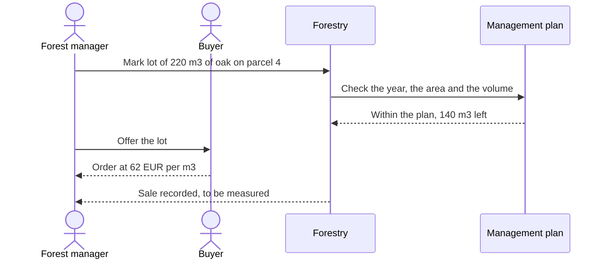

🏠 [Specs](../../../../README.md) › 🏷️ [Sectors](../../../README.md) › 🌾 [SC13 Agriculture and food](../../README.md) ›
📝 [Use cases](../README.md) ›
📝 [Use cases: FL-SC13-06 Vineyards, contractors, cooperatives, baskets, forests](README.md) ›
📝 UC-SC13-25 Manage forests and timber sales

# 📝 UC-SC13-25 Manage forests and timber sales

**Status:** ✅ specified

## Summary

A forest owner or a forest manager follows each forest parcel with its management plan, plans the fellings and thinnings
of the plan year by year, marks the timber lots, sells them standing or felled, and follows the haulage and the
invoices. It works at the desk and the lots are checked on the phone in the forest.

## Personas

- [U40 Farmer](../../../../01-users/personas/u40-farmer.md)

## Goal

No felling happens outside the management plan, every timber lot is sold with its volume and its buyer, and the timber
that leaves the forest is traceable to its parcel.

## Trigger

A felling is planned, a lot is marked, a lot is sold, or timber leaves the forest.

## Frequency

A few fellings a year per forest, a sale every few weeks for a manager.

## Preconditions

- The parcels are mapped with their species and area ([E-SC13-01 Plot](../../data/e-sc13-01-plot.md)).
- The management plan of each forest is attached with its years, areas and volumes.
- The buyers are customers
  ([E-F6-01](../../../../02-functional/f06-customers-and-sales/data/e-f06-01-customer-record.md)).

## Postconditions

- **Succeeded:** each lot is saved ([E-SC13-21 Timber lot](../../data/e-sc13-21-timber-lot.md)) with its parcel,
  species, volume and sale, and the volume felled of the year is compared with the plan.
- **Failed:** a lot is not marked outside the plan's year, area or volume, and a sale is not confirmed without its
  volume.

## Main flow

1. The manager opens the forestry screen
   ([S-SC13-25](../../screens/06-vineyards-contractors-and-cooperatives/s-sc13-25-forestry.md)) and sees the parcels
   with the year's felling planned by the management plan.
2. The manager marks a lot on a parcel with its species, estimated volume and the standing or felled state of the sale.
3. SimpleERP checks the lot against the plan: year, area and volume
   ([BR-SC13-20](../../business-rules/br-sc13-20-fellings-follow-the-management-plan.md)).
4. The manager offers the lot to buyers and records the sale with its price and conditions.
5. After the felling, the manager measures the volume and the sale is adjusted to it.
6. Each load that leaves is recorded with the parcel, the transporter and the delivery note
   [UC-F7-06](../../../../02-functional/f07-purchasing-and-stock/use-cases/04-pick-pack-and-ship/uc-f07-06-pick-pack-and-ship.md)
   and the invoice is created.

## Alternative flows

- 3a. The lot is outside the plan's year: it is blocked and the manager is asked to attach an authorisation or to change
  the plan.
- 4a. The sale is of standing timber: the buyer fells and the volume is measured at the end.
- 5a. The volume measured differs from the estimate: the price is recomputed on the measured volume.

## Error flows

- 3e. The parcel has no management plan: no lot can be marked on it.
- 3e2. The volume of the year is above the plan: the lot is refused with the figures.
- 6e. A load has no parcel: it cannot be recorded.
- Any step: a service does not answer; the call is retried first
  ([BR-F3-32](../../../../02-functional/f03-assistant/business-rules/br-f03-32-retry-before-an-error.md)), then the
  message follows the error pattern ([D122](../../../../06-decisions/ux/d122-error-message-standard.md)) and what the
  user typed stays on the screen.

## Business rules

- [BR-SC13-20](../../business-rules/br-sc13-20-fellings-follow-the-management-plan.md)
- [BR-SC13-06](../../business-rules/br-sc13-06-lots-traced-field-to-customer.md)

## Entities

- [E-SC13-21 Timber lot](../../data/e-sc13-21-timber-lot.md): created, changed, sold
- [E-SC13-01 Plot](../../data/e-sc13-01-plot.md): read, the parcel and its area
- [E-SC13-04 Lot](../../data/e-sc13-04-lot.md): created, the traced lot of timber
- [E-F6-05 Invoice](../../../../02-functional/f06-customers-and-sales/data/e-f06-05-invoice.md): created, the invoice of
  the sale

## Permissions

Forest manager marks, sells and records loads; the owner reads and approves sales above a limit. A buyer sees
only their own lot.

## Notifications

The manager, in the app: a lot would exceed the plan or a sale has no measured volume.

## Audit events

Each lot marked, checked against the plan, offered, sold, measured and delivered, who and when.

## AI involvement

No AI step of its own. The AI assistant may open the screen and prefill it from the user's words; the user checks and
confirms
[BR-F3-07](../../../../02-functional/f03-assistant/business-rules/br-f03-07-no-deletes-no-irreversible-acts.md).

## API, MCP and A2A exposure

T5 operations of the capability for the personas above: create, read, update and list. The MCP tool of the
capability may read and propose, never confirm alone. No A2A skill.

## Screens

- [S-SC13-25](../../screens/06-vineyards-contractors-and-cooperatives/s-sc13-25-forestry.md)

## Flowchart

See
[FL-SC13-06 Vineyards, contractors, cooperatives, baskets, forests](../../flows/fl-sc13-06-vineyards-contractors-and-cooperatives.md#flowchart).

## Sequence diagram

## Acceptance criteria

1. **Given** a parcel whose plan allows 300 m3 in 2026 of which 100 m3 are felled **when** the manager marks a lot of
   220 m3 **then** the lot is refused and shows 200 m3 left.
2. **Given** a lot sold at 62.00 EUR per m3 with an estimate of 200 m3 **when** the measured volume is 188 m3 **then**
   the sale becomes 11,656.00 EUR.
3. **Given** a parcel without a management plan **when** the manager marks a lot **then** no lot can be marked and the
   plan is asked for.
4. **Given** a load that leaves the forest **when** the driver records it without a parcel **then** the load is refused.

## Non-functional notes

The screen answers within 2 seconds for 10,000 records; every change is audited.

## Regulatory references

A private forest above a surface set by law must have an approved management plan, and fellings follow its
programme of thinnings and cuts. A clear cut above a set area needs an authorisation. Timber sold standing or felled is
a sale with its own conditions, and timber placed on the market must be traceable to its origin under the European
timber and deforestation rules. The thresholds and authorities are data of the France pack, written later. Related:
[CR-FR-061](../../../../10-country-packs/france/products/cr-fr-061-food-traceability.md),
[CR-FR-008 VAT rates](../../../../10-country-packs/france/tax-and-vat/cr-fr-008-vat-rates.md),
[CR-FR-015](../../../../10-country-packs/france/invoicing/cr-fr-015-invoice-mandatory-mentions.md).

## Related use cases

- [UC-SC13-24 Sell basket subscriptions](uc-sc13-24-sell-basket-subscriptions.md)
- [UC-SC13-01 Map plots and plan crops](../01-crops/uc-sc13-01-map-plots-and-plan-crops.md)
- [UC-SC13-14](../05-food-processing/uc-sc13-14-trace-lots-from-field-to-customer.md)

## Open questions

None.

---

⬅️ [UC-SC13-24 Sell basket subscriptions](uc-sc13-24-sell-basket-subscriptions.md) · ⬆️ [Up](README.md)
