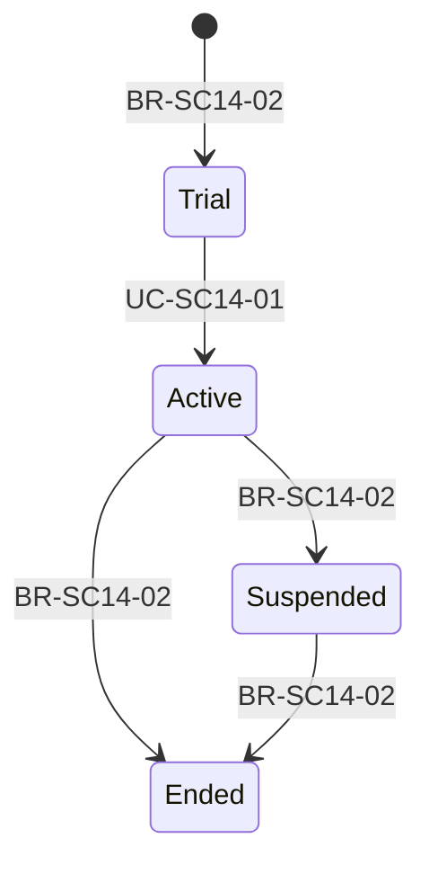

🏠 [Specs](../../../README.md) › 🏷️ [Sectors](../../README.md) › 💻 [SC14 IT and software](../README.md) ›
🗃️ [Data](README.md) › 🗃️ E-SC14-01 Software subscription

# 🗃️ E-SC14-01 Software subscription

**Status:** ✅ specified

## Purpose

A customer's subscription.

## Fields

| Name | Type | Required | Validation | Default | Example | Personal data | Custom fields |
|---|---|---|---|---|---|---|---|
| customer, plan, seats | records | yes | BR-SC14-02 | - | Acme, Business, 25 | no | no |
| term, renewal | dates | yes | BR-SC14-04 | - | 2026-2027 | no | no |
| state | trial, active, suspended, ended | yes | - | trial | active | no | no |

## Relations

As its use cases.

## Lifecycle

## Indexes and search

By number, date, partner.

## Retention

As an accounting record:
[CR-FR-002 Accounting records kept 10 years](../../../10-country-packs/france/accounting/cr-fr-002-accounting-records-kept-ten-years.md).

## Audit

Every change.

## Import and export

CSV, FEC where relevant.

## Used by

- [UC-SC14-01](../use-cases/01-subscriptions-and-billing/uc-sc14-01-sell-subscriptions-with-plans-and-seats.md)
- [UC-SC14-10](../use-cases/02-licences-and-renewals/uc-sc14-10-run-renewals-and-expansion.md)
- [UC-SC14-17](../use-cases/06-portal-and-metrics/uc-sc14-17-give-customers-their-portal.md)
- [UC-SC14-18](../use-cases/06-portal-and-metrics/uc-sc14-18-follow-saas-metrics.md)

## Open questions

None.

---

⬆️ [Up](README.md) · ➡️ [E-SC14-02 Customer usage record](e-sc14-02-customer-usage-record.md)
