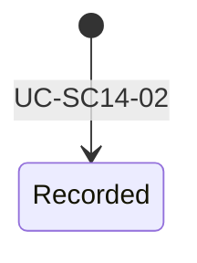

🏠 [Specs](../../../README.md) › 🏷️ [Sectors](../../README.md) › 💻 [SC14 IT and software](../README.md) ›
🗃️ [Data](README.md) › 🗃️ E-SC14-02 Customer usage record

# 🗃️ E-SC14-02 Customer usage record

**Status:** 🔄 waiting for the owner

## Purpose

Metered usage.

## Fields

| Name | Type | Required | Validation | Default | Example | Personal data | Custom fields |
|---|---|---|---|---|---|---|---|
| subscription, metric, quantity | records | yes | - | - | Acme, API calls, 1.2 M | no | no |

## Relations

(Proposed) As its use cases.

## Lifecycle

## Indexes and search

(Proposed) By number, date, partner.

## Retention

As an accounting record:
[CR-FR-002 Accounting records kept 10 years](../../../10-country-packs/france/accounting/cr-fr-002-accounting-records-kept-ten-years.md).

## Audit

Every change.

## Import and export

(Proposed) CSV, FEC where relevant.

## Used by

- [UC-SC14-02](../use-cases/01-subscriptions-and-billing/uc-sc14-02-meter-usage-and-bill-it.md)
- [UC-SC14-15](../use-cases/01-subscriptions-and-billing/uc-sc14-15-bill-digital-services-across-the-eu.md)
- [UC-SC14-17](../use-cases/06-portal-and-metrics/uc-sc14-17-give-customers-their-portal.md)

## Open questions

None.

---

⬅️ [E-SC14-01 Software subscription](e-sc14-01-software-subscription.md) · ⬆️ [Up](README.md) ·
➡️ [E-SC14-03 Revenue schedule](e-sc14-03-revenue-schedule.md)
