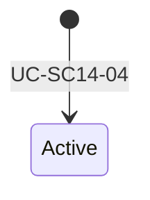

🏠 [Specs](../../../README.md) › 🏷️ [Sectors](../../README.md) › 💻 [SC14 IT and software](../README.md) ›
🗃️ [Data](README.md) › 🗃️ E-SC14-04 Software licence

# 🗃️ E-SC14-04 Software licence

**Status:** 🔄 waiting for the owner

## Purpose

A licence and its key.

## Fields

| Name | Type | Required | Validation | Default | Example | Personal data | Custom fields |
|---|---|---|---|---|---|---|---|
| customer, product, key | records | yes | - | - | Acme, Desk Pro, KEY-… | no | no |
| valid to | date | yes | BR-SC14-04 | - | 2027-03 | no | no |

## Relations

(Proposed) As its use cases.

## Lifecycle

## Indexes and search

(Proposed) By number, date, partner.

## Retention

Kept for the period of its kind of record in the country pack (D293), or else its kind's default in the
[retention schedule](../../../05-non-functional/data-retention.md).

## Audit

Every change.

## Import and export

(Proposed) CSV, FEC where relevant.

## Used by

- [UC-SC14-04](../use-cases/02-licences-and-renewals/uc-sc14-04-manage-licences-keys-and-renewals.md)

## Open questions

None.

---

⬅️ [E-SC14-03 Revenue schedule](e-sc14-03-revenue-schedule.md) · ⬆️ [Up](README.md) ·
➡️ [E-SC14-05 Service level](e-sc14-05-service-level.md)
