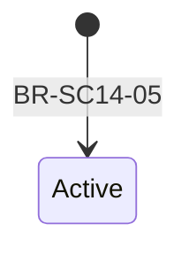

🏠 [Specs](../../../README.md) › 🏷️ [Sectors](../../README.md) › 💻 [SC14 IT and software](../README.md) ›
🗃️ [Data](README.md) › 🗃️ E-SC14-05 Service level

# 🗃️ E-SC14-05 Service level

**Status:** ✅ specified

## Purpose

A contract's response and resolution times.

## Fields

| Name | Type | Required | Validation | Default | Example | Personal data | Custom fields |
|---|---|---|---|---|---|---|---|
| contract, priority, times | records | yes | BR-SC14-05 | - | premium, P1, 1 h / 4 h | no | no |

## Relations

As its use cases.

## Lifecycle

## Indexes and search

By number, date, partner.

## Retention

Kept for the period of its kind of record in the country pack (D293), or else its kind's default in the
[retention schedule](../../../05-non-functional/data-retention.md).

## Audit

Every change.

## Import and export

CSV, FEC where relevant.

## Used by

- [UC-SC14-05](../use-cases/03-support-and-services/uc-sc14-05-run-support-with-service-levels.md)

## Open questions

None.

---

⬅️ [E-SC14-04 Software licence](e-sc14-04-software-licence.md) · ⬆️ [Up](README.md) ·
➡️ [E-SC14-06 Managed asset](e-sc14-06-managed-asset.md)
