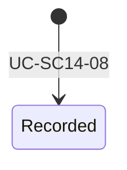

🏠 [Specs](../../../README.md) › 🏷️ [Sectors](../../README.md) › 💻 [SC14 IT and software](../README.md) ›
🗃️ [Data](README.md) › 🗃️ E-SC14-08 Software release note

# 🗃️ E-SC14-08 Software release note

**Status:** 🔄 waiting for the owner

## Purpose

A version's release note.

## Fields

| Name | Type | Required | Validation | Default | Example | Personal data | Custom fields |
|---|---|---|---|---|---|---|---|
| product, version, date | records | yes | - | - | Desk Pro, 4.2, 1 Dec | no | no |
| features | links | yes | BR-SC14-14 | - | 6 | no | no |

## Relations

(Proposed) As its use cases.

## Lifecycle

## Indexes and search

(Proposed) By number, date, partner.

## Retention

Kept for the period of its kind of record in the country pack (D293), or else its kind's default in the
[retention schedule](../../../05-non-functional/data-retention.md).

## Audit

Every change.

## Import and export

(Proposed) CSV, FEC where relevant.

## Used by

- [UC-SC14-08](../use-cases/04-product-delivery/uc-sc14-08-publish-release-notes-to-customers.md)
- [UC-SC14-21](../use-cases/04-product-delivery/uc-sc14-21-follow-features-and-products-in-the-development-tool.md)

## Open questions

None.

---

⬅️ [E-SC14-07 Sprint](e-sc14-07-sprint.md) · ⬆️ [Up](README.md) ·
➡️ [E-SC14-09 Health score](e-sc14-09-health-score.md)
