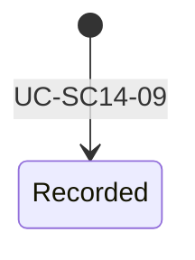

🏠 [Specs](../../../README.md) › 🏷️ [Sectors](../../README.md) › 💻 [SC14 IT and software](../README.md) ›
🗃️ [Data](README.md) › 🗃️ E-SC14-09 Health score

# 🗃️ E-SC14-09 Health score

**Status:** ✅ specified

## Purpose

A customer's health.

## Fields

| Name | Type | Required | Validation | Default | Example | Personal data | Custom fields |
|---|---|---|---|---|---|---|---|
| customer, score, factors | records | yes | BR-SC14-13 | - | Acme, 62, usage down | no | no |

## Relations

As its use cases.

## Lifecycle

## Indexes and search

By number, date, partner.

## Retention

Kept for the period of its kind of record in the country pack (D293), or else its kind's default in the
[retention schedule](../../../05-non-functional/data-retention.md).

## Audit

Every change.

## Import and export

CSV, FEC where relevant.

## Used by

- [UC-SC14-09](../use-cases/02-licences-and-renewals/uc-sc14-09-follow-customer-health-and-churn-risk.md)
- [UC-SC14-10](../use-cases/02-licences-and-renewals/uc-sc14-10-run-renewals-and-expansion.md)
- [UC-SC14-18](../use-cases/06-portal-and-metrics/uc-sc14-18-follow-saas-metrics.md)
- [UC-SC14-20](../use-cases/06-portal-and-metrics/uc-sc14-20-ask-the-assistant.md)

## Open questions

None.

---

⬅️ [E-SC14-08 Software release note](e-sc14-08-software-release-note.md) · ⬆️ [Up](README.md) ·
➡️ [E-SC14-10 Processor agreement](e-sc14-10-processor-agreement.md)
