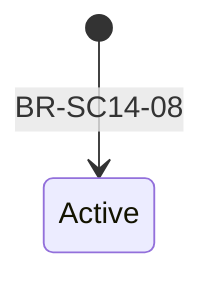

🏠 [Specs](../../../README.md) › 🏷️ [Sectors](../../README.md) › 💻 [SC14 IT and software](../README.md) ›
🗃️ [Data](README.md) › 🗃️ E-SC14-11 Component

# 🗃️ E-SC14-11 Component

**Status:** 🔄 waiting for the owner

## Purpose

A component in the bill of materials.

## Fields

| Name | Type | Required | Validation | Default | Example | Personal data | Custom fields |
|---|---|---|---|---|---|---|---|
| release, name, version | records | yes | BR-SC14-08 | - | 4.2, library L, 1.9 | no | no |
| vulnerabilities | list | no | - | - | CVE-… | no | no |

## Relations

(Proposed) As its use cases.

## Lifecycle

## Indexes and search

(Proposed) By number, date, partner.

## Retention

Kept for the period of its kind of record in the country pack (D293), or else its kind's default in the
[retention schedule](../../../05-non-functional/data-retention.md).

## Audit

Every change.

## Import and export

(Proposed) CSV, FEC where relevant.

## Used by

- [UC-SC14-12](../use-cases/05-security-and-data-compliance/uc-sc14-12-keep-the-software-bill-of-materials-and-handle-vulnerabilities.md)

## Open questions

None.

---

⬅️ [E-SC14-10 Processor agreement](e-sc14-10-processor-agreement.md) · ⬆️ [Up](README.md) ·
➡️ [E-SC14-12 Security report](e-sc14-12-security-report.md)
