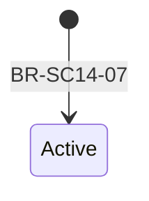

🏠 [Specs](../../../README.md) › 🏷️ [Sectors](../../README.md) › 💻 [SC14 IT and software](../README.md) ›
🗃️ [Data](README.md) › 🗃️ E-SC14-12 Security report

# 🗃️ E-SC14-12 Security report

**Status:** 🔄 waiting for the owner

## Purpose

An incident or vulnerability report.

## Fields

| Name | Type | Required | Validation | Default | Example | Personal data | Custom fields |
|---|---|---|---|---|---|---|---|
| kind, aware at | records | yes | BR-SC14-07 | - | exploited vulnerability, 3 Dec 09:00 | no | no |
| early warning, notification, final | times | no | - | - | 4 Dec 08:00 | no | no |

## Relations

(Proposed) As its use cases.

## Lifecycle

## Indexes and search

(Proposed) By number, date, partner.

## Retention

Kept for the period of its kind of record in the country pack (D293), or else its kind's default in the
[retention schedule](../../../05-non-functional/data-retention.md).

## Audit

Every change.

## Import and export

(Proposed) CSV, FEC where relevant.

## Used by

- [UC-SC14-13](../use-cases/05-security-and-data-compliance/uc-sc14-13-report-security-incidents.md)

## Open questions

None.

---

⬅️ [E-SC14-11 Component](e-sc14-11-component.md) · ⬆️ [Up](README.md) ·
➡️ [E-SC14-13 Data export](e-sc14-13-data-export.md)
