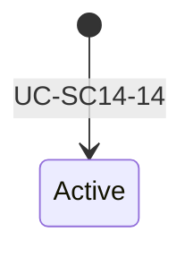

🏠 [Specs](../../../README.md) › 🏷️ [Sectors](../../README.md) › 💻 [SC14 IT and software](../README.md) ›
🗃️ [Data](README.md) › 🗃️ E-SC14-13 Data export

# 🗃️ E-SC14-13 Data export

**Status:** ✅ specified

## Purpose

An export or switch request.

## Fields

| Name | Type | Required | Validation | Default | Example | Personal data | Custom fields |
|---|---|---|---|---|---|---|---|
| customer, scope, format | records | yes | BR-SC14-10 | - | Acme, all, JSON | no | no |

## Relations

As its use cases.

## Lifecycle

## Indexes and search

By number, date, partner.

## Retention

Kept for the period of its kind of record in the country pack (D293), or else its kind's default in the
[retention schedule](../../../05-non-functional/data-retention.md).

## Audit

Every change.

## Import and export

CSV, FEC where relevant.

## Used by

- [UC-SC14-14](../use-cases/05-security-and-data-compliance/uc-sc14-14-let-customers-switch-and-export-their-data.md)

## Open questions

None.

---

⬅️ [E-SC14-12 Security report](e-sc14-12-security-report.md) · ⬆️ [Up](README.md) ·
➡️ [E-SC14-14 Dunning case](e-sc14-14-dunning-case.md)
