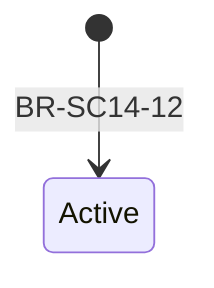

🏠 [Specs](../../../README.md) › 🏷️ [Sectors](../../README.md) › 💻 [SC14 IT and software](../README.md) ›
🗃️ [Data](README.md) › 🗃️ E-SC14-14 Dunning case

# 🗃️ E-SC14-14 Dunning case

**Status:** ✅ specified

## Purpose

A failed payment and its steps.

## Fields

| Name | Type | Required | Validation | Default | Example | Personal data | Custom fields |
|---|---|---|---|---|---|---|---|
| invoice, step | records | yes | BR-SC14-12 | - | INV-88, reminder | no | no |

## Relations

As its use cases.

## Lifecycle

## Indexes and search

By number, date, partner.

## Retention

As an accounting record:
[CR-FR-002 Accounting records kept 10 years](../../../10-country-packs/france/accounting/cr-fr-002-accounting-records-kept-ten-years.md).

## Audit

Every change.

## Import and export

CSV, FEC where relevant.

## Used by

- [UC-SC14-16](../use-cases/01-subscriptions-and-billing/uc-sc14-16-handle-failed-payments-and-dunning.md)

## Open questions

None.

---

⬅️ [E-SC14-13 Data export](e-sc14-13-data-export.md) · ⬆️ [Up](README.md) ·
➡️ [E-SC14-15 Partner deal](e-sc14-15-partner-deal.md)
