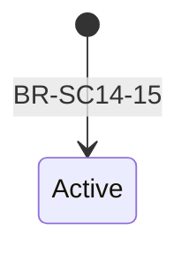

🏠 [Specs](../../../README.md) › 🏷️ [Sectors](../../README.md) › 💻 [SC14 IT and software](../README.md) ›
🗃️ [Data](README.md) › 🗃️ E-SC14-15 Partner deal

# 🗃️ E-SC14-15 Partner deal

**Status:** 🔄 waiting for the owner

## Purpose

A deal brought by a partner; its commission is a line of the shared commissions
([E-F6-19 Commission line](../../../02-functional/f06-customers-and-sales/data/e-f06-19-commission-line.md)).

## Fields

| Name | Type | Required | Validation | Default | Example | Personal data | Custom fields |
|---|---|---|---|---|---|---|---|
| partner, customer, amount, rate | records | yes | BR-SC14-15 | - | Partner P, Beta, 12 000, 20 % | no | no |

## Relations

(Proposed) As its use cases.

## Lifecycle

## Indexes and search

(Proposed) By number, date, partner.

## Retention

As an accounting record:
[CR-FR-002 Accounting records kept 10 years](../../../10-country-packs/france/accounting/cr-fr-002-accounting-records-kept-ten-years.md).

## Audit

Every change.

## Import and export

(Proposed) CSV, FEC where relevant.

## Used by

- [UC-SC14-19](../use-cases/02-licences-and-renewals/uc-sc14-19-manage-partners-and-resellers.md)

## Open questions

None.

---

⬅️ [E-SC14-14 Dunning case](e-sc14-14-dunning-case.md) · ⬆️ [Up](README.md) ·
➡️ [E-SC14-16 Tracked feature](e-sc14-16-tracked-feature.md)
