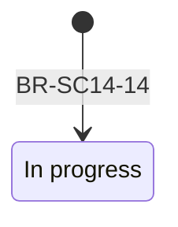

🏠 [Specs](../../../README.md) › 🏷️ [Sectors](../../README.md) › 💻 [SC14 IT and software](../README.md) ›
🗃️ [Data](README.md) › 🗃️ E-SC14-16 Tracked feature

# 🗃️ E-SC14-16 Tracked feature

**Status:** 🔄 waiting for the owner

## Purpose

A feature or issue from the development tool.

## Fields

| Name | Type | Required | Validation | Default | Example | Personal data | Custom fields |
|---|---|---|---|---|---|---|---|
| tool, key, title | records | yes | BR-SC14-14 | - | GitHub, #412, CSV export | no | no |
| requests, state | links, state | yes | - | - | 7, in progress | no | no |

## Relations

(Proposed) As its use cases.

## Lifecycle

## Indexes and search

(Proposed) By number, date, partner.

## Retention

Kept for the period of its kind of record in the country pack (D293), or else its kind's default in the
[retention schedule](../../../05-non-functional/data-retention.md).

## Audit

Every change.

## Import and export

(Proposed) CSV, FEC where relevant.

## Used by

- [UC-SC14-20](../use-cases/06-portal-and-metrics/uc-sc14-20-ask-the-assistant.md)
- [UC-SC14-21](../use-cases/04-product-delivery/uc-sc14-21-follow-features-and-products-in-the-development-tool.md)

## Open questions

None.

---

⬅️ [E-SC14-15 Partner deal](e-sc14-15-partner-deal.md) · ⬆️ [Up](README.md) ·
➡️ [E-SC14-17 Leased device](e-sc14-17-leased-device.md)
