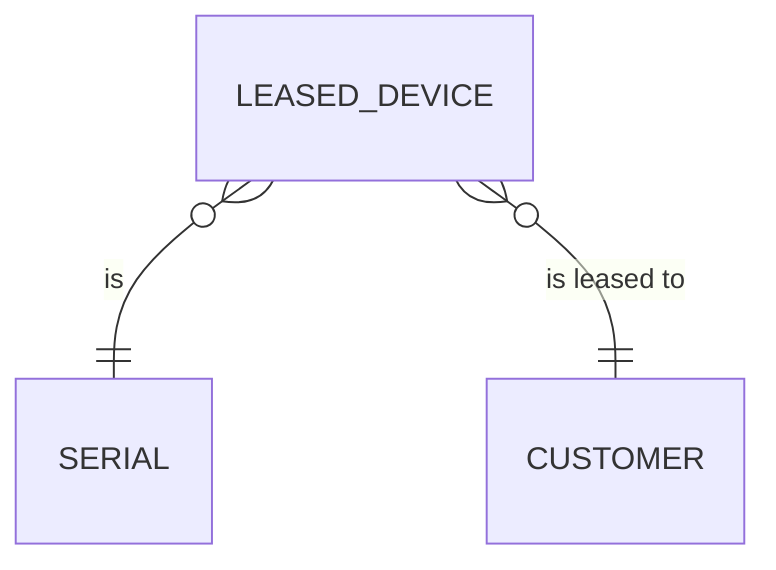
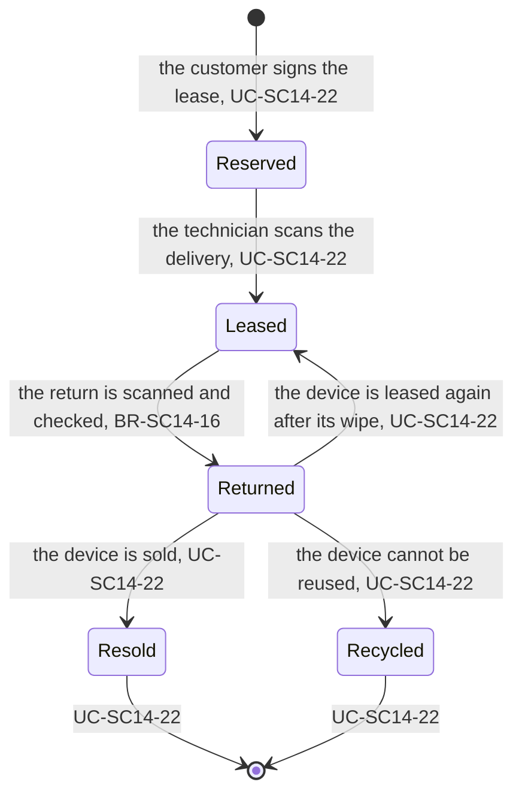

🏠 [Specs](../../../README.md) › 🏷️ [Sectors](../../README.md) › 💻 [SC14 IT and software](../README.md) ›
🗃️ [Data](README.md) › 🗃️ E-SC14-17 Leased device

# 🗃️ E-SC14-17 Leased device

**Status:** ✅ specified

## Purpose

One device on lease to a customer, followed by serial number from delivery to its next use
([D558](../../../06-decisions/sectors/d558-benchmark-gaps-sc14-it-and-software.md)). It is not the stock serial
([E-F7-10](../../../02-functional/f07-purchasing-and-stock/data/e-f07-10-lot-or-serial.md)) nor the customer's managed
asset ([E-SC14-06 Managed asset](e-sc14-06-managed-asset.md)): it carries the lease term, the monthly fee and the wipe
certificate.

## Fields

| Name | Type | Required | Validation | Default | Example | Personal data | Custom fields |
|---|---|---|---|---|---|---|---|
| serial | serial (E-F7-10) | yes | a serial number in stock | - | SN-77120 | no | no |
| item | item (E-F7-06) | yes | a hardware item | - | Laptop 14 | no | no |
| customer | customer (E-F6-01) | yes | a customer of the company | - | Cabinet Perrin | no | no |
| start | date | yes | - | delivery date | 2024-03-01 | no | no |
| end | date | yes | after the start | - | 2027-02-28 | no | no |
| fee | amount in EUR | yes | 0 or more | - | 35.00 | no | no |
| residual price | amount in EUR | no | 0 or more | - | 120.00 | no | no |
| wipe certificate | file | no | required before reuse | - | wipe-8812.pdf | no | no |
| returned on | date | no | not before the start | - | 2027-03-02 | no | no |
| state | Reserved, Leased, Returned, Resold, Recycled | yes | the lifecycle below | Reserved | Leased | no | no |
| owner | user | yes | a user of the company | the creator | Claire P. | yes | no |

## Relations

- [E-F7-10](../../../02-functional/f07-purchasing-and-stock/data/e-f07-10-lot-or-serial.md)
- [E-F6-01](../../../02-functional/f06-customers-and-sales/data/e-f06-01-customer-record.md)
- [E-SC14-06 Managed asset](e-sc14-06-managed-asset.md)

## Lifecycle

## Indexes and search

By serial number, item, customer, lease end and state.

## Retention

Kept ten years with the invoices
([CR-FR-002](../../../10-country-packs/france/accounting/cr-fr-002-accounting-records-kept-ten-years.md)), and the wipe
certificate five years.

## Audit

Every delivery, return, wipe, sale and recycling, each change of fee or term, with who and when.

## Import and export

Import of the serial numbers of a delivery note as CSV; export of a customer's devices as PDF.

## Used by

- [UC-SC14-22](../use-cases/07-hardware-licences-and-tax-credits/uc-sc14-22-resell-and-lease-it-hardware.md)
- [UC-SC14-06](../use-cases/03-support-and-services/uc-sc14-06-manage-managed-service-contracts-and-customers-assets.md)

## Open questions

None.

---

⬅️ [E-SC14-16 Tracked feature](e-sc14-16-tracked-feature.md) · ⬆️ [Up](README.md) ·
➡️ [E-SC14-18 Licence subscription](e-sc14-18-licence-subscription.md)
