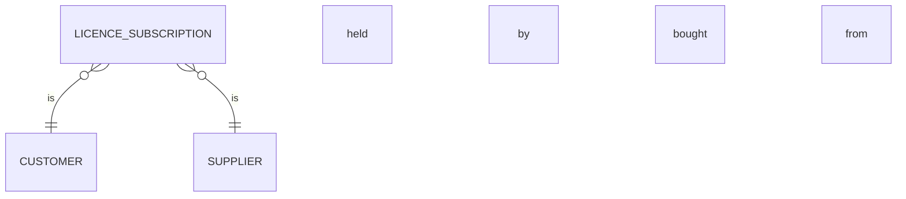
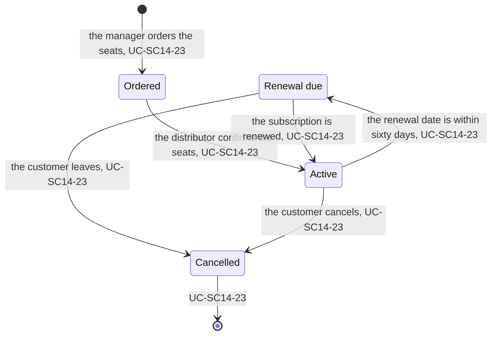

🏠 [Specs](../../../README.md) › 🏷️ [Sectors](../../README.md) › 💻 [SC14 IT and software](../README.md) ›
🗃️ [Data](README.md) › 🗃️ E-SC14-18 Licence subscription

# 🗃️ E-SC14-18 Licence subscription

**Status:** ✅ specified

## Purpose

The seats of one resold product held by one customer, with the customer price, the distributor's cost and the renewal
date ([D558](../../../06-decisions/sectors/d558-benchmark-gaps-sc14-it-and-software.md)). It is not the software the
company itself licenses ([E-SC14-04 Software licence](e-sc14-04-software-licence.md)) nor the generic recurring contract
([E-F6-07](../../../02-functional/f06-customers-and-sales/data/e-f06-07-subscription-contract.md)): it is tied to a
distributor's monthly statement.

## Fields

| Name | Type | Required | Validation | Default | Example | Personal data | Custom fields |
|---|---|---|---|---|---|---|---|
| customer | customer (E-F6-01) | yes | a customer of the company | - | Atelier Roche | no | no |
| product | text | yes | a product of the distributor's price list | - | Mail suite | no | no |
| distributor | supplier (E-F7-01) | yes | a supplier of the company | - | Nuage Distribution | no | no |
| seats | number | yes | 0 or more | - | 40 | no | no |
| price | amount in EUR per seat and month | yes | 0 or more | - | 12.00 | no | no |
| cost | amount in EUR per seat and month | yes | 0 or more | - | 8.40 | no | no |
| renewal date | date | yes | after today | - | 2027-01-15 | no | no |
| statement seats | number | no | from the imported statement | - | 40 | no | no |
| difference | number | no | own seats minus statement seats | 0 | 0 | no | no |
| state | Ordered, Active, Renewal due, Cancelled | yes | the lifecycle below | Ordered | Active | no | no |
| owner | user | yes | a user of the company | the creator | Claire P. | yes | no |

## Relations

- [E-F6-01](../../../02-functional/f06-customers-and-sales/data/e-f06-01-customer-record.md)
- [E-F7-01](../../../02-functional/f07-purchasing-and-stock/data/e-f07-01-supplier-record.md)
- [E-SC14-04 Software licence](e-sc14-04-software-licence.md)

## Lifecycle

## Indexes and search

By customer, product, distributor, renewal date and state.

## Retention

Kept ten years with the invoices
([CR-FR-002](../../../10-country-packs/france/accounting/cr-fr-002-accounting-records-kept-ten-years.md)).

## Audit

Every seat change, statement import, difference and explanation, with who, when and the old and new value.

## Import and export

Import of the distributor's monthly statement as CSV; export of the differences as CSV.

## Used by

- [UC-SC14-23](../use-cases/07-hardware-licences-and-tax-credits/uc-sc14-23-resell-cloud-licences.md)
- [UC-SC14-04](../use-cases/02-licences-and-renewals/uc-sc14-04-manage-licences-keys-and-renewals.md)

## Open questions

None.

---

⬅️ [E-SC14-17 Leased device](e-sc14-17-leased-device.md) · ⬆️ [Up](README.md) ·
➡️ [E-SC14-19 R&D project](e-sc14-19-r-d-project.md)
