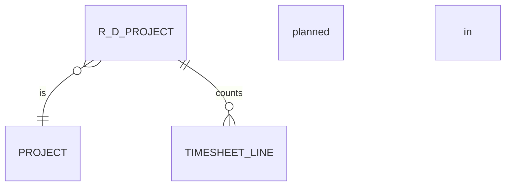
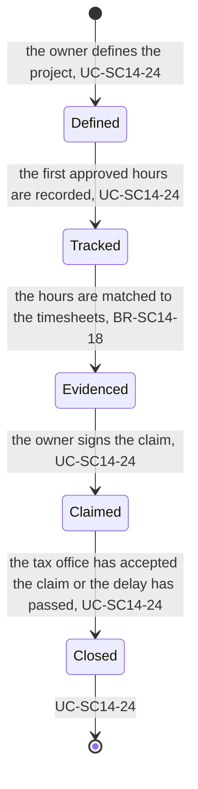

🏠 [Specs](../../../README.md) › 🏷️ [Sectors](../../README.md) › 💻 [SC14 IT and software](../README.md) ›
🗃️ [Data](README.md) › 🗃️ E-SC14-19 R&D project

# 🗃️ E-SC14-19 R&D project

**Status:** ✅ specified

## Purpose

One research project of the company, with its description, its dates, the hours and the expenses that make it eligible
to a tax credit ([D558](../../../06-decisions/sectors/d558-benchmark-gaps-sc14-it-and-software.md)). It is not the
project of the company's planning
([E-F9-18](../../../02-functional/f09-hr-and-projects/data/e-f09-18-project-and-task.md)): it adds the scientific or
technical uncertainty and the evidence file, and it may group several planning projects.

## Fields

| Name | Type | Required | Validation | Default | Example | Personal data | Custom fields |
|---|---|---|---|---|---|---|---|
| project | project (E-F9-18) | yes | a project of the company | - | Search engine | no | no |
| uncertainty | text | yes | a description of the technical problem | - | Ranking under 50 ms on 10 million documents | no | no |
| start | date | yes | - | - | 2026-01-05 | no | no |
| end | date | no | after the start | - | 2026-12-18 | no | no |
| hours claimed | number | yes | 0 or more | 0 | 1,200 | no | no |
| hours approved | number | no | from the approved timesheet lines | computed | 1,150 | no | no |
| staff cost | amount in EUR | no | approved hours times the hourly cost | computed | 43,700.00 | no | no |
| other expenses | amount in EUR | no | 0 or more | 0 | 8,400.00 | no | no |
| grants | amount in EUR | no | 0 or more | 0 | 0.00 | no | no |
| evidence file | file | no | required to claim | - | evidence-search-2026.pdf | no | no |
| state | Defined, Tracked, Evidenced, Claimed, Closed | yes | the lifecycle below | Defined | Tracked | no | no |
| owner | user | yes | a user of the company | the creator | Claire P. | yes | no |

## Relations

- [E-F9-18](../../../02-functional/f09-hr-and-projects/data/e-f09-18-project-and-task.md)
- [E-F9-17](../../../02-functional/f09-hr-and-projects/data/e-f09-17-timesheet-line.md)
- [E-F8-21](../../../02-functional/f08-accounting/data/e-f08-21-corporate-tax-computation.md)

## Lifecycle

## Indexes and search

By project, year, state and gap in hours.

## Retention

Kept for the period in which the tax office may check the claim, and ten years with the accounting records
([CR-FR-002](../../../10-country-packs/france/accounting/cr-fr-002-accounting-records-kept-ten-years.md)).

## Audit

Every hour counted or left out, every expense, evidence export and claim, with who, when and the old and new value.

## Import and export

Export of the evidence file as PDF and of the expenses as CSV for the tax form.

## Used by

- [UC-SC14-24](../use-cases/07-hardware-licences-and-tax-credits/uc-sc14-24-claim-research-tax-credits.md)
- [UC-SC14-07](../use-cases/04-product-delivery/uc-sc14-07-plan-it-projects-in-sprints-with-time.md)

## Open questions

None.

---

⬅️ [E-SC14-18 Licence subscription](e-sc14-18-licence-subscription.md) · ⬆️ [Up](README.md) ·
➡️ [E-SC14-20 Sponsorship](e-sc14-20-sponsorship.md)
