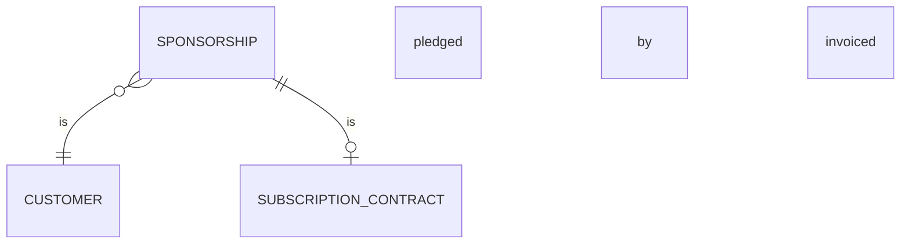
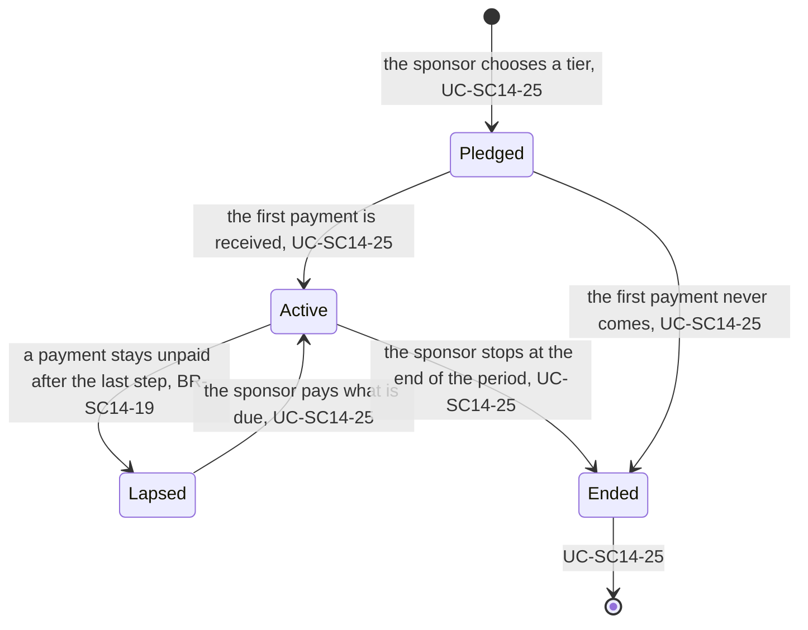

🏠 [Specs](../../../README.md) › 🏷️ [Sectors](../../README.md) › 💻 [SC14 IT and software](../README.md) ›
🗃️ [Data](README.md) › 🗃️ E-SC14-20 Sponsorship

# 🗃️ E-SC14-20 Sponsorship

**Status:** ✅ specified

## Purpose

One sponsor's pledge to a tier of an open-source project, with its fee, period and benefits
([D558](../../../06-decisions/sectors/d558-benchmark-gaps-sc14-it-and-software.md)). It differs from the sponsor of an
event ([E-SC16-11 Sponsorship](../../sc16-events-and-culture/data/e-sc16-11-sponsorship.md)), which has a one-off
package: this one is a recurring pledge that follows a subscription
([E-F6-07](../../../02-functional/f06-customers-and-sales/data/e-f06-07-subscription-contract.md)).

## Fields

| Name | Type | Required | Validation | Default | Example | Personal data | Custom fields |
|---|---|---|---|---|---|---|---|
| sponsor | customer (E-F6-01) | yes | a customer of the company | - | Atelier Roche | no | no |
| tier | text | yes | a tier of the settings | - | Gold | no | no |
| period | monthly, yearly | yes | one of the two | monthly | yearly | no | no |
| fee | amount in EUR | yes | the tier's price | from the tier | 1,200.00 | no | no |
| next invoice | date | no | after today | - | 2027-03-01 | no | no |
| benefits | list | no | from the tier | - | Logo, support | no | no |
| listed | yes or no | yes | the sponsor's consent | no | yes | no | no |
| subscription | subscription (E-F6-07) | no | created at pledge | - | SUB-0412 | no | no |
| state | Pledged, Active, Lapsed, Ended | yes | the lifecycle below | Pledged | Active | no | no |
| owner | user | yes | a user of the company | the creator | Claire P. | yes | no |

## Relations

- [E-F6-01](../../../02-functional/f06-customers-and-sales/data/e-f06-01-customer-record.md)
- [E-F6-07](../../../02-functional/f06-customers-and-sales/data/e-f06-07-subscription-contract.md)
- [E-SC16-11 Sponsorship](../../sc16-events-and-culture/data/e-sc16-11-sponsorship.md)

## Lifecycle

## Indexes and search

By sponsor, tier, period, next invoice and state.

## Retention

Kept ten years with the invoices
([CR-FR-002](../../../10-country-packs/france/accounting/cr-fr-002-accounting-records-kept-ten-years.md)), and the
consent while the sponsorship lasts and five years after.

## Audit

Every pledge, tier change, payment, lapse and consent change, with who, when and the old and new value.

## Import and export

Export of the sponsors and the money raised by tier as CSV; import of existing sponsors as CSV.

## Used by

- [UC-SC14-25](../use-cases/07-hardware-licences-and-tax-credits/uc-sc14-25-accept-open-source-sponsorship.md)
- [UC-SC14-01](../use-cases/01-subscriptions-and-billing/uc-sc14-01-sell-subscriptions-with-plans-and-seats.md)

## Open questions

None.

---

⬅️ [E-SC14-19 R&D project](e-sc14-19-r-d-project.md) · ⬆️ [Up](README.md)
