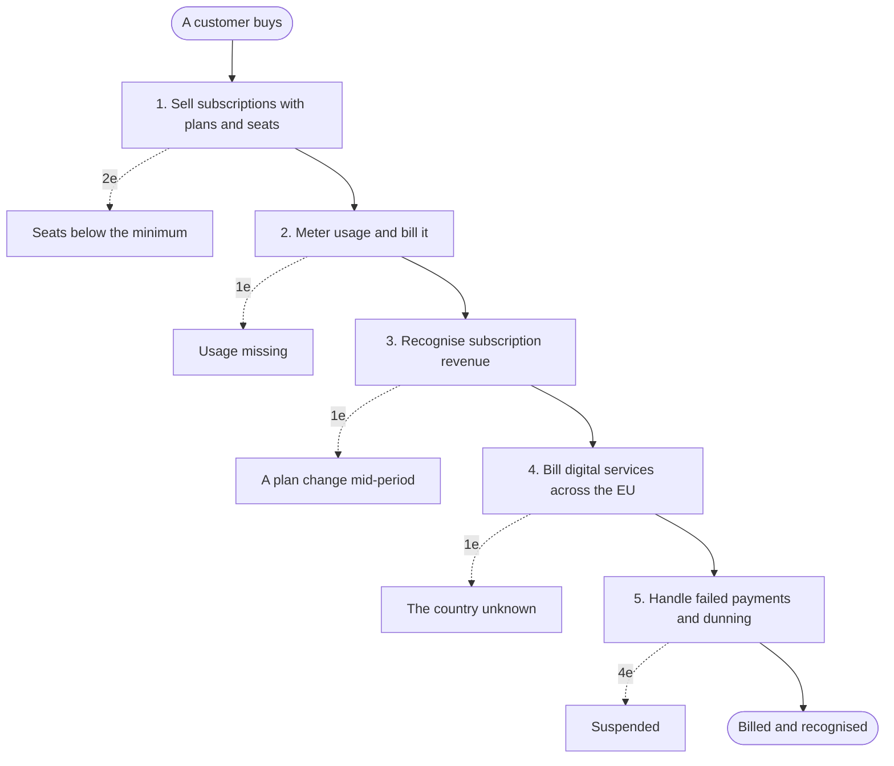

🏠 [Specs](../../../README.md) › 🏷️ [Sectors](../../README.md) › 💻 [SC14 IT and software](../README.md) ›
🔀 [Flows](README.md) › 🔀 FL-SC14-01 Subscriptions and billing

# 🔀 FL-SC14-01 Subscriptions and billing

**Status:** ✅ specified

## Summary

Subscriptions, usage, revenue, EU VAT and dunning. It covers
[UC-SC14-01 Sell subscriptions with plans and seats](../use-cases/01-subscriptions-and-billing/uc-sc14-01-sell-subscriptions-with-plans-and-seats.md),
[UC-SC14-02 Meter usage and bill it](../use-cases/01-subscriptions-and-billing/uc-sc14-02-meter-usage-and-bill-it.md),
[UC-SC14-03 Recognise subscription revenue](../use-cases/01-subscriptions-and-billing/uc-sc14-03-recognise-subscription-revenue.md),
[UC-SC14-15 Bill digital services across the EU](../use-cases/01-subscriptions-and-billing/uc-sc14-15-bill-digital-services-across-the-eu.md),
[UC-SC14-16 Handle failed payments and dunning](../use-cases/01-subscriptions-and-billing/uc-sc14-16-handle-failed-payments-and-dunning.md).

## Personas

- [U03 Sales](../../../01-users/personas/u03-sales.md)
- [U05 Accounting](../../../01-users/personas/u05-accounting.md)
- [U09 Customer](../../../01-users/personas/u09-customer.md)

## Flowchart

## Sequence diagram

See each use case.

## Steps

| Step | Persona | Screen | Use case | What happens |
|---|---|---|---|---|
| 1 | U03, U09, U05 | [S-SC14-01](../screens/01-subscriptions-and-billing/s-sc14-01-subscriptions.md) | [UC-SC14-01](../use-cases/01-subscriptions-and-billing/uc-sc14-01-sell-subscriptions-with-plans-and-seats.md) | Sales or the customer chooses a plan and a number of seats, and subscribes, seats and upgrades are billed with proration |
| 2 | U05 | [S-SC14-02](../screens/01-subscriptions-and-billing/s-sc14-02-usage.md) | [UC-SC14-02](../use-cases/01-subscriptions-and-billing/uc-sc14-02-meter-usage-and-bill-it.md) | Accounting imports usage records, rates them by the plan and bills them |
| 3 | U05 | [S-SC14-03](../screens/01-subscriptions-and-billing/s-sc14-03-revenue.md) | [UC-SC14-03](../use-cases/01-subscriptions-and-billing/uc-sc14-03-recognise-subscription-revenue.md) | Accounting computes recognised and deferred revenue over the service period, reviews and posts it |
| 4 | U05 | [S-SC14-15](../screens/01-subscriptions-and-billing/s-sc14-15-eu-vat.md) | [UC-SC14-15](../use-cases/01-subscriptions-and-billing/uc-sc14-15-bill-digital-services-across-the-eu.md) | Accounting checks the customer's country and status, applies the right VAT and declares it |
| 5 | U05 | [S-SC14-16](../screens/01-subscriptions-and-billing/s-sc14-16-dunning.md) | [UC-SC14-16](../use-cases/01-subscriptions-and-billing/uc-sc14-16-handle-failed-payments-and-dunning.md) | A failed payment follows the steps |

### Entities and screens

| Entity | States in this flow | Shown at step and screen | Aggregated view |
|---|---|---|---|
| [E-SC14-01 Software subscription](../data/e-sc14-01-software-subscription.md) | Trial, Active, Suspended | 1 [S-SC14-01](../screens/01-subscriptions-and-billing/s-sc14-01-subscriptions.md) | Software subscriptions |
| [E-F6-10 Rate plan and meter](../../../02-functional/f06-customers-and-sales/data/e-f06-10-rate-plan-and-meter.md) | Active | Shown elsewhere: [S-F6-14 Usage billing](../../../02-functional/f06-customers-and-sales/screens/05-benchmark-additions/s-f06-14-usage-billing.md) | Rate plan and meters |
| [E-SC14-02 Customer usage record](../data/e-sc14-02-customer-usage-record.md) | Recorded | 2 [S-SC14-02](../screens/01-subscriptions-and-billing/s-sc14-02-usage.md); 4 [S-SC14-15](../screens/01-subscriptions-and-billing/s-sc14-15-eu-vat.md) | Customer usage records |
| [E-F8-14 Revenue schedule](../../../02-functional/f08-accounting/data/e-f08-14-revenue-schedule.md) | Active | 3 [S-SC14-03](../screens/01-subscriptions-and-billing/s-sc14-03-revenue.md) | Revenue schedules |
| [E-F6-06 Customer payment](../../../02-functional/f06-customers-and-sales/data/e-f06-06-customer-payment.md) | Refused | Shown elsewhere: [S-F6-07 Payments and reconciliation](../../../02-functional/f06-customers-and-sales/screens/03-invoice-and-get-paid/s-f06-07-payments-and-reconciliation.md) | Customer payments |
| [E-SC14-14 Dunning case](../data/e-sc14-14-dunning-case.md) | Active | 5 [S-SC14-16](../screens/01-subscriptions-and-billing/s-sc14-16-dunning.md) | Dunning cases |

## Errors

- [UC-SC14-01](../use-cases/01-subscriptions-and-billing/uc-sc14-01-sell-subscriptions-with-plans-and-seats.md) 2e.
  Seats below the minimum: it is refused.
- [UC-SC14-01](../use-cases/01-subscriptions-and-billing/uc-sc14-01-sell-subscriptions-with-plans-and-seats.md) 3e.
  Payment refused: the subscription waits.
- [UC-SC14-02](../use-cases/01-subscriptions-and-billing/uc-sc14-02-meter-usage-and-bill-it.md) 1e. Usage missing: it is
  estimated and flagged.
- [UC-SC14-02](../use-cases/01-subscriptions-and-billing/uc-sc14-02-meter-usage-and-bill-it.md) 3e. A spike: the
  customer success manager is told.
- [UC-SC14-03](../use-cases/01-subscriptions-and-billing/uc-sc14-03-recognise-subscription-revenue.md) 1e. A plan change
  mid-period: the schedule is recomputed.
- [UC-SC14-03](../use-cases/01-subscriptions-and-billing/uc-sc14-03-recognise-subscription-revenue.md) 3e. A closed
  period: entries go to the next.
- [UC-SC14-15](../use-cases/01-subscriptions-and-billing/uc-sc14-15-bill-digital-services-across-the-eu.md) 1e. The
  country unknown: it is asked.
- [UC-SC14-15](../use-cases/01-subscriptions-and-billing/uc-sc14-15-bill-digital-services-across-the-eu.md) 1f. Two
  conflicting proofs of country: the customer is asked.
- [UC-SC14-16](../use-cases/01-subscriptions-and-billing/uc-sc14-16-handle-failed-payments-and-dunning.md) 4e.
  Suspended: access is read-only.
- [UC-SC14-16](../use-cases/01-subscriptions-and-billing/uc-sc14-16-handle-failed-payments-and-dunning.md) 1e. A card
  expired: the customer is asked to update it.

## Images

Every step and error, for each persona taking part, in light and dark mode (D120). Steps are numbered as in the Steps
table; E rows are the error cases.

| Step | Persona | Device | Light | Dark |
|---|---|---|---|---|
| 1 | U03 | desktop | [light](../images/01-subscriptions-and-billing/u03-sales/1-subscription-desktop-light.png) | [dark](../images/01-subscriptions-and-billing/u03-sales/1-subscription-desktop-dark.png) |
| 1 | U03 | phone | [light](../images/01-subscriptions-and-billing/u03-sales/1-subscription-phone-light.png) | [dark](../images/01-subscriptions-and-billing/u03-sales/1-subscription-phone-dark.png) |
| 1 | U03 | tablet | [light](../images/01-subscriptions-and-billing/u03-sales/1-subscription-tablet-light.png) | [dark](../images/01-subscriptions-and-billing/u03-sales/1-subscription-tablet-dark.png) |
| 1 | U05 | desktop | [light](../images/01-subscriptions-and-billing/u05-accounting/1-subscription-desktop-light.png) | [dark](../images/01-subscriptions-and-billing/u05-accounting/1-subscription-desktop-dark.png) |
| 1 | U09 | phone | [light](../images/01-subscriptions-and-billing/u09-customer/1-subscription-phone-light.png) | [dark](../images/01-subscriptions-and-billing/u09-customer/1-subscription-phone-dark.png) |
| 2 | U05 | desktop | [light](../images/01-subscriptions-and-billing/u05-accounting/2-usage-desktop-light.png) | [dark](../images/01-subscriptions-and-billing/u05-accounting/2-usage-desktop-dark.png) |
| 3 | U05 | desktop | [light](../images/01-subscriptions-and-billing/u05-accounting/3-revenue-desktop-light.png) | [dark](../images/01-subscriptions-and-billing/u05-accounting/3-revenue-desktop-dark.png) |
| 4 | U05 | desktop | [light](../images/01-subscriptions-and-billing/u05-accounting/4-eu-vat-desktop-light.png) | [dark](../images/01-subscriptions-and-billing/u05-accounting/4-eu-vat-desktop-dark.png) |
| 5 | U05 | desktop | [light](../images/01-subscriptions-and-billing/u05-accounting/5-dunning-desktop-light.png) | [dark](../images/01-subscriptions-and-billing/u05-accounting/5-dunning-desktop-dark.png) |
| E1 | U05 | desktop | [light](../images/01-subscriptions-and-billing/u05-accounting/e1-usage-missing-desktop-light.png) | [dark](../images/01-subscriptions-and-billing/u05-accounting/e1-usage-missing-desktop-dark.png) |

## Open questions

None.

---

⬆️ [Up](README.md) · ➡️ [FL-SC14-02 Licences and renewals](fl-sc14-02-licences-and-renewals.md)
