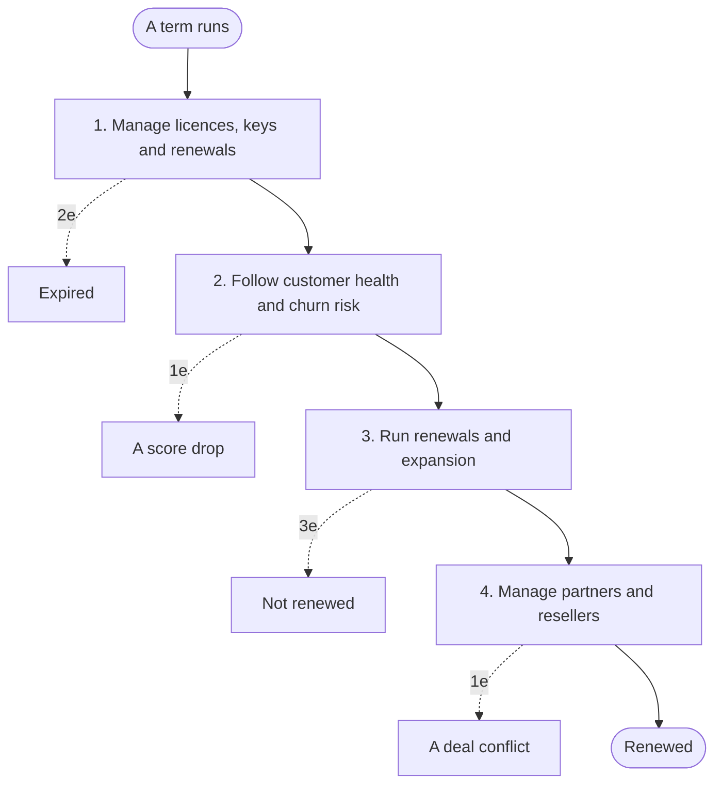

🏠 [Specs](../../../README.md) › 🏷️ [Sectors](../../README.md) › 💻 [SC14 IT and software](../README.md) ›
🔀 [Flows](README.md) › 🔀 FL-SC14-02 Licences and renewals

# 🔀 FL-SC14-02 Licences and renewals

**Status:** ✅ specified

## Summary

Licences, health, renewals and partners on the shared commissions. It covers
[UC-SC14-04 Manage licences, keys and renewals](../use-cases/02-licences-and-renewals/uc-sc14-04-manage-licences-keys-and-renewals.md),
[UC-SC14-09 Follow customer health and churn risk](../use-cases/02-licences-and-renewals/uc-sc14-09-follow-customer-health-and-churn-risk.md),
[UC-SC14-10 Run renewals and expansion](../use-cases/02-licences-and-renewals/uc-sc14-10-run-renewals-and-expansion.md),
[UC-SC14-19 Manage partners and resellers](../use-cases/02-licences-and-renewals/uc-sc14-19-manage-partners-and-resellers.md).

## Personas

- [U03 Sales](../../../01-users/personas/u03-sales.md)
- [U05 Accounting](../../../01-users/personas/u05-accounting.md)
- [U09 Customer](../../../01-users/personas/u09-customer.md)
- [U41 Customer success manager](../../../01-users/personas/u41-customer-success-manager.md)

## Flowchart

## Sequence diagram

See each use case.

## Steps

| Step | Persona | Screen | Use case | What happens |
|---|---|---|---|---|
| 1 | U41, U03 | [S-SC14-04](../screens/02-licences-and-renewals/s-sc14-04-licences.md) | [UC-SC14-04](../use-cases/02-licences-and-renewals/uc-sc14-04-manage-licences-keys-and-renewals.md) | The customer success manager issues licence keys, tracks terms and has renewals prepared before expiry |
| 2 | U41 | [S-SC14-09](../screens/02-licences-and-renewals/s-sc14-09-health.md) | [UC-SC14-09](../use-cases/02-licences-and-renewals/uc-sc14-09-follow-customer-health-and-churn-risk.md) | The customer success manager reviews health scores from usage, tickets, payments and surveys, acts on risks and records outcomes |
| 3 | U41, U03, U09 | [S-SC14-10](../screens/02-licences-and-renewals/s-sc14-10-renewals.md) | [UC-SC14-10](../use-cases/02-licences-and-renewals/uc-sc14-10-run-renewals-and-expansion.md) | The customer success manager opens the renewal, sales quotes and closes it with any upsell |
| 4 | U03, U05 | [S-SC14-19](../screens/02-licences-and-renewals/s-sc14-19-partners.md) | [UC-SC14-19](../use-cases/02-licences-and-renewals/uc-sc14-19-manage-partners-and-resellers.md) | Sales registers partners' deals, accounting bills them and pays commissions on collection through the shared commissions capability |

### Entities and screens

| Entity | States in this flow | Shown at step and screen | Aggregated view |
|---|---|---|---|
| [E-SC14-04 Software licence](../data/e-sc14-04-software-licence.md) | Active | 1 [S-SC14-04](../screens/02-licences-and-renewals/s-sc14-04-licences.md) | Software licences |
| [E-SC14-09 Health score](../data/e-sc14-09-health-score.md) | Recorded | 2 [S-SC14-09](../screens/02-licences-and-renewals/s-sc14-09-health.md); 3 [S-SC14-10](../screens/02-licences-and-renewals/s-sc14-10-renewals.md) | Health scores |
| [E-SC14-15 Partner deal](../data/e-sc14-15-partner-deal.md) | Active | 4 [S-SC14-19](../screens/02-licences-and-renewals/s-sc14-19-partners.md) | Partner deals |

## Errors

- [UC-SC14-04](../use-cases/02-licences-and-renewals/uc-sc14-04-manage-licences-keys-and-renewals.md) 2e. Expired: the
  key is disabled.
- [UC-SC14-04](../use-cases/02-licences-and-renewals/uc-sc14-04-manage-licences-keys-and-renewals.md) 1e. A key already
  issued: it is refused.
- [UC-SC14-09](../use-cases/02-licences-and-renewals/uc-sc14-09-follow-customer-health-and-churn-risk.md) 1e. A score
  drop: the manager is alerted.
- [UC-SC14-09](../use-cases/02-licences-and-renewals/uc-sc14-09-follow-customer-health-and-churn-risk.md) 1f. Data
  missing: the score says it is partial.
- [UC-SC14-10](../use-cases/02-licences-and-renewals/uc-sc14-10-run-renewals-and-expansion.md) 3e. Not renewed: churn is
  recorded with its reason.
- [UC-SC14-10](../use-cases/02-licences-and-renewals/uc-sc14-10-run-renewals-and-expansion.md) 2e. A discount over the
  limit: approval is needed,
  [BR-F6-04](../../../02-functional/f06-customers-and-sales/business-rules/br-f06-04-large-discounts-need-approval.md).
- [UC-SC14-19](../use-cases/02-licences-and-renewals/uc-sc14-19-manage-partners-and-resellers.md) 1e. A deal conflict:
  sales decides.
- [UC-SC14-19](../use-cases/02-licences-and-renewals/uc-sc14-19-manage-partners-and-resellers.md) 3e. The invoice
  unpaid: no commission yet.

## Images

Every step and error, for each persona taking part, in light and dark mode (D120). Steps are numbered as in the Steps
table; E rows are the error cases.

| Step | Persona | Device | Light | Dark |
|---|---|---|---|---|
| 1 | U41 | desktop | [light](../images/02-licences-and-renewals/u41-customer-success-manager/1-licences-desktop-light.png) | [dark](../images/02-licences-and-renewals/u41-customer-success-manager/1-licences-desktop-dark.png) |
| 1 | U41 | phone | [light](../images/02-licences-and-renewals/u41-customer-success-manager/1-licences-phone-light.png) | [dark](../images/02-licences-and-renewals/u41-customer-success-manager/1-licences-phone-dark.png) |
| 1 | U03 | desktop | [light](../images/02-licences-and-renewals/u03-sales/1-licences-desktop-light.png) | [dark](../images/02-licences-and-renewals/u03-sales/1-licences-desktop-dark.png) |
| 1 | U03 | phone | [light](../images/02-licences-and-renewals/u03-sales/1-licences-phone-light.png) | [dark](../images/02-licences-and-renewals/u03-sales/1-licences-phone-dark.png) |
| 1 | U03 | tablet | [light](../images/02-licences-and-renewals/u03-sales/1-licences-tablet-light.png) | [dark](../images/02-licences-and-renewals/u03-sales/1-licences-tablet-dark.png) |
| 2 | U41 | desktop | [light](../images/02-licences-and-renewals/u41-customer-success-manager/2-health-desktop-light.png) | [dark](../images/02-licences-and-renewals/u41-customer-success-manager/2-health-desktop-dark.png) |
| 2 | U41 | phone | [light](../images/02-licences-and-renewals/u41-customer-success-manager/2-health-phone-light.png) | [dark](../images/02-licences-and-renewals/u41-customer-success-manager/2-health-phone-dark.png) |
| 3 | U41 | desktop | [light](../images/02-licences-and-renewals/u41-customer-success-manager/3-renewal-desktop-light.png) | [dark](../images/02-licences-and-renewals/u41-customer-success-manager/3-renewal-desktop-dark.png) |
| 3 | U41 | phone | [light](../images/02-licences-and-renewals/u41-customer-success-manager/3-renewal-phone-light.png) | [dark](../images/02-licences-and-renewals/u41-customer-success-manager/3-renewal-phone-dark.png) |
| 3 | U03 | desktop | [light](../images/02-licences-and-renewals/u03-sales/3-renewal-desktop-light.png) | [dark](../images/02-licences-and-renewals/u03-sales/3-renewal-desktop-dark.png) |
| 3 | U03 | phone | [light](../images/02-licences-and-renewals/u03-sales/3-renewal-phone-light.png) | [dark](../images/02-licences-and-renewals/u03-sales/3-renewal-phone-dark.png) |
| 3 | U03 | tablet | [light](../images/02-licences-and-renewals/u03-sales/3-renewal-tablet-light.png) | [dark](../images/02-licences-and-renewals/u03-sales/3-renewal-tablet-dark.png) |
| 3 | U09 | phone | [light](../images/02-licences-and-renewals/u09-customer/3-renewal-phone-light.png) | [dark](../images/02-licences-and-renewals/u09-customer/3-renewal-phone-dark.png) |
| 4 | U03 | desktop | [light](../images/02-licences-and-renewals/u03-sales/4-partners-desktop-light.png) | [dark](../images/02-licences-and-renewals/u03-sales/4-partners-desktop-dark.png) |
| 4 | U03 | phone | [light](../images/02-licences-and-renewals/u03-sales/4-partners-phone-light.png) | [dark](../images/02-licences-and-renewals/u03-sales/4-partners-phone-dark.png) |
| 4 | U03 | tablet | [light](../images/02-licences-and-renewals/u03-sales/4-partners-tablet-light.png) | [dark](../images/02-licences-and-renewals/u03-sales/4-partners-tablet-dark.png) |
| 4 | U05 | desktop | [light](../images/02-licences-and-renewals/u05-accounting/4-partners-desktop-light.png) | [dark](../images/02-licences-and-renewals/u05-accounting/4-partners-desktop-dark.png) |
| E1 | U09 | phone | [light](../images/02-licences-and-renewals/u09-customer/e1-key-expired-phone-light.png) | [dark](../images/02-licences-and-renewals/u09-customer/e1-key-expired-phone-dark.png) |

## Open questions

None.

---

⬅️ [FL-SC14-01 Subscriptions and billing](fl-sc14-01-subscriptions-and-billing.md) · ⬆️ [Up](README.md) ·
➡️ [FL-SC14-03 Support and services](fl-sc14-03-support-and-services.md)
