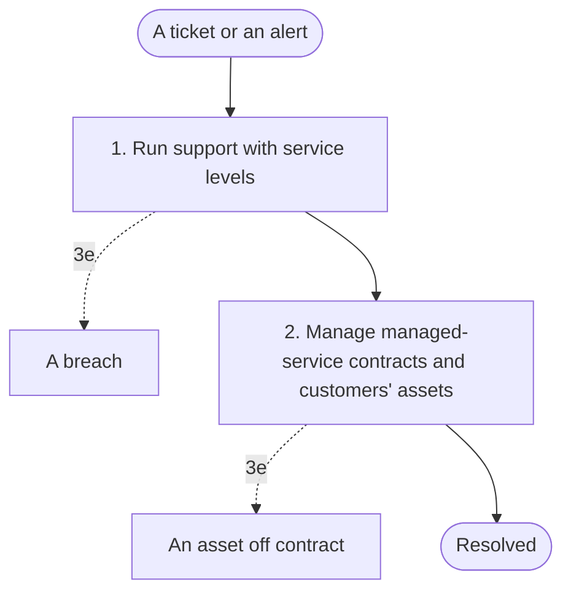

🏠 [Specs](../../../README.md) › 🏷️ [Sectors](../../README.md) › 💻 [SC14 IT and software](../README.md) ›
🔀 [Flows](README.md) › 🔀 FL-SC14-03 Support and services

# 🔀 FL-SC14-03 Support and services

**Status:** ✅ specified

## Summary

Support with service levels and managed services. It covers
[UC-SC14-05 Run support with service levels](../use-cases/03-support-and-services/uc-sc14-05-run-support-with-service-levels.md),
[UC-SC14-06 Manage managed-service contracts and customers' assets](../use-cases/03-support-and-services/uc-sc14-06-manage-managed-service-contracts-and-customers-assets.md).

## Personas

- [U09 Customer](../../../01-users/personas/u09-customer.md)
- [U16 Office worker](../../../01-users/personas/u16-office-worker.md)
- [U41 Customer success manager](../../../01-users/personas/u41-customer-success-manager.md)

## Flowchart

## Sequence diagram

See each use case.

## Steps

| Step | Persona | Screen | Use case | What happens |
|---|---|---|---|---|
| 1 | U09, U41 | [S-SC14-05](../screens/03-support-and-services/s-sc14-05-support-levels.md) | [UC-SC14-05](../use-cases/03-support-and-services/uc-sc14-05-run-support-with-service-levels.md) | Customers open tickets, support answers and resolves within the customer's service level, measured by F16, breaches propose credits |
| 2 | U16, U41 | [S-SC14-06](../screens/03-support-and-services/s-sc14-06-managed-services.md) | [UC-SC14-06](../use-cases/03-support-and-services/uc-sc14-06-manage-managed-service-contracts-and-customers-assets.md) | An office worker records customers' assets under contract, monitors them through connectors and acts on alerts |

### Entities and screens

| Entity | States in this flow | Shown at step and screen | Aggregated view |
|---|---|---|---|
| [E-F16-01 Customer request](../../../02-functional/f16-customer-support-agents/data/e-f16-01-customer-request.md) | Resolved | Shown elsewhere: [S-F16-11 My requests](../../../02-functional/f16-customer-support-agents/screens/05-customer-side/s-f16-11-my-requests.md) | Customer requests |
| [E-SC14-05 Service level](../data/e-sc14-05-service-level.md) | Active | 1 [S-SC14-05](../screens/03-support-and-services/s-sc14-05-support-levels.md) | Service levels |
| [E-F6-07 Subscription contract](../../../02-functional/f06-customers-and-sales/data/e-f06-07-subscription-contract.md) | Active | Shown elsewhere: [S-F6-09 Subscriptions](../../../02-functional/f06-customers-and-sales/screens/04-subscriptions/s-f06-09-subscriptions.md) | Subscription contracts |
| [E-SC14-06 Managed asset](../data/e-sc14-06-managed-asset.md) | Active | 2 [S-SC14-06](../screens/03-support-and-services/s-sc14-06-managed-services.md) | Managed assets |

## Errors

- [UC-SC14-05](../use-cases/03-support-and-services/uc-sc14-05-run-support-with-service-levels.md) 3e. A breach: a
  credit is proposed.
- [UC-SC14-05](../use-cases/03-support-and-services/uc-sc14-05-run-support-with-service-levels.md) 1e. No contract:
  standard levels apply.
- [UC-SC14-06](../use-cases/03-support-and-services/uc-sc14-06-manage-managed-service-contracts-and-customers-assets.md)
  3e. An asset off contract: it is flagged.
- [UC-SC14-06](../use-cases/03-support-and-services/uc-sc14-06-manage-managed-service-contracts-and-customers-assets.md)
  2e. Monitoring down: the gap is shown.

## Images

Every step and error, for each persona taking part, in light and dark mode (D120). Steps are numbered as in the Steps
table; E rows are the error cases.

| Step | Persona | Device | Light | Dark |
|---|---|---|---|---|
| 1 | U41 | desktop | [light](../images/03-support-and-services/u41-customer-success-manager/1-service-levels-desktop-light.png) | [dark](../images/03-support-and-services/u41-customer-success-manager/1-service-levels-desktop-dark.png) |
| 1 | U41 | phone | [light](../images/03-support-and-services/u41-customer-success-manager/1-service-levels-phone-light.png) | [dark](../images/03-support-and-services/u41-customer-success-manager/1-service-levels-phone-dark.png) |
| 1 | U09 | phone | [light](../images/03-support-and-services/u09-customer/1-service-levels-phone-light.png) | [dark](../images/03-support-and-services/u09-customer/1-service-levels-phone-dark.png) |
| 2 | U16 | desktop | [light](../images/03-support-and-services/u16-office-worker/2-managed-desktop-light.png) | [dark](../images/03-support-and-services/u16-office-worker/2-managed-desktop-dark.png) |
| 2 | U16 | phone | [light](../images/03-support-and-services/u16-office-worker/2-managed-phone-light.png) | [dark](../images/03-support-and-services/u16-office-worker/2-managed-phone-dark.png) |
| 2 | U41 | desktop | [light](../images/03-support-and-services/u41-customer-success-manager/2-managed-desktop-light.png) | [dark](../images/03-support-and-services/u41-customer-success-manager/2-managed-desktop-dark.png) |
| 2 | U41 | phone | [light](../images/03-support-and-services/u41-customer-success-manager/2-managed-phone-light.png) | [dark](../images/03-support-and-services/u41-customer-success-manager/2-managed-phone-dark.png) |
| E1 | U41 | desktop | [light](../images/03-support-and-services/u41-customer-success-manager/e1-breach-desktop-light.png) | [dark](../images/03-support-and-services/u41-customer-success-manager/e1-breach-desktop-dark.png) |
| E1 | U41 | phone | [light](../images/03-support-and-services/u41-customer-success-manager/e1-breach-phone-light.png) | [dark](../images/03-support-and-services/u41-customer-success-manager/e1-breach-phone-dark.png) |

## Open questions

None.

---

⬅️ [FL-SC14-02 Licences and renewals](fl-sc14-02-licences-and-renewals.md) · ⬆️ [Up](README.md) ·
➡️ [FL-SC14-04 Product delivery](fl-sc14-04-product-delivery.md)
