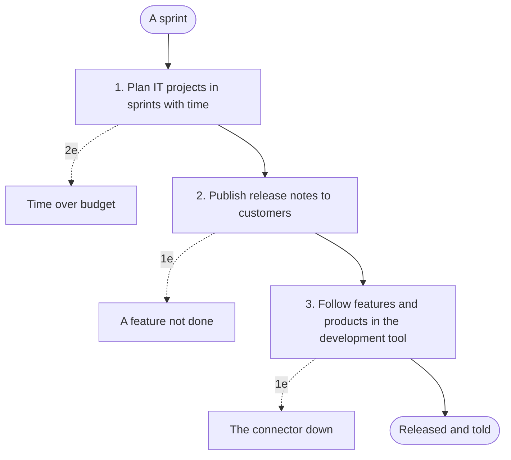

🏠 [Specs](../../../README.md) › 🏷️ [Sectors](../../README.md) › 💻 [SC14 IT and software](../README.md) ›
🔀 [Flows](README.md) › 🔀 FL-SC14-04 Product delivery

# 🔀 FL-SC14-04 Product delivery

**Status:** ✅ specified

## Summary

Delivery: sprints, release notes and the development tool. It covers
[UC-SC14-07 Plan IT projects in sprints with time](../use-cases/04-product-delivery/uc-sc14-07-plan-it-projects-in-sprints-with-time.md),
[UC-SC14-08 Publish release notes to customers](../use-cases/04-product-delivery/uc-sc14-08-publish-release-notes-to-customers.md),
[UC-SC14-21 Follow features and products in the development tool](../use-cases/04-product-delivery/uc-sc14-21-follow-features-and-products-in-the-development-tool.md).

## Personas

- [U16 Office worker](../../../01-users/personas/u16-office-worker.md)
- [U24 Engagement manager](../../../01-users/personas/u24-engagement-manager.md)
- [U41 Customer success manager](../../../01-users/personas/u41-customer-success-manager.md)

## Flowchart

## Sequence diagram

See each use case.

## Steps

| Step | Persona | Screen | Use case | What happens |
|---|---|---|---|---|
| 1 | U16, U24 | [S-SC14-07](../screens/04-product-delivery/s-sc14-07-sprints.md) | [UC-SC14-07](../use-cases/04-product-delivery/uc-sc14-07-plan-it-projects-in-sprints-with-time.md) | The engagement manager plans sprints, the team works and records time, the sprint is reviewed |
| 2 | U16, U41 | [S-SC14-08](../screens/04-product-delivery/s-sc14-08-release-notes.md) | [UC-SC14-08](../use-cases/04-product-delivery/uc-sc14-08-publish-release-notes-to-customers.md) | An office worker drafts release notes from the features linked in the development tool, the customer success manager reviews and publishes them |
| 3 | U16, U41 | [S-SC14-21](../screens/04-product-delivery/s-sc14-21-features.md) | [UC-SC14-21](../use-cases/04-product-delivery/uc-sc14-21-follow-features-and-products-in-the-development-tool.md) | An office worker connects the development tool, links features to requests and tickets, follows progress and tells customers on release |

### Entities and screens

| Entity | States in this flow | Shown at step and screen | Aggregated view |
|---|---|---|---|
| [E-SC14-07 Sprint](../data/e-sc14-07-sprint.md) | Active | 1 [S-SC14-07](../screens/04-product-delivery/s-sc14-07-sprints.md) | Sprints |
| [E-F9-18 Project and task](../../../02-functional/f09-hr-and-projects/data/e-f09-18-project-and-task.md) | Done | Shown elsewhere: [S-F9-17 Projects](../../../02-functional/f09-hr-and-projects/screens/06-plan-and-deliver-work/s-f09-17-projects.md) | Project and tasks |
| [E-F9-17 Timesheet line](../../../02-functional/f09-hr-and-projects/data/e-f09-17-timesheet-line.md) | Draft | Shown elsewhere: [S-F9-16 Timesheets](../../../02-functional/f09-hr-and-projects/screens/03-time/s-f09-16-timesheets.md) | Timesheet lines |
| [E-F8-08 Accounting budget](../../../02-functional/f08-accounting/data/e-f08-08-accounting-budget.md) | Active | Shown elsewhere: [S-F8-09 Analytics and budgets](../../../02-functional/f08-accounting/screens/04-tax-assets-and-analytics/s-f08-09-analytics-and-budgets.md) | Accounting budgets |
| [E-SC14-08 Software release note](../data/e-sc14-08-software-release-note.md) | Recorded | 2 [S-SC14-08](../screens/04-product-delivery/s-sc14-08-release-notes.md); 3 [S-SC14-21](../screens/04-product-delivery/s-sc14-21-features.md) | Software release notes |
| [E-SC14-16 Tracked feature](../data/e-sc14-16-tracked-feature.md) | In progress | 3 [S-SC14-21](../screens/04-product-delivery/s-sc14-21-features.md) | Tracked features |
| [E-F7-06 Item](../../../02-functional/f07-purchasing-and-stock/data/e-f07-06-item.md) | Active | Shown elsewhere: [S-F7-21 Stock levels](../../../02-functional/f07-purchasing-and-stock/screens/03-replenish/s-f07-21-stock-levels.md) | Items |
| [E-F24-02 Tool connection](../../../02-functional/f24-integrations-hub/data/e-f24-02-tool-connection.md) | Proposed, Active, Revoked | Shown elsewhere: [S-F21-10 Connections](../../../02-functional/f21-onboarding-and-modules/screens/03-team-and-data/s-f21-10-connections.md) | Tool connections |
| [E-F24-01 Connector](../../../02-functional/f24-integrations-hub/data/e-f24-01-connector.md) | Active | Shown elsewhere: [S-F24-01 Catalogue](../../../02-functional/f24-integrations-hub/screens/01-find-and-connect/s-f24-01-catalogue.md) | Connectors |

## Errors

- [UC-SC14-07](../use-cases/04-product-delivery/uc-sc14-07-plan-it-projects-in-sprints-with-time.md) 2e. Time over
  budget: the manager is alerted.
- [UC-SC14-07](../use-cases/04-product-delivery/uc-sc14-07-plan-it-projects-in-sprints-with-time.md) 1e. Nobody free:
  capacity is shown,
  [UC-F9-29](../../../02-functional/f09-hr-and-projects/use-cases/11-capacity-rounds-and-partners/uc-f09-29-plan-capacity-across-projects.md).
- [UC-SC14-08](../use-cases/04-product-delivery/uc-sc14-08-publish-release-notes-to-customers.md) 1e. A feature not
  done: it is left out.
- [UC-SC14-08](../use-cases/04-product-delivery/uc-sc14-08-publish-release-notes-to-customers.md) 3e. The website down:
  publication is retried.
- [UC-SC14-21](../use-cases/04-product-delivery/uc-sc14-21-follow-features-and-products-in-the-development-tool.md) 1e.
  The connector down: it is shown and the last sync kept.
- [UC-SC14-21](../use-cases/04-product-delivery/uc-sc14-21-follow-features-and-products-in-the-development-tool.md) 2e.
  A feature deleted: the link is closed.

## Images

Every step and error, for each persona taking part, in light and dark mode (D120). Steps are numbered as in the Steps
table; E rows are the error cases.

| Step | Persona | Device | Light | Dark |
|---|---|---|---|---|
| 1 | U16 | desktop | [light](../images/04-product-delivery/u16-office-worker/1-sprint-desktop-light.png) | [dark](../images/04-product-delivery/u16-office-worker/1-sprint-desktop-dark.png) |
| 1 | U16 | phone | [light](../images/04-product-delivery/u16-office-worker/1-sprint-phone-light.png) | [dark](../images/04-product-delivery/u16-office-worker/1-sprint-phone-dark.png) |
| 1 | U24 | desktop | [light](../images/04-product-delivery/u24-engagement-manager/1-sprint-desktop-light.png) | [dark](../images/04-product-delivery/u24-engagement-manager/1-sprint-desktop-dark.png) |
| 1 | U24 | phone | [light](../images/04-product-delivery/u24-engagement-manager/1-sprint-phone-light.png) | [dark](../images/04-product-delivery/u24-engagement-manager/1-sprint-phone-dark.png) |
| 2 | U16 | desktop | [light](../images/04-product-delivery/u16-office-worker/2-release-notes-desktop-light.png) | [dark](../images/04-product-delivery/u16-office-worker/2-release-notes-desktop-dark.png) |
| 2 | U16 | phone | [light](../images/04-product-delivery/u16-office-worker/2-release-notes-phone-light.png) | [dark](../images/04-product-delivery/u16-office-worker/2-release-notes-phone-dark.png) |
| 2 | U41 | desktop | [light](../images/04-product-delivery/u41-customer-success-manager/2-release-notes-desktop-light.png) | [dark](../images/04-product-delivery/u41-customer-success-manager/2-release-notes-desktop-dark.png) |
| 2 | U41 | phone | [light](../images/04-product-delivery/u41-customer-success-manager/2-release-notes-phone-light.png) | [dark](../images/04-product-delivery/u41-customer-success-manager/2-release-notes-phone-dark.png) |
| 3 | U41 | desktop | [light](../images/04-product-delivery/u41-customer-success-manager/3-features-desktop-light.png) | [dark](../images/04-product-delivery/u41-customer-success-manager/3-features-desktop-dark.png) |
| 3 | U41 | phone | [light](../images/04-product-delivery/u41-customer-success-manager/3-features-phone-light.png) | [dark](../images/04-product-delivery/u41-customer-success-manager/3-features-phone-dark.png) |
| 3 | U16 | desktop | [light](../images/04-product-delivery/u16-office-worker/3-features-desktop-light.png) | [dark](../images/04-product-delivery/u16-office-worker/3-features-desktop-dark.png) |
| 3 | U16 | phone | [light](../images/04-product-delivery/u16-office-worker/3-features-phone-light.png) | [dark](../images/04-product-delivery/u16-office-worker/3-features-phone-dark.png) |
| E1 | U41 | desktop | [light](../images/04-product-delivery/u41-customer-success-manager/e1-connector-down-desktop-light.png) | [dark](../images/04-product-delivery/u41-customer-success-manager/e1-connector-down-desktop-dark.png) |
| E1 | U41 | phone | [light](../images/04-product-delivery/u41-customer-success-manager/e1-connector-down-phone-light.png) | [dark](../images/04-product-delivery/u41-customer-success-manager/e1-connector-down-phone-dark.png) |

## Open questions

None.

---

⬅️ [FL-SC14-03 Support and services](fl-sc14-03-support-and-services.md) · ⬆️ [Up](README.md) ·
➡️ [FL-SC14-05 Security and data compliance](fl-sc14-05-security-and-data-compliance.md)
