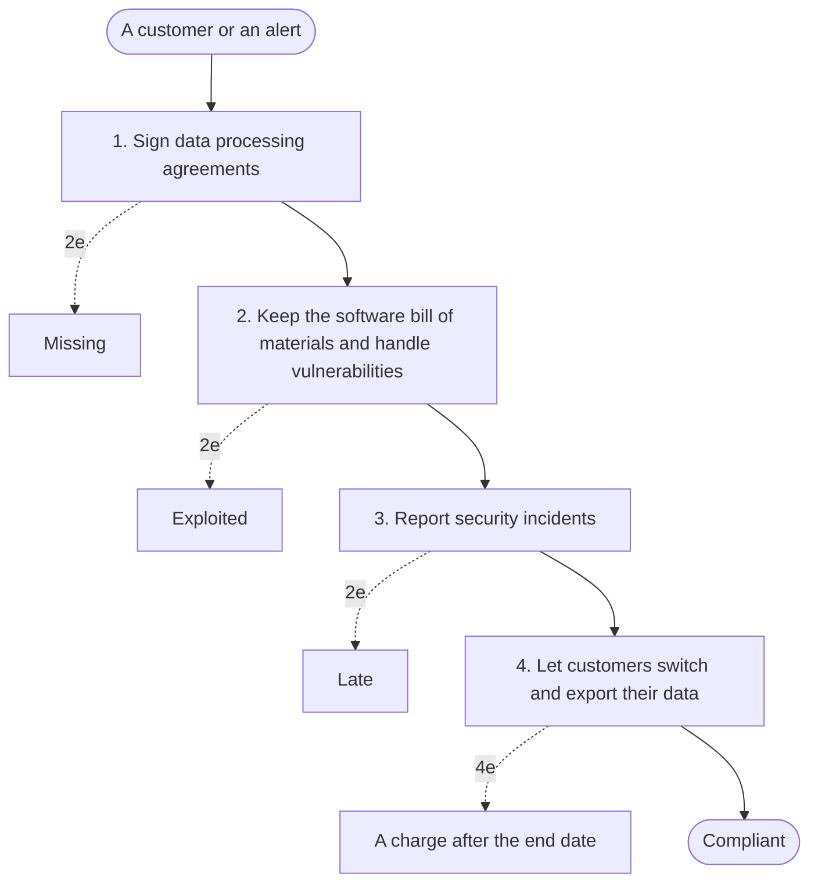

🏠 [Specs](../../../README.md) › 🏷️ [Sectors](../../README.md) › 💻 [SC14 IT and software](../README.md) ›
🔀 [Flows](README.md) › 🔀 FL-SC14-05 Security and data compliance

# 🔀 FL-SC14-05 Security and data compliance

**Status:** ✅ specified

## Summary

Security and data: agreements, vulnerabilities, incidents and exports. It covers
[UC-SC14-11 Sign data processing agreements](../use-cases/05-security-and-data-compliance/uc-sc14-11-sign-data-processing-agreements.md),
[UC-SC14-12 Keep the software bill of materials and handle vulnerabilities](../use-cases/05-security-and-data-compliance/uc-sc14-12-keep-the-software-bill-of-materials-and-handle-vulnerabilities.md),
[UC-SC14-13 Report security incidents](../use-cases/05-security-and-data-compliance/uc-sc14-13-report-security-incidents.md),
[UC-SC14-14 Let customers switch and export their data](../use-cases/05-security-and-data-compliance/uc-sc14-14-let-customers-switch-and-export-their-data.md).

## Personas

- [U07 Administrator](../../../01-users/personas/u07-administrator.md)
- [U09 Customer](../../../01-users/personas/u09-customer.md)
- [U13 Owner](../../../01-users/personas/u13-owner.md)
- [U16 Office worker](../../../01-users/personas/u16-office-worker.md)

## Flowchart

## Sequence diagram

See each use case.

## Steps

| Step | Persona | Screen | Use case | What happens |
|---|---|---|---|---|
| 1 | U07, U09 | [S-SC14-11](../screens/05-security-and-data-compliance/s-sc14-11-processor-agreements.md) | [UC-SC14-11](../use-cases/05-security-and-data-compliance/uc-sc14-11-sign-data-processing-agreements.md) | The administrator sends the processor agreement, the customer signs, it is kept with the contract |
| 2 | U16 | [S-SC14-12](../screens/05-security-and-data-compliance/s-sc14-12-vulnerabilities.md) | [UC-SC14-12](../use-cases/05-security-and-data-compliance/uc-sc14-12-keep-the-software-bill-of-materials-and-handle-vulnerabilities.md) | An office worker imports each release's bill of materials, matches vulnerabilities, fixes and notifies, exploited ones start the reporting clock |
| 3 | U07, U13 | [S-SC14-13](../screens/05-security-and-data-compliance/s-sc14-13-incident-reports.md) | [UC-SC14-13](../use-cases/05-security-and-data-compliance/uc-sc14-13-report-security-incidents.md) | The administrator assesses an incident or exploited vulnerability, sends the early warning, notifies and reports, the owner approves |
| 4 | U09, U07 | [S-SC14-14](../screens/05-security-and-data-compliance/s-sc14-14-data-export.md) | [UC-SC14-14](../use-cases/05-security-and-data-compliance/uc-sc14-14-let-customers-switch-and-export-their-data.md) | A customer requests an export, it is produced in a common format, the account is closed without switching charges after the legal date |

### Entities and screens

| Entity | States in this flow | Shown at step and screen | Aggregated view |
|---|---|---|---|
| [E-SC14-10 Processor agreement](../data/e-sc14-10-processor-agreement.md) | Sent, Signed | 1 [S-SC14-11](../screens/05-security-and-data-compliance/s-sc14-11-processor-agreements.md) | Processor agreements |
| [E-F14-14 Software bill of materials](../../../02-functional/f14-plugin-store/data/e-f14-14-software-bill-of-materials.md) | Generated, Checked, Published, Rescanned | Shown elsewhere: [S-F14-21 Dependency report](../../../02-functional/f14-plugin-store/screens/03-publish/s-f14-21-dependency-report.md) | Software bill of materials |
| [E-SC14-11 Component](../data/e-sc14-11-component.md) | Active | 2 [S-SC14-12](../screens/05-security-and-data-compliance/s-sc14-12-vulnerabilities.md) | Components |
| [E-SC14-12 Security report](../data/e-sc14-12-security-report.md) | Active | 3 [S-SC14-13](../screens/05-security-and-data-compliance/s-sc14-13-incident-reports.md) | Security reports |
| [E-SC14-13 Data export](../data/e-sc14-13-data-export.md) | Active | 4 [S-SC14-14](../screens/05-security-and-data-compliance/s-sc14-14-data-export.md) | Data exports |
| [E-F12-01 Bill of materials](../../../02-functional/f12-manufacturing/data/e-f12-01-bill-of-materials.md) | Draft, Approved, Retired | Shown elsewhere: [S-F12-01 Bill of materials](../../../02-functional/f12-manufacturing/screens/01-define-the-products/s-f12-01-bill-of-materials.md) | Bill of materials |
| [E-F16-01 Customer request](../../../02-functional/f16-customer-support-agents/data/e-f16-01-customer-request.md) | New, In progress, Resolved, Waiting, Escalated | Shown elsewhere: [S-F16-11 My requests](../../../02-functional/f16-customer-support-agents/screens/05-customer-side/s-f16-11-my-requests.md) | Customer requests |

## Errors

- [UC-SC14-11](../use-cases/05-security-and-data-compliance/uc-sc14-11-sign-data-processing-agreements.md) 2e. Missing:
  onboarding is blocked ([BR-SC14-06](../business-rules/br-sc14-06-processor-agreement-per-customer.md)).
- [UC-SC14-11](../use-cases/05-security-and-data-compliance/uc-sc14-11-sign-data-processing-agreements.md) 4e. A version
  refused: the old one stays.
-
  [UC-SC14-12](../use-cases/05-security-and-data-compliance/uc-sc14-12-keep-the-software-bill-of-materials-and-handle-vulnerabilities.md)
  2e. Exploited: the reporting clock starts,
  [BR-SC14-07](../business-rules/br-sc14-07-vulnerabilities-reported-in-time.md),
  [UC-SC14-13](../use-cases/05-security-and-data-compliance/uc-sc14-13-report-security-incidents.md).
-
  [UC-SC14-12](../use-cases/05-security-and-data-compliance/uc-sc14-12-keep-the-software-bill-of-materials-and-handle-vulnerabilities.md)
  1e. A bill of materials missing: the release is flagged.
- [UC-SC14-13](../use-cases/05-security-and-data-compliance/uc-sc14-13-report-security-incidents.md) 2e. Late: the owner
  is alerted.
- [UC-SC14-13](../use-cases/05-security-and-data-compliance/uc-sc14-13-report-security-incidents.md) 1e. Not
  significant: the assessment is kept.
- [UC-SC14-14](../use-cases/05-security-and-data-compliance/uc-sc14-14-let-customers-switch-and-export-their-data.md)
  4e. A charge after the end date: it is refused.
- [UC-SC14-14](../use-cases/05-security-and-data-compliance/uc-sc14-14-let-customers-switch-and-export-their-data.md)
  2e. A large export: it runs in the background.

## Images

Every step and error, for each persona taking part, in light and dark mode (D120). Steps are numbered as in the Steps
table; E rows are the error cases.

| Step | Persona | Device | Light | Dark |
|---|---|---|---|---|
| 1 | U07 | desktop | [light](../images/05-security-and-data-compliance/u07-administrator/1-processor-agreement-desktop-light.png) | [dark](../images/05-security-and-data-compliance/u07-administrator/1-processor-agreement-desktop-dark.png) |
| 1 | U09 | phone | [light](../images/05-security-and-data-compliance/u09-customer/1-processor-agreement-phone-light.png) | [dark](../images/05-security-and-data-compliance/u09-customer/1-processor-agreement-phone-dark.png) |
| 2 | U16 | desktop | [light](../images/05-security-and-data-compliance/u16-office-worker/2-vulnerabilities-desktop-light.png) | [dark](../images/05-security-and-data-compliance/u16-office-worker/2-vulnerabilities-desktop-dark.png) |
| 2 | U16 | phone | [light](../images/05-security-and-data-compliance/u16-office-worker/2-vulnerabilities-phone-light.png) | [dark](../images/05-security-and-data-compliance/u16-office-worker/2-vulnerabilities-phone-dark.png) |
| 3 | U07 | desktop | [light](../images/05-security-and-data-compliance/u07-administrator/3-incident-report-desktop-light.png) | [dark](../images/05-security-and-data-compliance/u07-administrator/3-incident-report-desktop-dark.png) |
| 3 | U13 | desktop | [light](../images/05-security-and-data-compliance/u13-owner/3-incident-report-desktop-light.png) | [dark](../images/05-security-and-data-compliance/u13-owner/3-incident-report-desktop-dark.png) |
| 3 | U13 | phone | [light](../images/05-security-and-data-compliance/u13-owner/3-incident-report-phone-light.png) | [dark](../images/05-security-and-data-compliance/u13-owner/3-incident-report-phone-dark.png) |
| 4 | U09 | phone | [light](../images/05-security-and-data-compliance/u09-customer/4-export-phone-light.png) | [dark](../images/05-security-and-data-compliance/u09-customer/4-export-phone-dark.png) |
| 4 | U07 | desktop | [light](../images/05-security-and-data-compliance/u07-administrator/4-export-desktop-light.png) | [dark](../images/05-security-and-data-compliance/u07-administrator/4-export-desktop-dark.png) |
| E1 | U07 | desktop | [light](../images/05-security-and-data-compliance/u07-administrator/e1-no-agreement-desktop-light.png) | [dark](../images/05-security-and-data-compliance/u07-administrator/e1-no-agreement-desktop-dark.png) |

## Open questions

None.

---

⬅️ [FL-SC14-04 Product delivery](fl-sc14-04-product-delivery.md) · ⬆️ [Up](README.md) ·
➡️ [FL-SC14-06 Portal and metrics](fl-sc14-06-portal-and-metrics.md)
