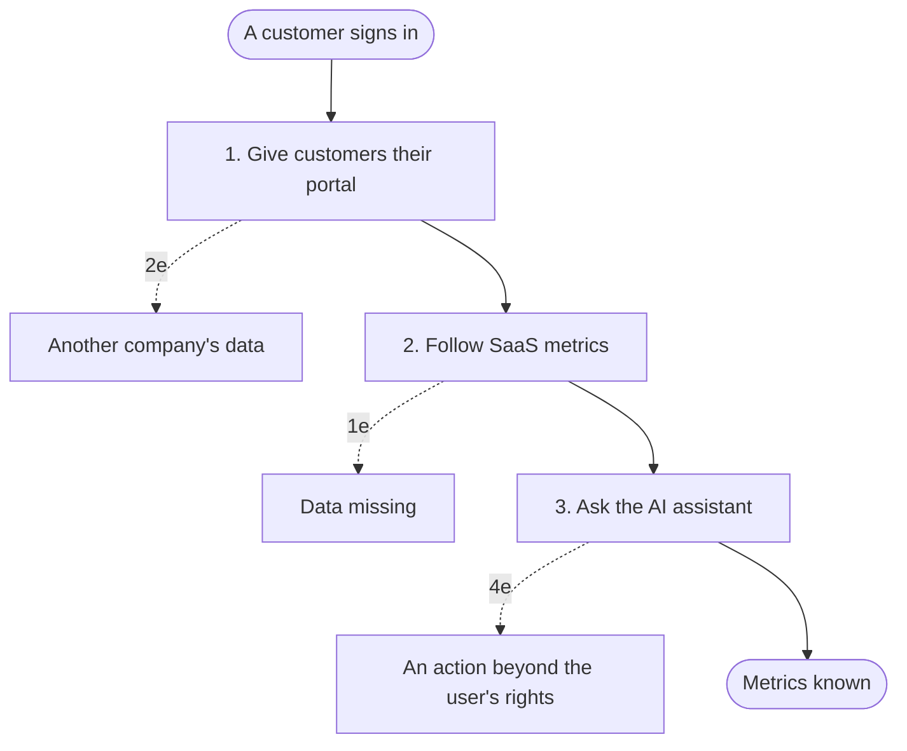

🏠 [Specs](../../../README.md) › 🏷️ [Sectors](../../README.md) › 💻 [SC14 IT and software](../README.md) ›
🔀 [Flows](README.md) › 🔀 FL-SC14-06 Portal and metrics

# 🔀 FL-SC14-06 Portal and metrics

**Status:** ✅ specified

## Summary

The customer portal, metrics and the AI assistant. It covers
[UC-SC14-17 Give customers their portal](../use-cases/06-portal-and-metrics/uc-sc14-17-give-customers-their-portal.md),
[UC-SC14-18 Follow SaaS metrics](../use-cases/06-portal-and-metrics/uc-sc14-18-follow-saas-metrics.md),
[UC-SC14-20 Ask the AI assistant](../use-cases/06-portal-and-metrics/uc-sc14-20-ask-the-assistant.md).

## Personas

- [U09 Customer](../../../01-users/personas/u09-customer.md)
- [U13 Owner](../../../01-users/personas/u13-owner.md)
- [U16 Office worker](../../../01-users/personas/u16-office-worker.md)
- [U41 Customer success manager](../../../01-users/personas/u41-customer-success-manager.md)

## Flowchart

## Sequence diagram

See each use case.

## Steps

| Step | Persona | Screen | Use case | What happens |
|---|---|---|---|---|
| 1 | U09 | [S-SC14-17](../screens/06-portal-and-metrics/s-sc14-17-customer-portal.md) | [UC-SC14-17](../use-cases/06-portal-and-metrics/uc-sc14-17-give-customers-their-portal.md) | Customers sign in to see and change subscriptions, invoices, usage, tickets and exports |
| 2 | U13, U41 | [S-SC14-18](../screens/06-portal-and-metrics/s-sc14-18-saas-metrics.md) | [UC-SC14-18](../use-cases/06-portal-and-metrics/uc-sc14-18-follow-saas-metrics.md) | The owner and the customer success manager follow recurring revenue, churn and net retention, compare and export |
| 3 | U41, U16 | [S-SC14-20](../screens/06-portal-and-metrics/s-sc14-20-software-assistant.md) | [UC-SC14-20](../use-cases/06-portal-and-metrics/uc-sc14-20-ask-the-assistant.md) | The customer success manager or an office worker asks the AI assistant about accounts at risk, a customer's usage or features awaited, within their role's rights |

### Entities and screens

| Entity | States in this flow | Shown at step and screen | Aggregated view |
|---|---|---|---|
| [E-F1-17 Portal account](../../../02-functional/f01-administration/data/e-f01-17-portal-account.md) | Invited, Active, Blocked, Deactivated | Shown elsewhere: [S-F1-19 Portal accounts](../../../02-functional/f01-administration/screens/12-portal-accounts-and-integrations/s-f01-19-portal-accounts.md) | Portal accounts |
| [E-F1-01 Company](../../../02-functional/f01-administration/data/e-f01-01-company.md) | In setup, Active | Shown elsewhere: [S-F1-10 Client companies](../../../02-functional/f01-administration/screens/08-provider-and-client-companies/s-f01-10-client-companies.md) | Companies |
| [E-F3-04 Assistant change batch](../../../02-functional/f03-assistant/data/e-f03-04-assistant-change-batch.md) | Proposed, Cancelled, Done, Partly done, Undone | Shown elsewhere: [S-F3-01 Assistant panel](../../../02-functional/f03-assistant/screens/01-ask-the-assistant/s-f03-01-assistant-panel.md) | Assistant change batches |
| [E-F1-03 User](../../../02-functional/f01-administration/data/e-f01-03-user.md) | Invited, Active, Deactivated | Shown elsewhere: [S-F1-03 Users](../../../02-functional/f01-administration/screens/03-user-lifecycle/s-f01-03-users.md) | Users |
| [E-F1-06 Role](../../../02-functional/f01-administration/data/e-f01-06-role.md) | Active | Shown elsewhere: [S-F1-06 Role editor](../../../02-functional/f01-administration/screens/04-edit-a-role/s-f01-06-role-editor.md) | Roles |

## Errors

- [UC-SC14-17](../use-cases/06-portal-and-metrics/uc-sc14-17-give-customers-their-portal.md) 2e. Another company's data:
  it is never shown,
  [BR-F6-03](../../../02-functional/f06-customers-and-sales/business-rules/br-f06-03-portal-shows-only-the-customer-s-own.md).
- [UC-SC14-17](../use-cases/06-portal-and-metrics/uc-sc14-17-give-customers-their-portal.md) 4e. Payment refused: the
  invoice stays.
- [UC-SC14-18](../use-cases/06-portal-and-metrics/uc-sc14-18-follow-saas-metrics.md) 1e. Data missing: it is shown.
- [UC-SC14-18](../use-cases/06-portal-and-metrics/uc-sc14-18-follow-saas-metrics.md) 4e. A large export: it runs in the
  background.
- [UC-SC14-20](../use-cases/06-portal-and-metrics/uc-sc14-20-ask-the-assistant.md) 4e. An action beyond the user's
  rights: the AI assistant refuses.
- [UC-SC14-20](../use-cases/06-portal-and-metrics/uc-sc14-20-ask-the-assistant.md) 2e. No data: the AI assistant says
  so.

## Images

Every step and error, for each persona taking part, in light and dark mode (D120). Steps are numbered as in the Steps
table; E rows are the error cases.

| Step | Persona | Device | Light | Dark |
|---|---|---|---|---|
| 1 | U09 | phone | [light](../images/06-portal-and-metrics/u09-customer/1-portal-phone-light.png) | [dark](../images/06-portal-and-metrics/u09-customer/1-portal-phone-dark.png) |
| 2 | U13 | desktop | [light](../images/06-portal-and-metrics/u13-owner/2-metrics-desktop-light.png) | [dark](../images/06-portal-and-metrics/u13-owner/2-metrics-desktop-dark.png) |
| 2 | U13 | phone | [light](../images/06-portal-and-metrics/u13-owner/2-metrics-phone-light.png) | [dark](../images/06-portal-and-metrics/u13-owner/2-metrics-phone-dark.png) |
| 2 | U41 | desktop | [light](../images/06-portal-and-metrics/u41-customer-success-manager/2-metrics-desktop-light.png) | [dark](../images/06-portal-and-metrics/u41-customer-success-manager/2-metrics-desktop-dark.png) |
| 2 | U41 | phone | [light](../images/06-portal-and-metrics/u41-customer-success-manager/2-metrics-phone-light.png) | [dark](../images/06-portal-and-metrics/u41-customer-success-manager/2-metrics-phone-dark.png) |
| 3 | U41 | desktop | [light](../images/06-portal-and-metrics/u41-customer-success-manager/3-assistant-desktop-light.png) | [dark](../images/06-portal-and-metrics/u41-customer-success-manager/3-assistant-desktop-dark.png) |
| 3 | U41 | phone | [light](../images/06-portal-and-metrics/u41-customer-success-manager/3-assistant-phone-light.png) | [dark](../images/06-portal-and-metrics/u41-customer-success-manager/3-assistant-phone-dark.png) |
| 3 | U16 | desktop | [light](../images/06-portal-and-metrics/u16-office-worker/3-assistant-desktop-light.png) | [dark](../images/06-portal-and-metrics/u16-office-worker/3-assistant-desktop-dark.png) |
| 3 | U16 | phone | [light](../images/06-portal-and-metrics/u16-office-worker/3-assistant-phone-light.png) | [dark](../images/06-portal-and-metrics/u16-office-worker/3-assistant-phone-dark.png) |
| E1 | U09 | phone | [light](../images/06-portal-and-metrics/u09-customer/e1-other-company-phone-light.png) | [dark](../images/06-portal-and-metrics/u09-customer/e1-other-company-phone-dark.png) |

## Open questions

None.

---

⬅️ [FL-SC14-05 Security and data compliance](fl-sc14-05-security-and-data-compliance.md) · ⬆️ [Up](README.md) ·
➡️ [FL-SC14-07](fl-sc14-07-hardware-licences-and-tax-credits.md)
