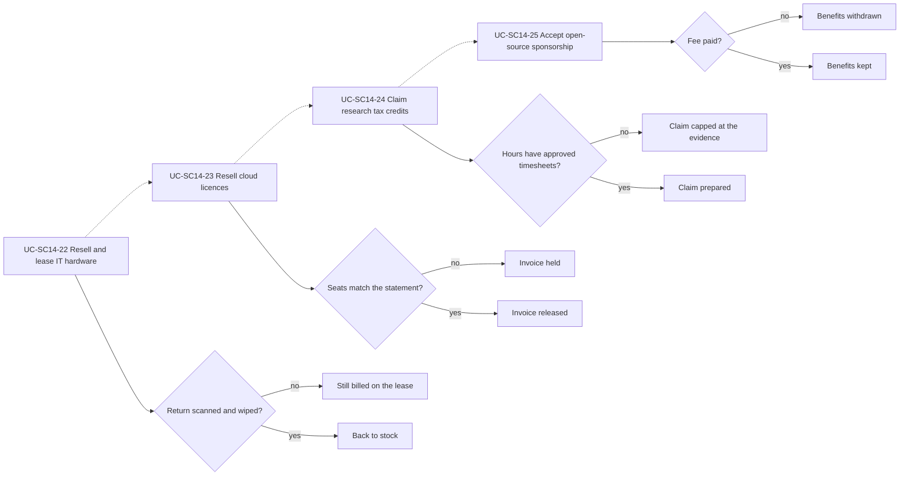
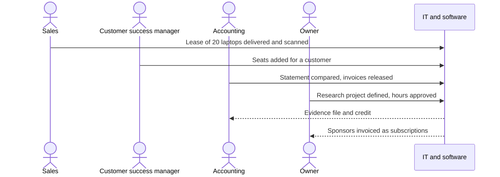

🏠 [Specs](../../../README.md) › 🏷️ [Sectors](../../README.md) › 💻 [SC14 IT and software](../README.md) ›
🔀 [Flows](README.md) › 🔀 FL-SC14-07 Hardware, licences, research tax credit and sponsorship

# 🔀 FL-SC14-07 Hardware, licences, research tax credit and sponsorship

**Status:** ✅ specified

## Summary

Four situations of IT and software companies that the sector had not covered: leasing hardware that stays on the
customer's list until returned, reselling cloud licences against the distributor's statement, claiming the research tax
credit from the timesheets, and accepting sponsors invoiced like subscriptions
([D558](../../../06-decisions/sectors/d558-benchmark-gaps-sc14-it-and-software.md)).

## Personas

- [U03 Sales](../../../01-users/personas/u03-sales.md), who prepares the leases
- [U14 Field worker](../../../01-users/personas/u14-field-worker.md), who delivers and collects the devices on the phone
- [U41 Customer success manager](../../../01-users/personas/u41-customer-success-manager.md), who orders and follows the
  licence seats
- [U05 Accounting](../../../01-users/personas/u05-accounting.md), who reconciles the statement and prepares the tax
  credit
- [U13 Owner](../../../01-users/personas/u13-owner.md), who defines the research and the sponsor tiers
- [U09 Customer](../../../01-users/personas/u09-customer.md), who sponsors the project

## Flowchart

## Sequence diagram

## Steps

| Step | Persona | Screen | Use case | What happens |
|---|---|---|---|---|
| 1 | [U03](../../../01-users/personas/u03-sales.md) | [S-SC14-22](../screens/07-hardware-licences-and-tax-credits/s-sc14-22-hardware-leasing.md) | [UC-SC14-22](../use-cases/07-hardware-licences-and-tax-credits/uc-sc14-22-resell-and-lease-it-hardware.md) | Sales leases devices and the technician scans each serial on delivery and on return |
| 2 | [U41](../../../01-users/personas/u41-customer-success-manager.md) | [S-SC14-23](../screens/07-hardware-licences-and-tax-credits/s-sc14-23-licence-reselling.md) | [UC-SC14-23](../use-cases/07-hardware-licences-and-tax-credits/uc-sc14-23-resell-cloud-licences.md) | The customer success manager orders seats and accounting reconciles them with the distributor's statement |
| 3 | [U13](../../../01-users/personas/u13-owner.md) | [S-SC14-24](../screens/07-hardware-licences-and-tax-credits/s-sc14-24-research-tax-credit.md) | [UC-SC14-24](../use-cases/07-hardware-licences-and-tax-credits/uc-sc14-24-claim-research-tax-credits.md) | The owner defines the research projects and accounting caps the claim at the approved hours |
| 4 | [U13](../../../01-users/personas/u13-owner.md) | [S-SC14-25](../screens/07-hardware-licences-and-tax-credits/s-sc14-25-sponsorship.md) | [UC-SC14-25](../use-cases/07-hardware-licences-and-tax-credits/uc-sc14-25-accept-open-source-sponsorship.md) | The owner defines the sponsor tiers and each pledge is invoiced and collected like a subscription |

### Entities and screens

| Entity | States in this flow | Shown at step and screen | Aggregated view |
|---|---|---|---|
| [E-SC14-17 Leased device](../data/e-sc14-17-leased-device.md) | Reserved, Leased, Returned, Resold, Recycled | 1 [S-SC14-22](../screens/07-hardware-licences-and-tax-credits/s-sc14-22-hardware-leasing.md) | Leased devices |
| [E-SC14-18 Licence subscription](../data/e-sc14-18-licence-subscription.md) | Ordered, Active, Renewal due, Cancelled | 2 [S-SC14-23](../screens/07-hardware-licences-and-tax-credits/s-sc14-23-licence-reselling.md) | Licence subscriptions |
| [E-SC14-19 R&D project](../data/e-sc14-19-r-d-project.md) | Defined, Tracked, Evidenced, Claimed, Closed | 3 [S-SC14-24](../screens/07-hardware-licences-and-tax-credits/s-sc14-24-research-tax-credit.md) | R&D projects |
| [E-SC14-20 Sponsorship](../data/e-sc14-20-sponsorship.md) | Pledged, Active, Lapsed, Ended | 4 [S-SC14-25](../screens/07-hardware-licences-and-tax-credits/s-sc14-25-sponsorship.md) | Sponsorships |

## Errors

- **E1 There is no timesheet evidence.** Hours are claimed on a project whose timesheet lines are not approved: the
  claim is capped at the approved hours and the missing weeks are listed
  ([BR-SC14-18](../business-rules/br-sc14-18-claimed-hours-have-timesheet-evidence.md), step 3).

## Images

Every step and error, for each persona taking part, in light and dark mode (D120). Steps are numbered as in the Steps
table; E rows are the error cases.

| Step | Persona | Device | Light | Dark |
|---|---|---|---|---|
| 1 | U03 | desktop | [light](../images/07-hardware-licences-and-tax-credits/u03-sales/1-hardware-leasing-desktop-light.png) | [dark](../images/07-hardware-licences-and-tax-credits/u03-sales/1-hardware-leasing-desktop-dark.png) |
| 1 | U14 | phone | [light](../images/07-hardware-licences-and-tax-credits/u14-field-worker/1-hardware-leasing-phone-light.png) | [dark](../images/07-hardware-licences-and-tax-credits/u14-field-worker/1-hardware-leasing-phone-dark.png) |
| 1 | U03 | phone | [light](../images/07-hardware-licences-and-tax-credits/u03-sales/1-hardware-leasing-phone-light.png) | [dark](../images/07-hardware-licences-and-tax-credits/u03-sales/1-hardware-leasing-phone-dark.png) |
| 1 | U03 | tablet | [light](../images/07-hardware-licences-and-tax-credits/u03-sales/1-hardware-leasing-tablet-light.png) | [dark](../images/07-hardware-licences-and-tax-credits/u03-sales/1-hardware-leasing-tablet-dark.png) |
| 2 | U41 | desktop | [light](../images/07-hardware-licences-and-tax-credits/u41-customer-success-manager/2-licence-reselling-desktop-light.png) | [dark](../images/07-hardware-licences-and-tax-credits/u41-customer-success-manager/2-licence-reselling-desktop-dark.png) |
| 2 | U05 | desktop | [light](../images/07-hardware-licences-and-tax-credits/u05-accounting/2-licence-reselling-desktop-light.png) | [dark](../images/07-hardware-licences-and-tax-credits/u05-accounting/2-licence-reselling-desktop-dark.png) |
| 2 | U41 | phone | [light](../images/07-hardware-licences-and-tax-credits/u41-customer-success-manager/2-licence-reselling-phone-light.png) | [dark](../images/07-hardware-licences-and-tax-credits/u41-customer-success-manager/2-licence-reselling-phone-dark.png) |
| 3 | U13 | desktop | [light](../images/07-hardware-licences-and-tax-credits/u13-owner/3-research-tax-credit-desktop-light.png) | [dark](../images/07-hardware-licences-and-tax-credits/u13-owner/3-research-tax-credit-desktop-dark.png) |
| 3 | U05 | desktop | [light](../images/07-hardware-licences-and-tax-credits/u05-accounting/3-research-tax-credit-desktop-light.png) | [dark](../images/07-hardware-licences-and-tax-credits/u05-accounting/3-research-tax-credit-desktop-dark.png) |
| 3 | U13 | phone | [light](../images/07-hardware-licences-and-tax-credits/u13-owner/3-research-tax-credit-phone-light.png) | [dark](../images/07-hardware-licences-and-tax-credits/u13-owner/3-research-tax-credit-phone-dark.png) |
| 4 | U13 | desktop | [light](../images/07-hardware-licences-and-tax-credits/u13-owner/4-sponsorship-desktop-light.png) | [dark](../images/07-hardware-licences-and-tax-credits/u13-owner/4-sponsorship-desktop-dark.png) |
| 4 | U09 | phone | [light](../images/07-hardware-licences-and-tax-credits/u09-customer/4-sponsorship-phone-light.png) | [dark](../images/07-hardware-licences-and-tax-credits/u09-customer/4-sponsorship-phone-dark.png) |
| 4 | U13 | phone | [light](../images/07-hardware-licences-and-tax-credits/u13-owner/4-sponsorship-phone-light.png) | [dark](../images/07-hardware-licences-and-tax-credits/u13-owner/4-sponsorship-phone-dark.png) |
| E1 | U03 | desktop | [light](../images/07-hardware-licences-and-tax-credits/u03-sales/e1-there-is-no-timesheet-evidence-desktop-light.png) | [dark](../images/07-hardware-licences-and-tax-credits/u03-sales/e1-there-is-no-timesheet-evidence-desktop-dark.png) |
| E1 | U03 | phone | [light](../images/07-hardware-licences-and-tax-credits/u03-sales/e1-there-is-no-timesheet-evidence-phone-light.png) | [dark](../images/07-hardware-licences-and-tax-credits/u03-sales/e1-there-is-no-timesheet-evidence-phone-dark.png) |
| E1 | U03 | tablet | [light](../images/07-hardware-licences-and-tax-credits/u03-sales/e1-there-is-no-timesheet-evidence-tablet-light.png) | [dark](../images/07-hardware-licences-and-tax-credits/u03-sales/e1-there-is-no-timesheet-evidence-tablet-dark.png) |

## Open questions

None.

---

⬅️ [FL-SC14-06 Portal and metrics](fl-sc14-06-portal-and-metrics.md) · ⬆️ [Up](README.md)
