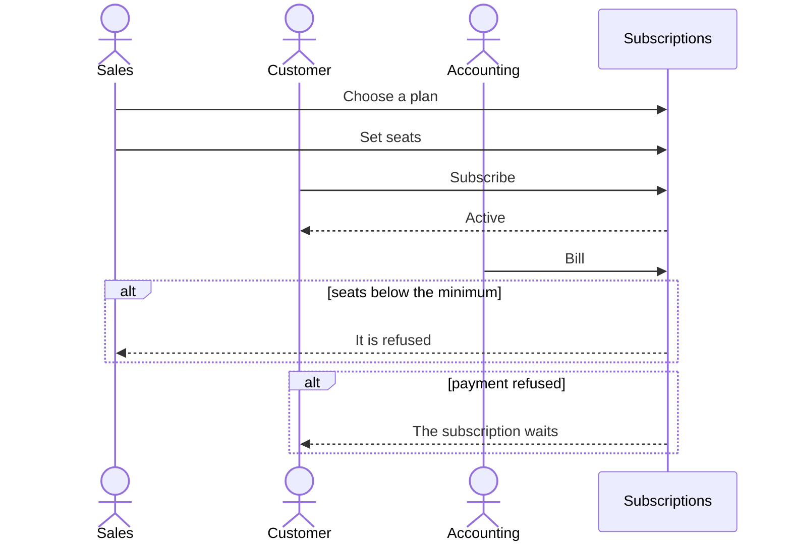

🏠 [Specs](../../../../README.md) › 🏷️ [Sectors](../../../README.md) › 💻 [SC14 IT and software](../../README.md) ›
📝 [Use cases](../README.md) › 📝 [Use cases: FL-SC14-01 Subscriptions and billing](README.md) ›
📝 UC-SC14-01 Sell subscriptions with plans and seats

# 📝 UC-SC14-01 Sell subscriptions with plans and seats

**Status:** ✅ specified

## Summary

Sales or the customer chooses a plan and a number of seats, and subscribes; seats and upgrades are billed with
proration.

## Personas

- [U03 Sales](../../../../01-users/personas/u03-sales.md)
- [U09 Customer](../../../../01-users/personas/u09-customer.md)
- [U05 Accounting](../../../../01-users/personas/u05-accounting.md)

## Goal

Customers on the right plan, billed from the subscription.

## Trigger

A customer buys or changes a plan.

## Frequency

Daily.

## Preconditions

- The SC14 sector pack is installed for the company,
  [UC-F14-02](../../../../02-functional/f14-plugin-store/use-cases/01-find-and-install/uc-f14-02-install-a-plugin-or-sector-pack.md),
  and its users have their roles,
  [UC-F1-06](../../../../02-functional/f01-administration/use-cases/04-edit-a-role/uc-f01-06-edit-a-role-and-its-record-rules.md).

## Postconditions

- **Success:** the subscription is active and billed.
- **Failed:** nothing is subscribed.

## Main flow

1. Sales chooses the plan on
   [S-SC14-01 Subscriptions](../../screens/01-subscriptions-and-billing/s-sc14-01-subscriptions.md),
   [UC-F6-10](../../../../02-functional/f06-customers-and-sales/use-cases/04-subscriptions/uc-f06-10-manage-subscriptions.md).
2. Sales sets seats and term.
3. The customer accepts and pays,
   [UC-F6-07](../../../../02-functional/f06-customers-and-sales/use-cases/03-invoice-and-get-paid/uc-f06-07-get-paid-online-and-reconcile.md).
4. The first invoice is issued ([BR-SC14-02](../../business-rules/br-sc14-02-seats-and-usage-billed-from-records.md)).

## Alternative flows

- 1a. A self-service signup: the customer subscribes on the website,
  [UC-F11-12](../../../../02-functional/f11-online-shop/use-cases/04-special-sales/uc-f11-12-sell-subscriptions-and-rentals-online.md).
- 2a. An upgrade mid-term: the difference is prorated.

## Error flows

- 2e. Seats below the minimum: it is refused.
- 3e. Payment refused: the subscription waits.
- Any step: a call to a service or an outside system fails: it is retried first
  ([BR-F3-32](../../../../02-functional/f03-assistant/business-rules/br-f03-32-retry-before-an-error.md)), then the
  error message pattern ([D122](../../../../06-decisions/ux/d122-error-message-standard.md)) says what failed; what was
  typed is kept.

## Business rules

- [BR-SC14-02 Seats and usage billed from records](../../business-rules/br-sc14-02-seats-and-usage-billed-from-records.md)

## Entities

- [E-SC14-01 Software subscription](../../data/e-sc14-01-software-subscription.md)

## Permissions

The sales, customer and accounting roles; the record rules of their role and site apply,
[UC-F1-06](../../../../02-functional/f01-administration/use-cases/04-edit-a-role/uc-f01-06-edit-a-role-and-its-record-rules.md).

## Notifications

None beyond the in-app updates of the records concerned.

## Audit events

Every creation, change and state change of subscription records, with who, when and the values before and after (T3).

## AI involvement

The AI assistant answers questions on the subscription records of this use case, with links, and prepares them as drafts
the user confirms. It works within the user's rights,
[BR-F3-34](../../../../02-functional/f03-assistant/business-rules/br-f03-34-every-capability-is-reachable-from-the-assistant.md),
and never deletes or does anything irreversible without the user's confirmation,
[BR-F3-07](../../../../02-functional/f03-assistant/business-rules/br-f03-07-no-deletes-no-irreversible-acts.md).

## API, MCP and A2A exposure

Through the API and webhooks (T5) and the MCP and A2A gateway (T6), with the caller's rights,
[BR-F3-34](../../../../02-functional/f03-assistant/business-rules/br-f03-34-every-capability-is-reachable-from-the-assistant.md),
reading, creating and changing the records of this use case; nothing irreversible without a person's confirmation.

## Screens

- [S-SC14-01 Subscriptions](../../screens/01-subscriptions-and-billing/s-sc14-01-subscriptions.md)

## Flowchart

See [FL-SC14-01 Subscriptions and billing](../../flows/fl-sc14-01-subscriptions-and-billing.md#flowchart).

## Sequence diagram

## Acceptance criteria

1. **Given** the example software company's Acme on Business with 25 seats for 2026-2027 **when** it subscribes **then**
   the subscription is active.
2. **Given** Business plan at 3 seats with a minimum of 5 **when** it is saved **then** it is refused.

## Non-functional notes

[D408](../../../../06-decisions/technical/d408-performance-and-profiles.md)'s targets
([performance](../../../../05-non-functional/performance.md)): 95 % of screens within 1 second; lists paged on the
server, the first page within 1 second; reports within 5 seconds or in the background. WCAG 2.2 AA and RGAA
([D46](../../../../06-decisions/ux/d46-accessibility-standard.md)).

## Regulatory references

None specific to this use case; the sector's legal rules are listed in [SC14 regulatory](../../regulatory.md).

## Related use cases

- [UC-SC14-02 Meter usage and bill it](uc-sc14-02-meter-usage-and-bill-it.md)

## Open questions

None.

---

⬆️ [Up](README.md) · ➡️ [UC-SC14-02 Meter usage and bill it](uc-sc14-02-meter-usage-and-bill-it.md)
