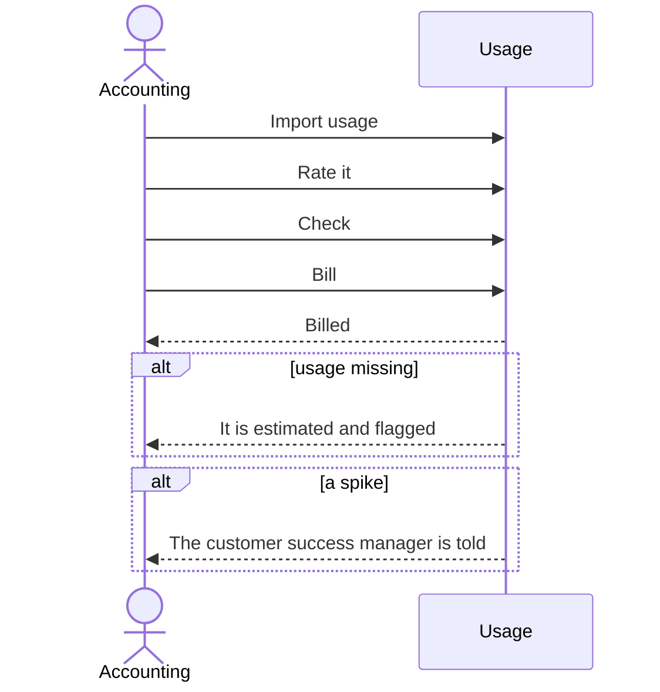

🏠 [Specs](../../../../README.md) › 🏷️ [Sectors](../../../README.md) › 💻 [SC14 IT and software](../../README.md) ›
📝 [Use cases](../README.md) › 📝 [Use cases: FL-SC14-01 Subscriptions and billing](README.md) ›
📝 UC-SC14-02 Meter usage and bill it

# 📝 UC-SC14-02 Meter usage and bill it

**Status:** ✅ specified

## Summary

Accounting imports usage records, rates them by the plan and bills them.

## Personas

- [U05 Accounting](../../../../01-users/personas/u05-accounting.md)

## Goal

Usage billed from metered data.

## Trigger

Month end.

## Frequency

Monthly.

## Preconditions

- The SC14 sector pack is installed for the company,
  [UC-F14-02](../../../../02-functional/f14-plugin-store/use-cases/01-find-and-install/uc-f14-02-install-a-plugin-or-sector-pack.md),
  and its users have their roles,
  [UC-F1-06](../../../../02-functional/f01-administration/use-cases/04-edit-a-role/uc-f01-06-edit-a-role-and-its-record-rules.md).

## Postconditions

- **Success:** usage is billed.
- **Failed:** missing usage is estimated and flagged.

## Main flow

1. Usage comes in on [S-SC14-02 Usage](../../screens/01-subscriptions-and-billing/s-sc14-02-usage.md),
   [UC-F6-16](../../../../02-functional/f06-customers-and-sales/use-cases/05-benchmark-additions/uc-f06-16-bill-usage-commitments-and-milestones.md).
2. Usage is rated by tier,
   [BR-F6-10](../../../../02-functional/f06-customers-and-sales/business-rules/br-f06-10-usage-is-billed-from-metered-data.md).
3. Accounting checks spikes.
4. Usage is billed.

## Alternative flows

- 2a. Usage tiers: each tier has its price.

## Error flows

- 1e. Usage missing: it is estimated and flagged.
- 3e. A spike: the customer success manager is told.
- Any step: a call to a service or an outside system fails: it is retried first
  ([BR-F3-32](../../../../02-functional/f03-assistant/business-rules/br-f03-32-retry-before-an-error.md)), then the
  error message pattern ([D122](../../../../06-decisions/ux/d122-error-message-standard.md)) says what failed; what was
  typed is kept.

## Business rules

- [BR-SC14-02 Seats and usage billed from records](../../business-rules/br-sc14-02-seats-and-usage-billed-from-records.md)
- [BR-F6-10 Usage is billed from metered data](../../../../02-functional/f06-customers-and-sales/business-rules/br-f06-10-usage-is-billed-from-metered-data.md)

## Entities

- [E-SC14-02 Customer usage record](../../data/e-sc14-02-customer-usage-record.md)

## Permissions

The accounting roles; the record rules of their role and site apply,
[UC-F1-06](../../../../02-functional/f01-administration/use-cases/04-edit-a-role/uc-f01-06-edit-a-role-and-its-record-rules.md).

## Notifications

None beyond the in-app updates of the records concerned.

## Audit events

Every creation, change and state change of usage record records, with who, when and the values before and after (T3).

## AI involvement

The AI assistant answers questions on the usage record records of this use case, with links, and prepares them as drafts
the user confirms. It works within the user's rights,
[BR-F3-34](../../../../02-functional/f03-assistant/business-rules/br-f03-34-every-capability-is-reachable-from-the-assistant.md),
and never deletes or does anything irreversible without the user's confirmation,
[BR-F3-07](../../../../02-functional/f03-assistant/business-rules/br-f03-07-no-deletes-no-irreversible-acts.md).

## API, MCP and A2A exposure

Through the API and webhooks (T5) and the MCP and A2A gateway (T6), with the caller's rights,
[BR-F3-34](../../../../02-functional/f03-assistant/business-rules/br-f03-34-every-capability-is-reachable-from-the-assistant.md),
reading, creating and changing the records of this use case; nothing irreversible without a person's confirmation.

## Screens

- [S-SC14-02 Usage](../../screens/01-subscriptions-and-billing/s-sc14-02-usage.md)

## Flowchart

See [FL-SC14-01 Subscriptions and billing](../../flows/fl-sc14-01-subscriptions-and-billing.md#flowchart).

## Sequence diagram

## Acceptance criteria

1. **Given** the example software company's Acme with 1.2 million API calls **when** November is billed **then** they
   are billed by tier.
2. **Given** Acme's API calls missing for 3 days **when** the month is billed **then** it is estimated and flagged.

## Non-functional notes

[D408](../../../../06-decisions/technical/d408-performance-and-profiles.md)'s targets
([performance](../../../../05-non-functional/performance.md)): 95 % of screens within 1 second; lists paged on the
server, the first page within 1 second; reports within 5 seconds or in the background. WCAG 2.2 AA and RGAA
([D46](../../../../06-decisions/ux/d46-accessibility-standard.md)).

## Regulatory references

None specific to this use case; the sector's legal rules are listed in [SC14 regulatory](../../regulatory.md).

## Related use cases

- [UC-SC14-03 Recognise subscription revenue](uc-sc14-03-recognise-subscription-revenue.md)

## Open questions

None.

---

⬅️ [UC-SC14-01 Sell subscriptions with plans and seats](uc-sc14-01-sell-subscriptions-with-plans-and-seats.md) ·
⬆️ [Up](README.md) · ➡️ [UC-SC14-03 Recognise subscription revenue](uc-sc14-03-recognise-subscription-revenue.md)
