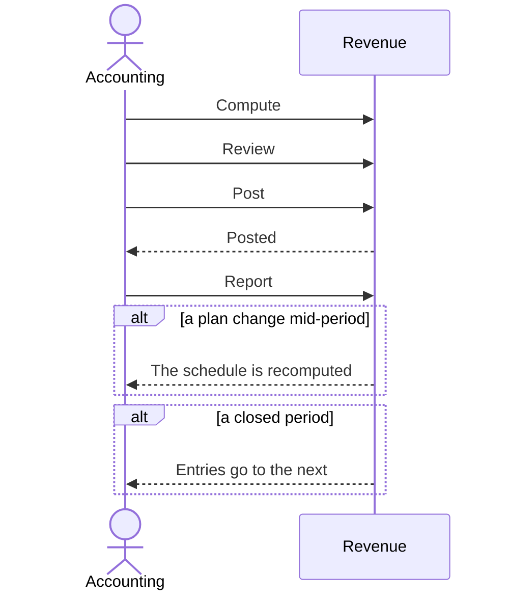

🏠 [Specs](../../../../README.md) › 🏷️ [Sectors](../../../README.md) › 💻 [SC14 IT and software](../../README.md) ›
📝 [Use cases](../README.md) › 📝 [Use cases: FL-SC14-01 Subscriptions and billing](README.md) ›
📝 UC-SC14-03 Recognise subscription revenue

# 📝 UC-SC14-03 Recognise subscription revenue

**Status:** ✅ specified

## Summary

Accounting computes recognised and deferred revenue over the service period, reviews and posts it.

## Personas

- [U05 Accounting](../../../../01-users/personas/u05-accounting.md)

## Goal

Revenue over the service period.

## Trigger

Month end.

## Frequency

Monthly.

## Preconditions

- The SC14 sector pack is installed for the company,
  [UC-F14-02](../../../../02-functional/f14-plugin-store/use-cases/01-find-and-install/uc-f14-02-install-a-plugin-or-sector-pack.md),
  and its users have their roles,
  [UC-F1-06](../../../../02-functional/f01-administration/use-cases/04-edit-a-role/uc-f01-06-edit-a-role-and-its-record-rules.md).

## Postconditions

- **Success:** entries are posted.
- **Failed:** the month stays open.

## Main flow

1. Schedules are computed on [S-SC14-03 Revenue](../../screens/01-subscriptions-and-billing/s-sc14-03-revenue.md),
   [UC-F8-16](../../../../02-functional/f08-accounting/use-cases/06-benchmark-additions/uc-f08-16-recognise-revenue-under-ifrs-15.md).
2. Accounting reviews changes.
3. Entries are posted ([BR-SC14-03](../../business-rules/br-sc14-03-revenue-over-the-service-period.md)).
4. Deferred revenue shows in reports.

## Alternative flows

- 1a. A multi-year contract: it is spread over its years.

## Error flows

- 1e. A plan change mid-period: the schedule is recomputed.
- 3e. A closed period: entries go to the next.
- Any step: a call to a service or an outside system fails: it is retried first
  ([BR-F3-32](../../../../02-functional/f03-assistant/business-rules/br-f03-32-retry-before-an-error.md)), then the
  error message pattern ([D122](../../../../06-decisions/ux/d122-error-message-standard.md)) says what failed; what was
  typed is kept.

## Business rules

- [BR-SC14-03 Revenue over the service period](../../business-rules/br-sc14-03-revenue-over-the-service-period.md)
- [BR-F8-11 Revenue follows performance obligations](../../../../02-functional/f08-accounting/business-rules/br-f08-11-revenue-follows-performance-obligations.md)

## Entities

- [E-F8-14 Revenue schedule](../../../../02-functional/f08-accounting/data/e-f08-14-revenue-schedule.md)

## Permissions

The accounting roles; the record rules of their role and site apply,
[UC-F1-06](../../../../02-functional/f01-administration/use-cases/04-edit-a-role/uc-f01-06-edit-a-role-and-its-record-rules.md).

## Notifications

None beyond the in-app updates of the records concerned.

## Audit events

Every creation, change and state change of revenue schedule records, with who, when and the values before and after
(T3).

## AI involvement

The AI assistant answers questions on the revenue schedule records of this use case, with links, and prepares them as
drafts the user confirms. It works within the user's rights,
[BR-F3-34](../../../../02-functional/f03-assistant/business-rules/br-f03-34-every-capability-is-reachable-from-the-assistant.md),
and never deletes or does anything irreversible without the user's confirmation,
[BR-F3-07](../../../../02-functional/f03-assistant/business-rules/br-f03-07-no-deletes-no-irreversible-acts.md).

## API, MCP and A2A exposure

Through the API and webhooks (T5) and the MCP and A2A gateway (T6), with the caller's rights,
[BR-F3-34](../../../../02-functional/f03-assistant/business-rules/br-f03-34-every-capability-is-reachable-from-the-assistant.md),
reading, creating and changing the records of this use case; nothing irreversible without a person's confirmation.

## Screens

- [S-SC14-03 Revenue](../../screens/01-subscriptions-and-billing/s-sc14-03-revenue.md)

## Flowchart

See [FL-SC14-01 Subscriptions and billing](../../flows/fl-sc14-01-subscriptions-and-billing.md#flowchart).

## Sequence diagram

## Acceptance criteria

1. **Given** the example software company's Acme paying 12,000 EUR for a year from 1 November **when** November is
   closed **then** 1,000 EUR is recognised.
2. **Given** Acme upgrading on 15 November **when** November is computed **then** the schedule is recomputed.

## Non-functional notes

[D408](../../../../06-decisions/technical/d408-performance-and-profiles.md)'s targets
([performance](../../../../05-non-functional/performance.md)): 95 % of screens within 1 second; lists paged on the
server, the first page within 1 second; reports within 5 seconds or in the background. WCAG 2.2 AA and RGAA
([D46](../../../../06-decisions/ux/d46-accessibility-standard.md)).

## Regulatory references

None specific to this use case; the sector's legal rules are listed in [SC14 regulatory](../../regulatory.md).

## Related use cases

- [UC-SC14-18 Follow SaaS metrics](../06-portal-and-metrics/uc-sc14-18-follow-saas-metrics.md)

## Open questions

None.

---

⬅️ [UC-SC14-02 Meter usage and bill it](uc-sc14-02-meter-usage-and-bill-it.md) · ⬆️ [Up](README.md) ·
➡️ [UC-SC14-04](../02-licences-and-renewals/uc-sc14-04-manage-licences-keys-and-renewals.md)
