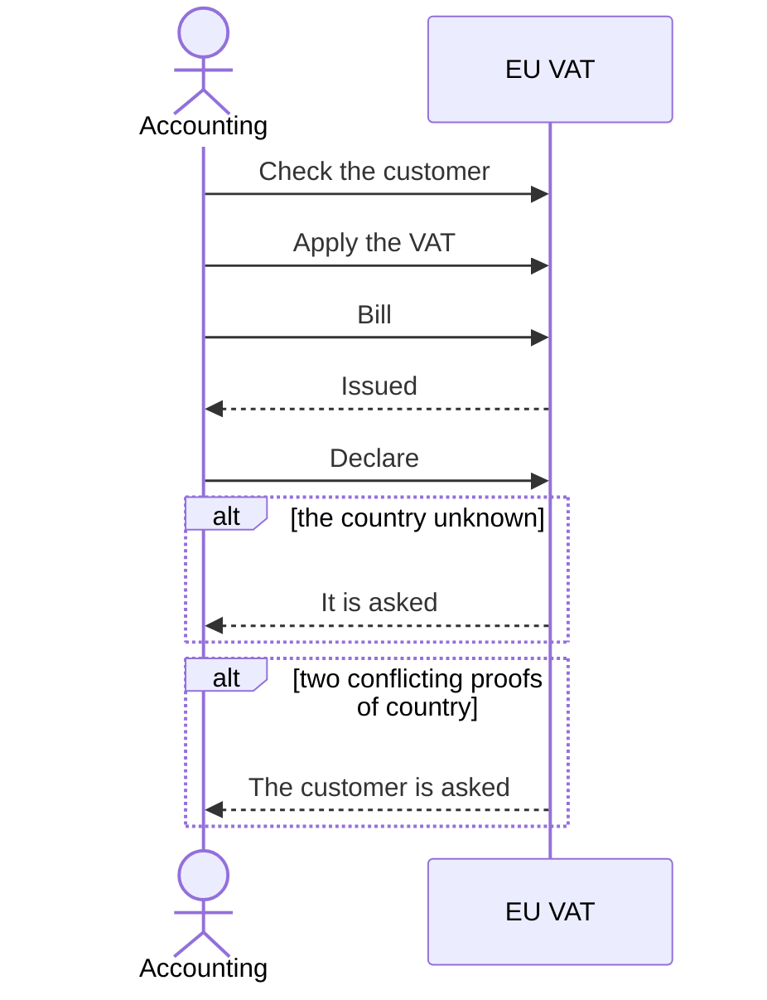

🏠 [Specs](../../../../README.md) › 🏷️ [Sectors](../../../README.md) › 💻 [SC14 IT and software](../../README.md) ›
📝 [Use cases](../README.md) › 📝 [Use cases: FL-SC14-01 Subscriptions and billing](README.md) ›
📝 UC-SC14-15 Bill digital services across the EU

# 📝 UC-SC14-15 Bill digital services across the EU

**Status:** ✅ specified

## Summary

Accounting checks the customer's country and status, applies the right VAT and declares it.

## Personas

- [U05 Accounting](../../../../01-users/personas/u05-accounting.md)

## Goal

Correct VAT for every EU customer.

## Trigger

An invoice to an EU customer.

## Frequency

Daily.

## Preconditions

- The SC14 sector pack is installed for the company,
  [UC-F14-02](../../../../02-functional/f14-plugin-store/use-cases/01-find-and-install/uc-f14-02-install-a-plugin-or-sector-pack.md),
  and its users have their roles,
  [UC-F1-06](../../../../02-functional/f01-administration/use-cases/04-edit-a-role/uc-f01-06-edit-a-role-and-its-record-rules.md).

## Postconditions

- **Success:** the VAT is right and declared.
- **Failed:** the invoice is held.

## Main flow

1. Country and VAT number are checked on
   [S-SC14-15 EU VAT](../../screens/01-subscriptions-and-billing/s-sc14-15-eu-vat.md).
2. The VAT follows the rules ([BR-SC14-11](../../business-rules/br-sc14-11-vat-by-the-customer-country.md)).
3. The invoice is issued.
4. It is declared,
   [UC-F8-07](../../../../02-functional/f08-accounting/use-cases/04-tax-assets-and-analytics/uc-f08-07-manage-vat-and-file-returns.md).

## Alternative flows

- 1a. A business customer: reverse charge applies.

## Error flows

- 1e. The country unknown: it is asked.
- 1f. Two conflicting proofs of country: the customer is asked.
- Any step: a call to a service or an outside system fails: it is retried first
  ([BR-F3-32](../../../../02-functional/f03-assistant/business-rules/br-f03-32-retry-before-an-error.md)), then the
  error message pattern ([D122](../../../../06-decisions/ux/d122-error-message-standard.md)) says what failed; what was
  typed is kept.

## Business rules

- [BR-SC14-11 VAT by the customer's country](../../business-rules/br-sc14-11-vat-by-the-customer-country.md)

## Entities

- [E-SC14-02 Customer usage record](../../data/e-sc14-02-customer-usage-record.md)

## Permissions

The accounting roles; the record rules of their role and site apply,
[UC-F1-06](../../../../02-functional/f01-administration/use-cases/04-edit-a-role/uc-f01-06-edit-a-role-and-its-record-rules.md).

## Notifications

None beyond the in-app updates of the records concerned.

## Audit events

Every creation, change and state change of usage record records, with who, when and the values before and after (T3).

## AI involvement

The AI assistant answers questions on the usage record records of this use case, with links, and prepares them as drafts
the user confirms. It works within the user's rights,
[BR-F3-34](../../../../02-functional/f03-assistant/business-rules/br-f03-34-every-capability-is-reachable-from-the-assistant.md),
and never deletes or does anything irreversible without the user's confirmation,
[BR-F3-07](../../../../02-functional/f03-assistant/business-rules/br-f03-07-no-deletes-no-irreversible-acts.md).

## API, MCP and A2A exposure

Through the API and webhooks (T5) and the MCP and A2A gateway (T6), with the caller's rights,
[BR-F3-34](../../../../02-functional/f03-assistant/business-rules/br-f03-34-every-capability-is-reachable-from-the-assistant.md),
reading, creating and changing the records of this use case; nothing irreversible without a person's confirmation.

## Screens

- [S-SC14-15 EU VAT](../../screens/01-subscriptions-and-billing/s-sc14-15-eu-vat.md)

## Flowchart

See [FL-SC14-01 Subscriptions and billing](../../flows/fl-sc14-01-subscriptions-and-billing.md#flowchart).

## Sequence diagram

## Acceptance criteria

1. **Given** the example software company's German business customer with a valid VAT number **when** it is billed
   **then** no VAT and the reverse-charge mention show.
2. **Given** a consumer without country **when** the invoice is built **then** it is asked.

## Non-functional notes

[D408](../../../../06-decisions/technical/d408-performance-and-profiles.md)'s targets
([performance](../../../../05-non-functional/performance.md)): 95 % of screens within 1 second; lists paged on the
server, the first page within 1 second; reports within 5 seconds or in the background. WCAG 2.2 AA and RGAA
([D46](../../../../06-decisions/ux/d46-accessibility-standard.md)).

## Regulatory references

Legal values from the France country pack:
[CR-FR-100 VAT on services to clients abroad](../../../../10-country-packs/france/tax-and-vat/cr-fr-100-vat-on-services-abroad.md).

## Related use cases

- [UC-SC14-16 Handle failed payments and dunning](uc-sc14-16-handle-failed-payments-and-dunning.md)

## Open questions

None.

---

⬅️ [UC-SC14-14](../05-security-and-data-compliance/uc-sc14-14-let-customers-switch-and-export-their-data.md) ·
⬆️ [Up](README.md) ·
➡️ [UC-SC14-16 Handle failed payments and dunning](uc-sc14-16-handle-failed-payments-and-dunning.md)
