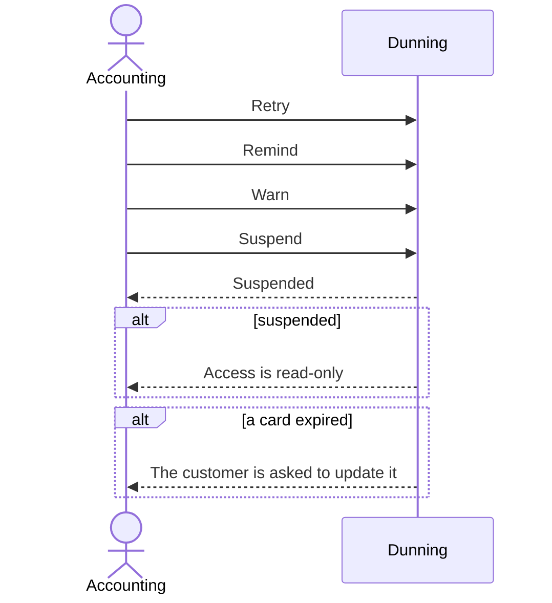

🏠 [Specs](../../../../README.md) › 🏷️ [Sectors](../../../README.md) › 💻 [SC14 IT and software](../../README.md) ›
📝 [Use cases](../README.md) › 📝 [Use cases: FL-SC14-01 Subscriptions and billing](README.md) ›
📝 UC-SC14-16 Handle failed payments and dunning

# 📝 UC-SC14-16 Handle failed payments and dunning

**Status:** ✅ specified

## Summary

A failed payment follows the steps: retry, reminder, suspension warning, suspension.

## Personas

- [U05 Accounting](../../../../01-users/personas/u05-accounting.md)

## Goal

Failed payments recovered.

## Trigger

A failed payment.

## Frequency

Daily.

## Preconditions

- The SC14 sector pack is installed for the company,
  [UC-F14-02](../../../../02-functional/f14-plugin-store/use-cases/01-find-and-install/uc-f14-02-install-a-plugin-or-sector-pack.md),
  and its users have their roles,
  [UC-F1-06](../../../../02-functional/f01-administration/use-cases/04-edit-a-role/uc-f01-06-edit-a-role-and-its-record-rules.md).

## Postconditions

- **Success:** the payment is recovered.
- **Failed:** access becomes read-only.

## Main flow

1. The payment is retried on [S-SC14-16 Dunning](../../screens/01-subscriptions-and-billing/s-sc14-16-dunning.md)
   ([BR-SC14-12](../../business-rules/br-sc14-12-dunning-steps.md)).
2. A reminder goes out,
   [UC-F6-08](../../../../02-functional/f06-customers-and-sales/use-cases/03-invoice-and-get-paid/uc-f06-08-remind-late-payers.md).
3. A suspension warning goes out.
4. Access is suspended to read-only.

## Alternative flows

- 2a. A payment plan: an instalment plan is agreed,
  [UC-F6-23](../../../../02-functional/f06-customers-and-sales/use-cases/08-collect-and-settle/uc-f06-23-agree-an-instalment-plan.md).

## Error flows

- 4e. Suspended: access is read-only.
- 1e. A card expired: the customer is asked to update it.
- Any step: a call to a service or an outside system fails: it is retried first
  ([BR-F3-32](../../../../02-functional/f03-assistant/business-rules/br-f03-32-retry-before-an-error.md)), then the
  error message pattern ([D122](../../../../06-decisions/ux/d122-error-message-standard.md)) says what failed; what was
  typed is kept.

## Business rules

- [BR-SC14-12 Dunning steps](../../business-rules/br-sc14-12-dunning-steps.md)

## Entities

- [E-SC14-14 Dunning case](../../data/e-sc14-14-dunning-case.md)

## Permissions

The accounting roles; the record rules of their role and site apply,
[UC-F1-06](../../../../02-functional/f01-administration/use-cases/04-edit-a-role/uc-f01-06-edit-a-role-and-its-record-rules.md).

## Notifications

None beyond the in-app updates of the records concerned.

## Audit events

Every creation, change and state change of dunning case records, with who, when and the values before and after (T3).

## AI involvement

The AI assistant answers questions on the dunning case records of this use case, with links, and prepares them as drafts
the user confirms. It works within the user's rights,
[BR-F3-34](../../../../02-functional/f03-assistant/business-rules/br-f03-34-every-capability-is-reachable-from-the-assistant.md),
and never deletes or does anything irreversible without the user's confirmation,
[BR-F3-07](../../../../02-functional/f03-assistant/business-rules/br-f03-07-no-deletes-no-irreversible-acts.md).

## API, MCP and A2A exposure

Through the API and webhooks (T5) and the MCP and A2A gateway (T6), with the caller's rights,
[BR-F3-34](../../../../02-functional/f03-assistant/business-rules/br-f03-34-every-capability-is-reachable-from-the-assistant.md),
reading, creating and changing the records of this use case; nothing irreversible without a person's confirmation.

## Screens

- [S-SC14-16 Dunning](../../screens/01-subscriptions-and-billing/s-sc14-16-dunning.md)

## Flowchart

See [FL-SC14-01 Subscriptions and billing](../../flows/fl-sc14-01-subscriptions-and-billing.md#flowchart).

## Sequence diagram

## Acceptance criteria

1. **Given** the example software company's INV-88 failing **when** the retry fails **then** the case moves to reminder.
2. **Given** INV-88 unpaid after the warning **when** the step runs **then** access is read-only.

## Non-functional notes

[D408](../../../../06-decisions/technical/d408-performance-and-profiles.md)'s targets
([performance](../../../../05-non-functional/performance.md)): 95 % of screens within 1 second; lists paged on the
server, the first page within 1 second; reports within 5 seconds or in the background. WCAG 2.2 AA and RGAA
([D46](../../../../06-decisions/ux/d46-accessibility-standard.md)).

## Regulatory references

Legal values from the France country pack:
[CR-FR-019 Late-payment penalties](../../../../10-country-packs/france/invoicing/cr-fr-019-late-payment-penalties.md).

## Related use cases

- [UC-SC14-01 Sell subscriptions with plans and seats](uc-sc14-01-sell-subscriptions-with-plans-and-seats.md)

## Open questions

None.

---

⬅️ [UC-SC14-15 Bill digital services across the EU](uc-sc14-15-bill-digital-services-across-the-eu.md) ·
⬆️ [Up](README.md) ·
➡️ [UC-SC14-17 Give customers their portal](../06-portal-and-metrics/uc-sc14-17-give-customers-their-portal.md)
