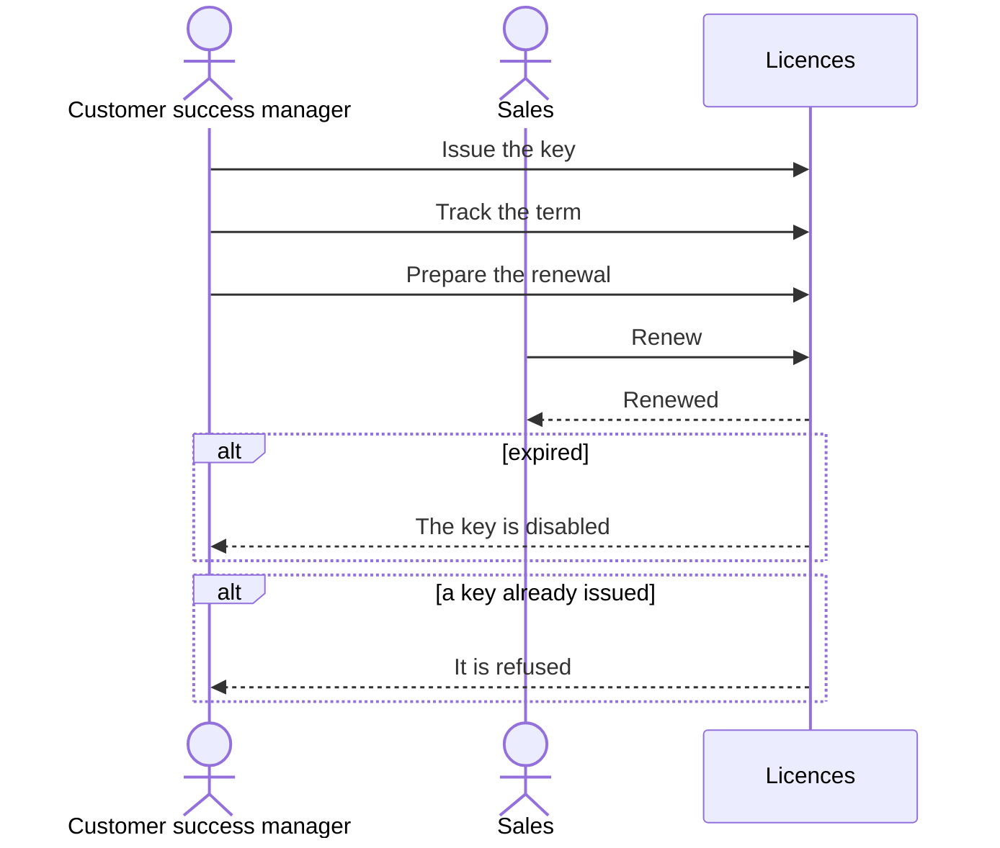

🏠 [Specs](../../../../README.md) › 🏷️ [Sectors](../../../README.md) › 💻 [SC14 IT and software](../../README.md) ›
📝 [Use cases](../README.md) › 📝 [Use cases: FL-SC14-02 Licences and renewals](README.md) ›
📝 UC-SC14-04 Manage licences, keys and renewals

# 📝 UC-SC14-04 Manage licences, keys and renewals

**Status:** 🔄 waiting for the owner

## Summary

The customer success manager issues licence keys, tracks terms and has renewals prepared before expiry.

## Personas

- [U41 Customer success manager](../../../../01-users/personas/u41-customer-success-manager.md)
- [U03 Sales](../../../../01-users/personas/u03-sales.md)

## Goal

No licence lapses unnoticed.

## Trigger

A sale, then the term.

## Frequency

Daily.

## Preconditions

- The SC14 sector pack is installed for the company,
  [UC-F14-02](../../../../02-functional/f14-plugin-store/use-cases/01-find-and-install/uc-f14-02-install-a-plugin-or-sector-pack.md),
  and its users have their roles,
  [UC-F1-06](../../../../02-functional/f01-administration/use-cases/04-edit-a-role/uc-f01-06-edit-a-role-and-its-record-rules.md).

## Postconditions

- **Success:** the key is valid and the renewal on time.
- **Failed:** the key is disabled.

## Main flow

1. A key is issued on [S-SC14-04 Licences](../../screens/02-licences-and-renewals/s-sc14-04-licences.md).
2. The term is tracked.
3. A renewal task and quote are created
   ([BR-SC14-04](../../business-rules/br-sc14-04-licences-renewed-before-expiry.md)).
4. Sales renews ([UC-SC14-10](uc-sc14-10-run-renewals-and-expansion.md)).

## Alternative flows

- 1a. An on-premise licence: the key is checked offline by the product.

## Error flows

- 2e. Expired: the key is disabled.
- 1e. A key already issued: it is refused.
- Any step: a call to a service or an outside system fails: it is retried first
  ([BR-F3-32](../../../../02-functional/f03-assistant/business-rules/br-f03-32-retry-before-an-error.md)), then the
  error message pattern ([D122](../../../../06-decisions/ux/d122-error-message-standard.md)) says what failed; what was
  typed is kept.

## Business rules

- [BR-SC14-04 Licences renewed before expiry](../../business-rules/br-sc14-04-licences-renewed-before-expiry.md)

## Entities

- [E-SC14-04 Software licence](../../data/e-sc14-04-software-licence.md)

## Permissions

The customer success manager and sales roles; the record rules of their role and site apply,
[UC-F1-06](../../../../02-functional/f01-administration/use-cases/04-edit-a-role/uc-f01-06-edit-a-role-and-its-record-rules.md).

## Notifications

None beyond the in-app updates of the records concerned.

## Audit events

Every creation, change and state change of licence records, with who, when and the values before and after (T3).

## AI involvement

The AI assistant answers questions on the licence records of this use case, with links, and prepares them as drafts the
user confirms. It works within the user's rights,
[BR-F3-34](../../../../02-functional/f03-assistant/business-rules/br-f03-34-every-capability-is-reachable-from-the-assistant.md),
and never deletes or does anything irreversible without the user's confirmation,
[BR-F3-07](../../../../02-functional/f03-assistant/business-rules/br-f03-07-no-deletes-no-irreversible-acts.md).

## API, MCP and A2A exposure

Through the API and webhooks (T5) and the MCP and A2A gateway (T6), with the caller's rights,
[BR-F3-34](../../../../02-functional/f03-assistant/business-rules/br-f03-34-every-capability-is-reachable-from-the-assistant.md),
reading, creating and changing the records of this use case; nothing irreversible without a person's confirmation.

## Screens

- [S-SC14-04 Licences](../../screens/02-licences-and-renewals/s-sc14-04-licences.md)

## Flowchart

See [FL-SC14-02 Licences and renewals](../../flows/fl-sc14-02-licences-and-renewals.md#flowchart).

## Sequence diagram

## Acceptance criteria

1. **Given** the example software company's Acme Desk Pro valid to 2027-03 **when** the lead time comes **then** a
   renewal task and quote are created ((Proposed) 90 days before).
2. **Given** Acme's Desk Pro valid to 2027-03 **when** it is April 2027 **then** the key is disabled.

## Non-functional notes

[D408](../../../../06-decisions/technical/d408-performance-and-profiles.md)'s targets
([performance](../../../../05-non-functional/performance.md)): 95 % of screens within 1 second; lists paged on the
server, the first page within 1 second; reports within 5 seconds or in the background. WCAG 2.2 AA and RGAA
([D46](../../../../06-decisions/ux/d46-accessibility-standard.md)).

## Regulatory references

None specific to this use case; the sector's legal rules are listed in [SC14 regulatory](../../regulatory.md).

## Related use cases

- [UC-SC14-10 Run renewals and expansion](uc-sc14-10-run-renewals-and-expansion.md)

## Open questions

None open; the items marked (Proposed) wait for the owner in the [waiting list](../../../../09-waiting/README.md).

---

⬅️ [UC-SC14-03](../01-subscriptions-and-billing/uc-sc14-03-recognise-subscription-revenue.md) · ⬆️ [Up](README.md) ·
➡️ [UC-SC14-05](../03-support-and-services/uc-sc14-05-run-support-with-service-levels.md)
