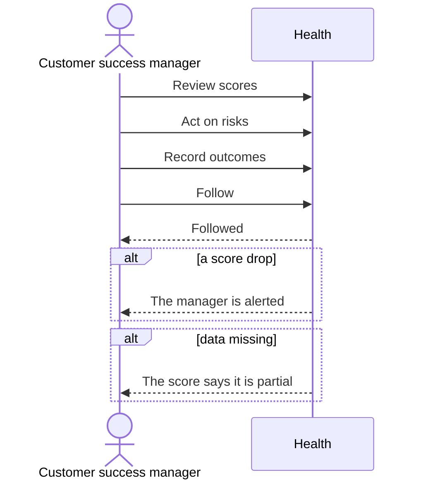

🏠 [Specs](../../../../README.md) › 🏷️ [Sectors](../../../README.md) › 💻 [SC14 IT and software](../../README.md) ›
📝 [Use cases](../README.md) › 📝 [Use cases: FL-SC14-02 Licences and renewals](README.md) ›
📝 UC-SC14-09 Follow customer health and churn risk

# 📝 UC-SC14-09 Follow customer health and churn risk

**Status:** ✅ specified

## Summary

The customer success manager reviews health scores from usage, tickets, payments and surveys, acts on risks and records
outcomes.

## Personas

- [U41 Customer success manager](../../../../01-users/personas/u41-customer-success-manager.md)

## Goal

Churn caught early.

## Trigger

A score drop or a review.

## Frequency

Weekly.

## Preconditions

- The SC14 sector pack is installed for the company,
  [UC-F14-02](../../../../02-functional/f14-plugin-store/use-cases/01-find-and-install/uc-f14-02-install-a-plugin-or-sector-pack.md),
  and its users have their roles,
  [UC-F1-06](../../../../02-functional/f01-administration/use-cases/04-edit-a-role/uc-f01-06-edit-a-role-and-its-record-rules.md).

## Postconditions

- **Success:** actions are recorded.
- **Failed:** the risk stays open.

## Main flow

1. Scores show on [S-SC14-09 Health](../../screens/02-licences-and-renewals/s-sc14-09-health.md)
   ([BR-SC14-13](../../business-rules/br-sc14-13-health-score-from-usage.md)).
2. The manager calls or plans training.
3. Outcomes are recorded.
4. The score is followed.

## Alternative flows

- 2a. A quarterly review: a business review is held,
  [UC-F4-25](../../../../02-functional/f04-meetings/use-cases/12-rooms-and-client-video/uc-f04-25-hold-a-client-video-meeting.md).

## Error flows

- 1e. A score drop: the manager is alerted.
- 1f. Data missing: the score says it is partial.
- Any step: a call to a service or an outside system fails: it is retried first
  ([BR-F3-32](../../../../02-functional/f03-assistant/business-rules/br-f03-32-retry-before-an-error.md)), then the
  error message pattern ([D122](../../../../06-decisions/ux/d122-error-message-standard.md)) says what failed; what was
  typed is kept.

## Business rules

- [BR-SC14-13 Health score from usage](../../business-rules/br-sc14-13-health-score-from-usage.md)

## Entities

- [E-SC14-09 Health score](../../data/e-sc14-09-health-score.md)

## Permissions

The customer success manager roles; the record rules of their role and site apply,
[UC-F1-06](../../../../02-functional/f01-administration/use-cases/04-edit-a-role/uc-f01-06-edit-a-role-and-its-record-rules.md).

## Notifications

None beyond the in-app updates of the records concerned.

## Audit events

Every creation, change and state change of health score records, with who, when and the values before and after (T3).

## AI involvement

The AI assistant answers questions on the health score records of this use case, with links, and prepares them as drafts
the user confirms. It works within the user's rights,
[BR-F3-34](../../../../02-functional/f03-assistant/business-rules/br-f03-34-every-capability-is-reachable-from-the-assistant.md),
and never deletes or does anything irreversible without the user's confirmation,
[BR-F3-07](../../../../02-functional/f03-assistant/business-rules/br-f03-07-no-deletes-no-irreversible-acts.md).

## API, MCP and A2A exposure

Through the API and webhooks (T5) and the MCP and A2A gateway (T6), with the caller's rights,
[BR-F3-34](../../../../02-functional/f03-assistant/business-rules/br-f03-34-every-capability-is-reachable-from-the-assistant.md),
reading, creating and changing the records of this use case; nothing irreversible without a person's confirmation.

## Screens

- [S-SC14-09 Health](../../screens/02-licences-and-renewals/s-sc14-09-health.md)

## Flowchart

See [FL-SC14-02 Licences and renewals](../../flows/fl-sc14-02-licences-and-renewals.md#flowchart).

## Sequence diagram

## Acceptance criteria

1. **Given** the example software company's Acme falling to 62 with usage down **when** the score drops **then** its
   manager is alerted.
2. **Given** Acme at 62 with usage down **when** the score drops **then** the manager is alerted.

## Non-functional notes

[D408](../../../../06-decisions/technical/d408-performance-and-profiles.md)'s targets
([performance](../../../../05-non-functional/performance.md)): 95 % of screens within 1 second; lists paged on the
server, the first page within 1 second; reports within 5 seconds or in the background. WCAG 2.2 AA and RGAA
([D46](../../../../06-decisions/ux/d46-accessibility-standard.md)).

## Regulatory references

None specific to this use case; the sector's legal rules are listed in [SC14 regulatory](../../regulatory.md).

## Related use cases

- [UC-SC14-10 Run renewals and expansion](uc-sc14-10-run-renewals-and-expansion.md)

## Open questions

None.

---

⬅️ [UC-SC14-08](../04-product-delivery/uc-sc14-08-publish-release-notes-to-customers.md) · ⬆️ [Up](README.md) ·
➡️ [UC-SC14-10 Run renewals and expansion](uc-sc14-10-run-renewals-and-expansion.md)
