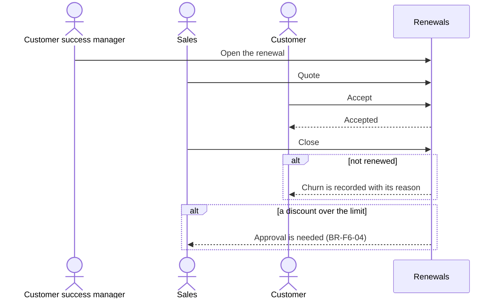

🏠 [Specs](../../../../README.md) › 🏷️ [Sectors](../../../README.md) › 💻 [SC14 IT and software](../../README.md) ›
📝 [Use cases](../README.md) › 📝 [Use cases: FL-SC14-02 Licences and renewals](README.md) ›
📝 UC-SC14-10 Run renewals and expansion

# 📝 UC-SC14-10 Run renewals and expansion

**Status:** ✅ specified

## Summary

The customer success manager opens the renewal, sales quotes and closes it with any upsell.

## Personas

- [U41 Customer success manager](../../../../01-users/personas/u41-customer-success-manager.md)
- [U03 Sales](../../../../01-users/personas/u03-sales.md)
- [U09 Customer](../../../../01-users/personas/u09-customer.md)

## Goal

Renewals closed, expansion won.

## Trigger

A renewal task.

## Frequency

Weekly.

## Preconditions

- The SC14 sector pack is installed for the company,
  [UC-F14-02](../../../../02-functional/f14-plugin-store/use-cases/01-find-and-install/uc-f14-02-install-a-plugin-or-sector-pack.md),
  and its users have their roles,
  [UC-F1-06](../../../../02-functional/f01-administration/use-cases/04-edit-a-role/uc-f01-06-edit-a-role-and-its-record-rules.md).

## Postconditions

- **Success:** the renewal is closed.
- **Failed:** churn is recorded.

## Main flow

1. The manager opens it on [S-SC14-10 Renewals](../../screens/02-licences-and-renewals/s-sc14-10-renewals.md).
2. Sales quotes,
   [UC-F6-03](../../../../02-functional/f06-customers-and-sales/use-cases/01-lead-to-quote/uc-f06-03-create-and-send-a-quote.md).
3. The customer accepts.
4. The subscription renews.

## Alternative flows

- 2a. A multi-year discount: the discount applies with approval.

## Error flows

- 3e. Not renewed: churn is recorded with its reason.
- 2e. A discount over the limit: approval is needed,
  [BR-F6-04](../../../../02-functional/f06-customers-and-sales/business-rules/br-f06-04-large-discounts-need-approval.md).
- Any step: a call to a service or an outside system fails: it is retried first
  ([BR-F3-32](../../../../02-functional/f03-assistant/business-rules/br-f03-32-retry-before-an-error.md)), then the
  error message pattern ([D122](../../../../06-decisions/ux/d122-error-message-standard.md)) says what failed; what was
  typed is kept.

## Business rules

- [BR-SC14-04 Licences renewed before expiry](../../business-rules/br-sc14-04-licences-renewed-before-expiry.md)
- [BR-F6-04 Large discounts need approval](../../../../02-functional/f06-customers-and-sales/business-rules/br-f06-04-large-discounts-need-approval.md)

## Entities

- [E-SC14-01 Software subscription](../../data/e-sc14-01-software-subscription.md)
- [E-SC14-09 Health score](../../data/e-sc14-09-health-score.md)

## Permissions

The customer success manager, sales and customer roles; the record rules of their role and site apply,
[UC-F1-06](../../../../02-functional/f01-administration/use-cases/04-edit-a-role/uc-f01-06-edit-a-role-and-its-record-rules.md).

## Notifications

None beyond the in-app updates of the records concerned.

## Audit events

Every creation, change and state change of subscription, health score records, with who, when and the values before and
after (T3).

## AI involvement

The AI assistant answers questions on the subscription, health score records of this use case, with links, and prepares
them as drafts the user confirms. It works within the user's rights,
[BR-F3-34](../../../../02-functional/f03-assistant/business-rules/br-f03-34-every-capability-is-reachable-from-the-assistant.md),
and never deletes or does anything irreversible without the user's confirmation,
[BR-F3-07](../../../../02-functional/f03-assistant/business-rules/br-f03-07-no-deletes-no-irreversible-acts.md).

## API, MCP and A2A exposure

Through the API and webhooks (T5) and the MCP and A2A gateway (T6), with the caller's rights,
[BR-F3-34](../../../../02-functional/f03-assistant/business-rules/br-f03-34-every-capability-is-reachable-from-the-assistant.md),
reading, creating and changing the records of this use case; nothing irreversible without a person's confirmation.

## Screens

- [S-SC14-10 Renewals](../../screens/02-licences-and-renewals/s-sc14-10-renewals.md)

## Flowchart

See [FL-SC14-02 Licences and renewals](../../flows/fl-sc14-02-licences-and-renewals.md#flowchart).

## Sequence diagram

## Acceptance criteria

1. **Given** the example software company's Acme renewing with 30 seats **when** it is closed **then** the subscription
   shows 30 seats.
2. **Given** Acme not renewing **when** the term ends **then** churn is recorded with its reason.

## Non-functional notes

[D408](../../../../06-decisions/technical/d408-performance-and-profiles.md)'s targets
([performance](../../../../05-non-functional/performance.md)): 95 % of screens within 1 second; lists paged on the
server, the first page within 1 second; reports within 5 seconds or in the background. WCAG 2.2 AA and RGAA
([D46](../../../../06-decisions/ux/d46-accessibility-standard.md)).

## Regulatory references

None specific to this use case; the sector's legal rules are listed in [SC14 regulatory](../../regulatory.md).

## Related use cases

- [UC-SC14-18 Follow SaaS metrics](../06-portal-and-metrics/uc-sc14-18-follow-saas-metrics.md)

## Open questions

None.

---

⬅️ [UC-SC14-09 Follow customer health and churn risk](uc-sc14-09-follow-customer-health-and-churn-risk.md) ·
⬆️ [Up](README.md) · ➡️ [UC-SC14-11](../05-security-and-data-compliance/uc-sc14-11-sign-data-processing-agreements.md)
