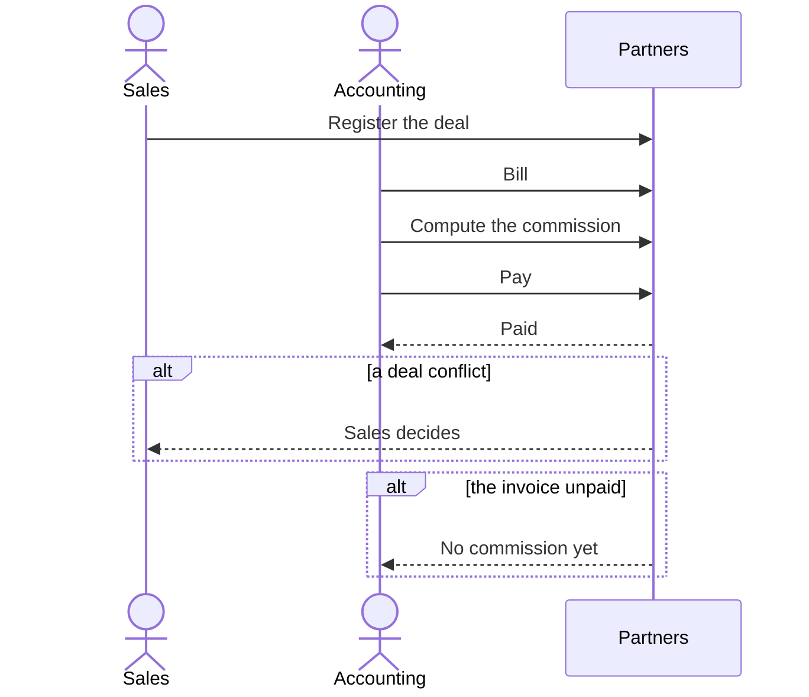

🏠 [Specs](../../../../README.md) › 🏷️ [Sectors](../../../README.md) › 💻 [SC14 IT and software](../../README.md) ›
📝 [Use cases](../README.md) › 📝 [Use cases: FL-SC14-02 Licences and renewals](README.md) ›
📝 UC-SC14-19 Manage partners and resellers

# 📝 UC-SC14-19 Manage partners and resellers

**Status:** ✅ specified

## Summary

Sales registers partners' deals; accounting bills them and pays commissions on collection through the shared commissions
capability.

## Personas

- [U03 Sales](../../../../01-users/personas/u03-sales.md)
- [U05 Accounting](../../../../01-users/personas/u05-accounting.md)

## Goal

Partners paid on what they bring.

## Trigger

A partner's deal.

## Frequency

Weekly.

## Preconditions

- The SC14 sector pack is installed for the company,
  [UC-F14-02](../../../../02-functional/f14-plugin-store/use-cases/01-find-and-install/uc-f14-02-install-a-plugin-or-sector-pack.md),
  and its users have their roles,
  [UC-F1-06](../../../../02-functional/f01-administration/use-cases/04-edit-a-role/uc-f01-06-edit-a-role-and-its-record-rules.md).

## Postconditions

- **Success:** the commission is paid.
- **Failed:** a conflict is decided.

## Main flow

1. Sales registers the deal on [S-SC14-19 Partners](../../screens/02-licences-and-renewals/s-sc14-19-partners.md).
2. Accounting bills the customer.
3. It is computed on collection,
   [UC-F6-25](../../../../02-functional/f06-customers-and-sales/use-cases/09-sell-on-the-road-and-steer-sales/uc-f06-25-set-sales-targets-and-pay-commissions.md),
   [BR-F6-18](../../../../02-functional/f06-customers-and-sales/business-rules/br-f06-18-commissions-follow-paid-invoices.md).
4. The partner is paid.

## Alternative flows

- 1a. A partner portal: partners register deals themselves,
  [UC-F2-20](../../../../02-functional/f02-no-code-configuration/use-cases/09-portals-and-offline-forms/uc-f02-20-expose-a-record-type-on-a-portal.md).

## Error flows

- 1e. A deal conflict: sales decides.
- 3e. The invoice unpaid: no commission yet.
- Any step: a call to a service or an outside system fails: it is retried first
  ([BR-F3-32](../../../../02-functional/f03-assistant/business-rules/br-f03-32-retry-before-an-error.md)), then the
  error message pattern ([D122](../../../../06-decisions/ux/d122-error-message-standard.md)) says what failed; what was
  typed is kept.

## Business rules

- [BR-SC14-15 Partners' commissions from deals](../../business-rules/br-sc14-15-partners-commissions-from-deals.md)
- [BR-F6-18 Commissions follow paid invoices](../../../../02-functional/f06-customers-and-sales/business-rules/br-f06-18-commissions-follow-paid-invoices.md)

## Entities

- [E-SC14-15 Partner deal](../../data/e-sc14-15-partner-deal.md)
- [E-F6-19 Commission line](../../../../02-functional/f06-customers-and-sales/data/e-f06-19-commission-line.md)

## Permissions

The sales and accounting roles; the record rules of their role and site apply,
[UC-F1-06](../../../../02-functional/f01-administration/use-cases/04-edit-a-role/uc-f01-06-edit-a-role-and-its-record-rules.md).

## Notifications

None beyond the in-app updates of the records concerned.

## Audit events

Every creation, change and state change of partner deal, commission line records, with who, when and the values before
and after (T3).

## AI involvement

The AI assistant answers questions on the partner deal, commission line records of this use case, with links, and
prepares them as drafts the user confirms. It works within the user's rights,
[BR-F3-34](../../../../02-functional/f03-assistant/business-rules/br-f03-34-every-capability-is-reachable-from-the-assistant.md),
and never deletes or does anything irreversible without the user's confirmation,
[BR-F3-07](../../../../02-functional/f03-assistant/business-rules/br-f03-07-no-deletes-no-irreversible-acts.md).

## API, MCP and A2A exposure

Through the API and webhooks (T5) and the MCP and A2A gateway (T6), with the caller's rights,
[BR-F3-34](../../../../02-functional/f03-assistant/business-rules/br-f03-34-every-capability-is-reachable-from-the-assistant.md),
reading, creating and changing the records of this use case; nothing irreversible without a person's confirmation.

## Screens

- [S-SC14-19 Partners](../../screens/02-licences-and-renewals/s-sc14-19-partners.md)

## Flowchart

See [FL-SC14-02 Licences and renewals](../../flows/fl-sc14-02-licences-and-renewals.md#flowchart).

## Sequence diagram

## Acceptance criteria

1. **Given** the example software company's Partner P bringing Beta for 12,000 EUR at 20 % **when** Beta pays **then**
   2,400 EUR is due to Partner P.
2. **Given** Beta registered by two partners **when** it is registered **then** sales decides.

## Non-functional notes

[D408](../../../../06-decisions/technical/d408-performance-and-profiles.md)'s targets
([performance](../../../../05-non-functional/performance.md)): 95 % of screens within 1 second; lists paged on the
server, the first page within 1 second; reports within 5 seconds or in the background. WCAG 2.2 AA and RGAA
([D46](../../../../06-decisions/ux/d46-accessibility-standard.md)).

## Regulatory references

None specific to this use case; the sector's legal rules are listed in [SC14 regulatory](../../regulatory.md).

## Related use cases

- [UC-SC14-01 Sell subscriptions with plans and seats](../01-subscriptions-and-billing/uc-sc14-01-sell-subscriptions-with-plans-and-seats.md)

## Open questions

None.

---

⬅️ [UC-SC14-18 Follow SaaS metrics](../06-portal-and-metrics/uc-sc14-18-follow-saas-metrics.md) · ⬆️ [Up](README.md) ·
➡️ [UC-SC14-20 Ask the AI assistant](../06-portal-and-metrics/uc-sc14-20-ask-the-assistant.md)
