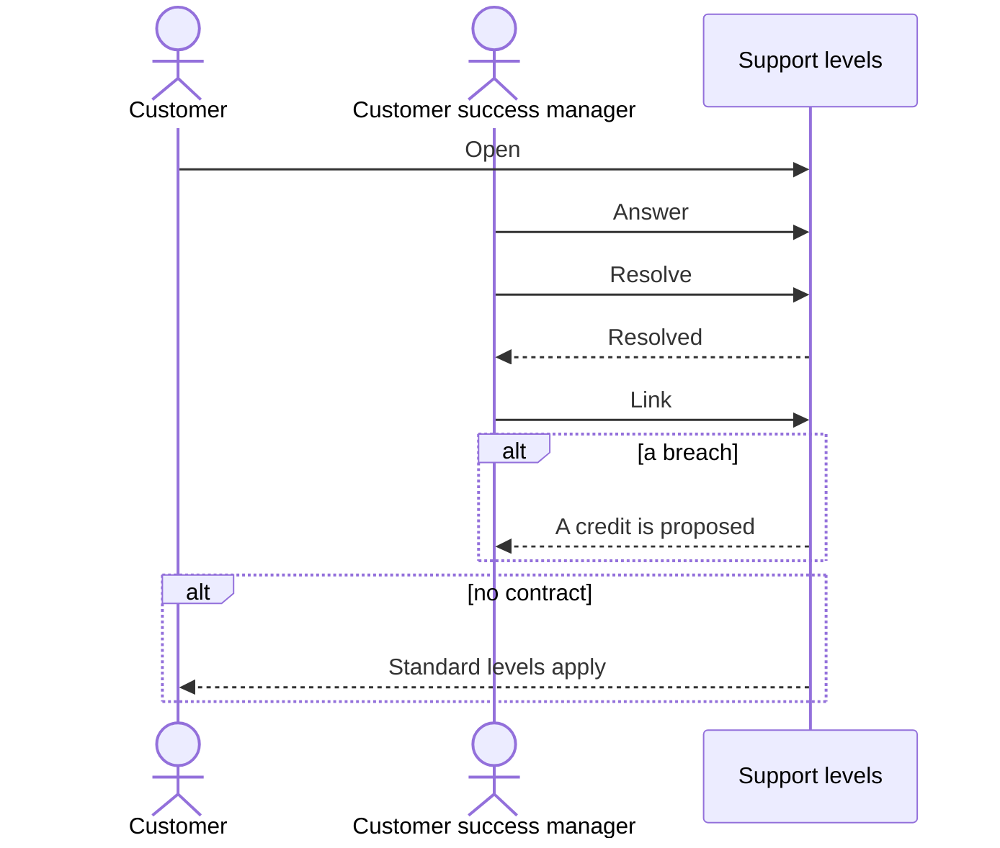

🏠 [Specs](../../../../README.md) › 🏷️ [Sectors](../../../README.md) › 💻 [SC14 IT and software](../../README.md) ›
📝 [Use cases](../README.md) › 📝 [Use cases: FL-SC14-03 Support and services](README.md) ›
📝 UC-SC14-05 Run support with service levels

# 📝 UC-SC14-05 Run support with service levels

**Status:** ✅ specified

## Summary

Customers open tickets; support answers and resolves within the customer's service level, measured by F16; breaches
propose credits.

## Personas

- [U09 Customer](../../../../01-users/personas/u09-customer.md)
- [U41 Customer success manager](../../../../01-users/personas/u41-customer-success-manager.md)

## Goal

Tickets solved within service levels.

## Trigger

A ticket.

## Frequency

Daily.

## Preconditions

- The SC14 sector pack is installed for the company,
  [UC-F14-02](../../../../02-functional/f14-plugin-store/use-cases/01-find-and-install/uc-f14-02-install-a-plugin-or-sector-pack.md),
  and its users have their roles,
  [UC-F1-06](../../../../02-functional/f01-administration/use-cases/04-edit-a-role/uc-f01-06-edit-a-role-and-its-record-rules.md).

## Postconditions

- **Success:** the ticket is resolved in time.
- **Failed:** a credit is proposed.

## Main flow

1. The customer opens a ticket on
   [S-SC14-05 Support levels](../../screens/03-support-and-services/s-sc14-05-support-levels.md),
   [UC-F16-01](../../../../02-functional/f16-customer-support-agents/use-cases/01-resolve-a-request/uc-f16-01-resolve-a-customer-request-automatically.md).
2. Support answers within the response time ([BR-SC14-05](../../business-rules/br-sc14-05-service-levels-measured.md)).
3. Support resolves.
4. A bug links to its feature
   ([UC-SC14-21](../04-product-delivery/uc-sc14-21-follow-features-and-products-in-the-development-tool.md)).

## Alternative flows

- 2a. 24/7 for premium: the on-call rota answers.

## Error flows

- 3e. A breach: a credit is proposed.
- 1e. No contract: standard levels apply.
- Any step: a call to a service or an outside system fails: it is retried first
  ([BR-F3-32](../../../../02-functional/f03-assistant/business-rules/br-f03-32-retry-before-an-error.md)), then the
  error message pattern ([D122](../../../../06-decisions/ux/d122-error-message-standard.md)) says what failed; what was
  typed is kept.

## Business rules

- [BR-SC14-05 Service levels measured](../../business-rules/br-sc14-05-service-levels-measured.md)

## Entities

- [E-SC14-05 Service level](../../data/e-sc14-05-service-level.md)

## Permissions

The customer and customer success manager roles; the record rules of their role and site apply,
[UC-F1-06](../../../../02-functional/f01-administration/use-cases/04-edit-a-role/uc-f01-06-edit-a-role-and-its-record-rules.md).

## Notifications

None beyond the in-app updates of the records concerned.

## Audit events

Every creation, change and state change of service level records, with who, when and the values before and after (T3).

## AI involvement

The AI assistant answers questions on the service level records of this use case, with links, and prepares them as
drafts the user confirms. It works within the user's rights,
[BR-F3-34](../../../../02-functional/f03-assistant/business-rules/br-f03-34-every-capability-is-reachable-from-the-assistant.md),
and never deletes or does anything irreversible without the user's confirmation,
[BR-F3-07](../../../../02-functional/f03-assistant/business-rules/br-f03-07-no-deletes-no-irreversible-acts.md).

## API, MCP and A2A exposure

Through the API and webhooks (T5) and the MCP and A2A gateway (T6), with the caller's rights,
[BR-F3-34](../../../../02-functional/f03-assistant/business-rules/br-f03-34-every-capability-is-reachable-from-the-assistant.md),
reading, creating and changing the records of this use case; nothing irreversible without a person's confirmation.

## Screens

- [S-SC14-05 Support levels](../../screens/03-support-and-services/s-sc14-05-support-levels.md)

## Flowchart

See [FL-SC14-03 Support and services](../../flows/fl-sc14-03-support-and-services.md#flowchart).

## Sequence diagram

## Acceptance criteria

1. **Given** the example software company's Acme on premium with P1 at 1 hour and 4 hours **when** a P1 is answered in
   40 minutes **then** the response time is met.
2. **Given** a P1 for Acme resolved after 6 hours with 4 hours agreed **when** it is resolved **then** a credit is
   proposed.

## Non-functional notes

[D408](../../../../06-decisions/technical/d408-performance-and-profiles.md)'s targets
([performance](../../../../05-non-functional/performance.md)): 95 % of screens within 1 second; lists paged on the
server, the first page within 1 second; reports within 5 seconds or in the background. WCAG 2.2 AA and RGAA
([D46](../../../../06-decisions/ux/d46-accessibility-standard.md)).

## Regulatory references

None specific to this use case; the sector's legal rules are listed in [SC14 regulatory](../../regulatory.md).

## Related use cases

- [UC-SC14-06 Manage managed-service contracts and customers' assets](uc-sc14-06-manage-managed-service-contracts-and-customers-assets.md)

## Open questions

None.

---

⬅️ [UC-SC14-04](../02-licences-and-renewals/uc-sc14-04-manage-licences-keys-and-renewals.md) · ⬆️ [Up](README.md) ·
➡️ [UC-SC14-06](uc-sc14-06-manage-managed-service-contracts-and-customers-assets.md)
