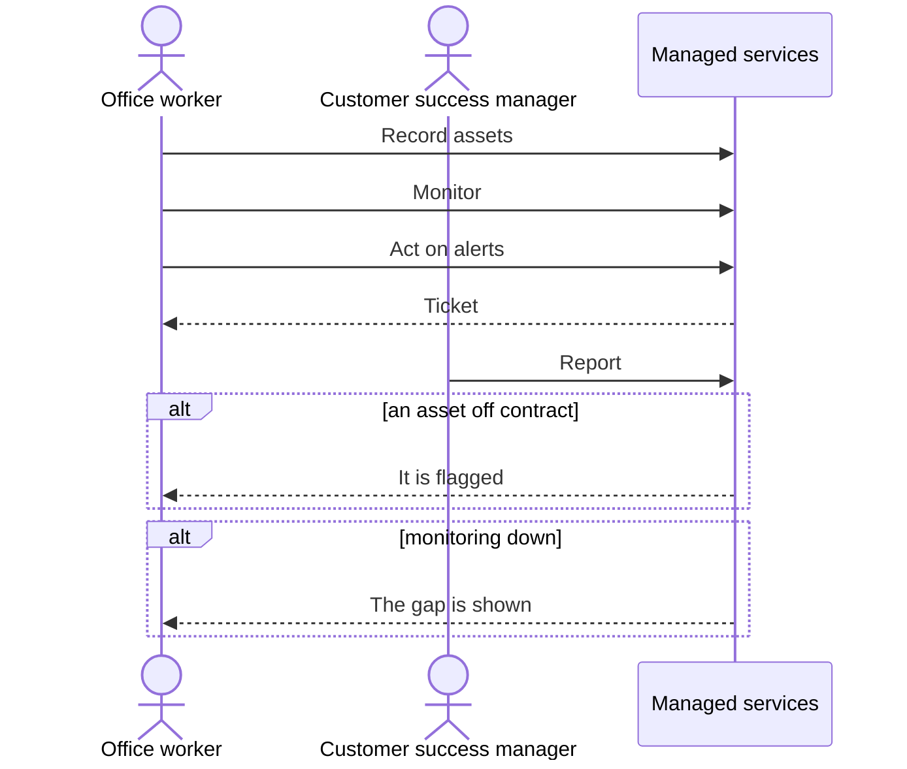

🏠 [Specs](../../../../README.md) › 🏷️ [Sectors](../../../README.md) › 💻 [SC14 IT and software](../../README.md) ›
📝 [Use cases](../README.md) › 📝 [Use cases: FL-SC14-03 Support and services](README.md) ›
📝 UC-SC14-06 Manage managed-service contracts and customers' assets

# 📝 UC-SC14-06 Manage managed-service contracts and customers' assets

**Status:** ✅ specified

## Summary

An office worker records customers' assets under contract, monitors them through connectors and acts on alerts.

## Personas

- [U16 Office worker](../../../../01-users/personas/u16-office-worker.md)
- [U41 Customer success manager](../../../../01-users/personas/u41-customer-success-manager.md)

## Goal

Customers' assets watched and covered.

## Trigger

A new contract or an alert.

## Frequency

Daily.

## Preconditions

- The SC14 sector pack is installed for the company,
  [UC-F14-02](../../../../02-functional/f14-plugin-store/use-cases/01-find-and-install/uc-f14-02-install-a-plugin-or-sector-pack.md),
  and its users have their roles,
  [UC-F1-06](../../../../02-functional/f01-administration/use-cases/04-edit-a-role/uc-f01-06-edit-a-role-and-its-record-rules.md).

## Postconditions

- **Success:** alerts are handled.
- **Failed:** assets off contract are flagged.

## Main flow

1. Assets are recorded on
   [S-SC14-06 Managed services](../../screens/03-support-and-services/s-sc14-06-managed-services.md).
2. Monitoring comes through the connector (T12).
3. An alert opens a ticket ([UC-SC14-05](uc-sc14-05-run-support-with-service-levels.md)).
4. The monthly report goes to the customer.

## Alternative flows

- 3a. A patch campaign: patches are planned across assets.

## Error flows

- 3e. An asset off contract: it is flagged.
- 2e. Monitoring down: the gap is shown.
- Any step: a call to a service or an outside system fails: it is retried first
  ([BR-F3-32](../../../../02-functional/f03-assistant/business-rules/br-f03-32-retry-before-an-error.md)), then the
  error message pattern ([D122](../../../../06-decisions/ux/d122-error-message-standard.md)) says what failed; what was
  typed is kept.

## Business rules

- [BR-SC14-05 Service levels measured](../../business-rules/br-sc14-05-service-levels-measured.md)

## Entities

- [E-SC14-06 Managed asset](../../data/e-sc14-06-managed-asset.md)

## Permissions

The office worker and customer success manager roles; the record rules of their role and site apply,
[UC-F1-06](../../../../02-functional/f01-administration/use-cases/04-edit-a-role/uc-f01-06-edit-a-role-and-its-record-rules.md).

## Notifications

None beyond the in-app updates of the records concerned.

## Audit events

Every creation, change and state change of managed asset records, with who, when and the values before and after (T3).

## AI involvement

The AI assistant answers questions on the managed asset records of this use case, with links, and prepares them as
drafts the user confirms. It works within the user's rights,
[BR-F3-34](../../../../02-functional/f03-assistant/business-rules/br-f03-34-every-capability-is-reachable-from-the-assistant.md),
and never deletes or does anything irreversible without the user's confirmation,
[BR-F3-07](../../../../02-functional/f03-assistant/business-rules/br-f03-07-no-deletes-no-irreversible-acts.md).

## API, MCP and A2A exposure

Through the API and webhooks (T5) and the MCP and A2A gateway (T6), with the caller's rights,
[BR-F3-34](../../../../02-functional/f03-assistant/business-rules/br-f03-34-every-capability-is-reachable-from-the-assistant.md),
reading, creating and changing the records of this use case; nothing irreversible without a person's confirmation.

## Screens

- [S-SC14-06 Managed services](../../screens/03-support-and-services/s-sc14-06-managed-services.md)

## Flowchart

See [FL-SC14-03 Support and services](../../flows/fl-sc14-03-support-and-services.md#flowchart).

## Sequence diagram

## Acceptance criteria

1. **Given** the example software company's Acme server S1 under MSP-12 **when** an alert comes **then** a ticket opens.
2. **Given** server S2 not in MSP-12 **when** an alert comes **then** it is flagged.

## Non-functional notes

[D408](../../../../06-decisions/technical/d408-performance-and-profiles.md)'s targets
([performance](../../../../05-non-functional/performance.md)): 95 % of screens within 1 second; lists paged on the
server, the first page within 1 second; reports within 5 seconds or in the background. WCAG 2.2 AA and RGAA
([D46](../../../../06-decisions/ux/d46-accessibility-standard.md)).

## Regulatory references

None specific to this use case; the sector's legal rules are listed in [SC14 regulatory](../../regulatory.md).

## Related use cases

- [UC-SC14-05 Run support with service levels](uc-sc14-05-run-support-with-service-levels.md)

## Open questions

None.

---

⬅️ [UC-SC14-05 Run support with service levels](uc-sc14-05-run-support-with-service-levels.md) · ⬆️ [Up](README.md) ·
➡️ [UC-SC14-07](../04-product-delivery/uc-sc14-07-plan-it-projects-in-sprints-with-time.md)
