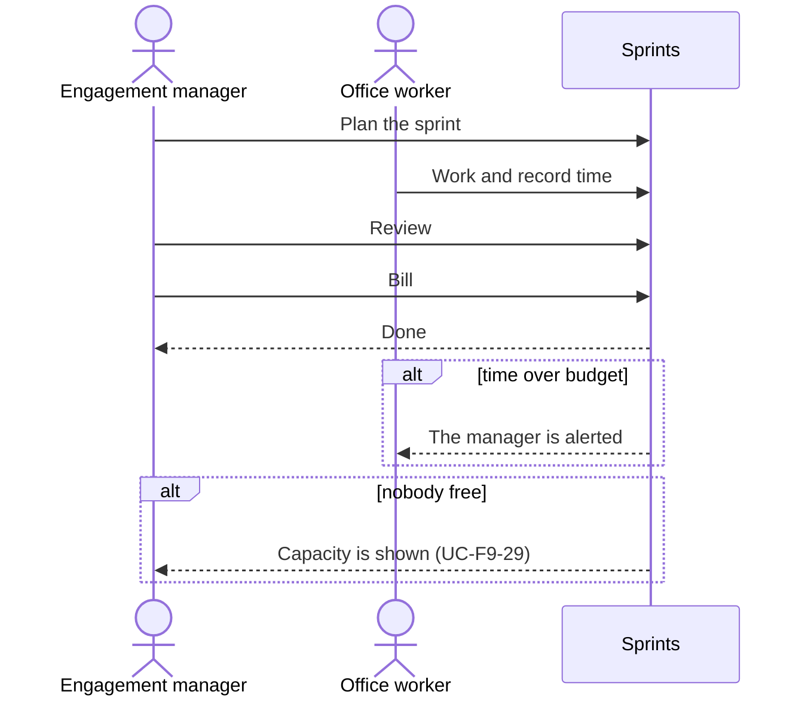

🏠 [Specs](../../../../README.md) › 🏷️ [Sectors](../../../README.md) › 💻 [SC14 IT and software](../../README.md) ›
📝 [Use cases](../README.md) › 📝 [Use cases: FL-SC14-04 Product delivery](README.md) ›
📝 UC-SC14-07 Plan IT projects in sprints with time

# 📝 UC-SC14-07 Plan IT projects in sprints with time

**Status:** ✅ specified

## Summary

The engagement manager plans sprints; the team works and records time; the sprint is reviewed.

## Personas

- [U16 Office worker](../../../../01-users/personas/u16-office-worker.md)
- [U24 Engagement manager](../../../../01-users/personas/u24-engagement-manager.md)

## Goal

Projects delivered within budget.

## Trigger

A project.

## Frequency

Every sprint.

## Preconditions

- The SC14 sector pack is installed for the company,
  [UC-F14-02](../../../../02-functional/f14-plugin-store/use-cases/01-find-and-install/uc-f14-02-install-a-plugin-or-sector-pack.md),
  and its users have their roles,
  [UC-F1-06](../../../../02-functional/f01-administration/use-cases/04-edit-a-role/uc-f01-06-edit-a-role-and-its-record-rules.md).

## Postconditions

- **Success:** the sprint is reviewed.
- **Failed:** an alert shows over budget.

## Main flow

1. The manager plans on [S-SC14-07 Sprints](../../screens/04-product-delivery/s-sc14-07-sprints.md),
   [UC-F9-17](../../../../02-functional/f09-hr-and-projects/use-cases/06-plan-and-deliver-work/uc-f09-17-manage-projects-and-tasks.md).
2. The team records time,
   [UC-F9-16](../../../../02-functional/f09-hr-and-projects/use-cases/03-time/uc-f09-16-record-and-validate-timesheets.md).
3. The sprint is reviewed.
4. Time is billed or counted against the price.

## Alternative flows

- 4a. A fixed-price project: time is counted against the budget.

## Error flows

- 2e. Time over budget: the manager is alerted.
- 1e. Nobody free: capacity is shown,
  [UC-F9-29](../../../../02-functional/f09-hr-and-projects/use-cases/11-capacity-rounds-and-partners/uc-f09-29-plan-capacity-across-projects.md).
- Any step: a call to a service or an outside system fails: it is retried first
  ([BR-F3-32](../../../../02-functional/f03-assistant/business-rules/br-f03-32-retry-before-an-error.md)), then the
  error message pattern ([D122](../../../../06-decisions/ux/d122-error-message-standard.md)) says what failed; what was
  typed is kept.

## Business rules

- [BR-SC14-14 Features linked to requests](../../business-rules/br-sc14-14-features-linked-to-requests.md)

## Entities

- [E-SC14-07 Sprint](../../data/e-sc14-07-sprint.md)

## Permissions

The office worker and engagement manager roles; the record rules of their role and site apply,
[UC-F1-06](../../../../02-functional/f01-administration/use-cases/04-edit-a-role/uc-f01-06-edit-a-role-and-its-record-rules.md).

## Notifications

None beyond the in-app updates of the records concerned.

## Audit events

Every creation, change and state change of sprint records, with who, when and the values before and after (T3).

## AI involvement

The AI assistant answers questions on the sprint records of this use case, with links, and prepares them as drafts the
user confirms. It works within the user's rights,
[BR-F3-34](../../../../02-functional/f03-assistant/business-rules/br-f03-34-every-capability-is-reachable-from-the-assistant.md),
and never deletes or does anything irreversible without the user's confirmation,
[BR-F3-07](../../../../02-functional/f03-assistant/business-rules/br-f03-07-no-deletes-no-irreversible-acts.md).

## API, MCP and A2A exposure

Through the API and webhooks (T5) and the MCP and A2A gateway (T6), with the caller's rights,
[BR-F3-34](../../../../02-functional/f03-assistant/business-rules/br-f03-34-every-capability-is-reachable-from-the-assistant.md),
reading, creating and changing the records of this use case; nothing irreversible without a person's confirmation.

## Screens

- [S-SC14-07 Sprints](../../screens/04-product-delivery/s-sc14-07-sprints.md)

## Flowchart

See [FL-SC14-04 Product delivery](../../flows/fl-sc14-04-product-delivery.md#flowchart).

## Sequence diagram

## Acceptance criteria

1. **Given** the example software company's Portal sprint W47-48 with goal export **when** it is reviewed **then** done
   items show.
2. **Given** the Portal project over budget **when** time is recorded **then** the manager is alerted.

## Non-functional notes

[D408](../../../../06-decisions/technical/d408-performance-and-profiles.md)'s targets
([performance](../../../../05-non-functional/performance.md)): 95 % of screens within 1 second; lists paged on the
server, the first page within 1 second; reports within 5 seconds or in the background. WCAG 2.2 AA and RGAA
([D46](../../../../06-decisions/ux/d46-accessibility-standard.md)).

## Regulatory references

None specific to this use case; the sector's legal rules are listed in [SC14 regulatory](../../regulatory.md).

## Related use cases

- [UC-SC14-21 Follow features and products in the development tool](uc-sc14-21-follow-features-and-products-in-the-development-tool.md)

## Open questions

None.

---

⬅️ [UC-SC14-06](../03-support-and-services/uc-sc14-06-manage-managed-service-contracts-and-customers-assets.md) ·
⬆️ [Up](README.md) ·
➡️ [UC-SC14-08 Publish release notes to customers](uc-sc14-08-publish-release-notes-to-customers.md)
