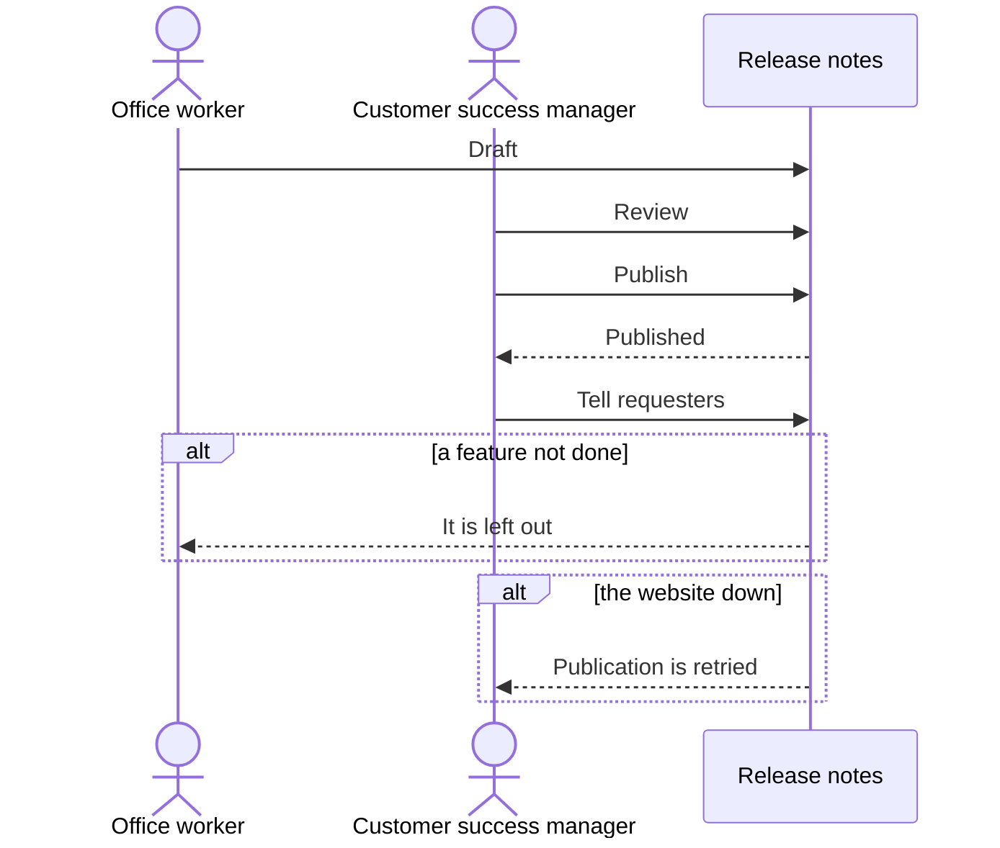

🏠 [Specs](../../../../README.md) › 🏷️ [Sectors](../../../README.md) › 💻 [SC14 IT and software](../../README.md) ›
📝 [Use cases](../README.md) › 📝 [Use cases: FL-SC14-04 Product delivery](README.md) ›
📝 UC-SC14-08 Publish release notes to customers

# 📝 UC-SC14-08 Publish release notes to customers

**Status:** ✅ specified

## Summary

An office worker drafts release notes from the features linked in the development tool; the customer success manager
reviews and publishes them.

## Personas

- [U16 Office worker](../../../../01-users/personas/u16-office-worker.md)
- [U41 Customer success manager](../../../../01-users/personas/u41-customer-success-manager.md)

## Goal

Customers know what changed.

## Trigger

A release.

## Frequency

Per release.

## Preconditions

- The SC14 sector pack is installed for the company,
  [UC-F14-02](../../../../02-functional/f14-plugin-store/use-cases/01-find-and-install/uc-f14-02-install-a-plugin-or-sector-pack.md),
  and its users have their roles,
  [UC-F1-06](../../../../02-functional/f01-administration/use-cases/04-edit-a-role/uc-f01-06-edit-a-role-and-its-record-rules.md).

## Postconditions

- **Success:** notes are published.
- **Failed:** the notes stay drafts.

## Main flow

1. Notes are drafted on [S-SC14-08 Release notes](../../screens/04-product-delivery/s-sc14-08-release-notes.md) from
   done features ([BR-SC14-14](../../business-rules/br-sc14-14-features-linked-to-requests.md)).
2. The manager reviews.
3. Notes are published.
4. Customers who asked are told.

## Alternative flows

- 3a. Private notes per customer: a customer gets its own notes.

## Error flows

- 1e. A feature not done: it is left out.
- 3e. The website down: publication is retried.
- Any step: a call to a service or an outside system fails: it is retried first
  ([BR-F3-32](../../../../02-functional/f03-assistant/business-rules/br-f03-32-retry-before-an-error.md)), then the
  error message pattern ([D122](../../../../06-decisions/ux/d122-error-message-standard.md)) says what failed; what was
  typed is kept.

## Business rules

- [BR-SC14-14 Features linked to requests](../../business-rules/br-sc14-14-features-linked-to-requests.md)

## Entities

- [E-SC14-08 Software release note](../../data/e-sc14-08-software-release-note.md)

## Permissions

The office worker and customer success manager roles; the record rules of their role and site apply,
[UC-F1-06](../../../../02-functional/f01-administration/use-cases/04-edit-a-role/uc-f01-06-edit-a-role-and-its-record-rules.md).

## Notifications

None beyond the in-app updates of the records concerned.

## Audit events

Every creation, change and state change of release note records, with who, when and the values before and after (T3).

## AI involvement

The AI assistant answers questions on the release note records of this use case, with links, and prepares them as drafts
the user confirms. It works within the user's rights,
[BR-F3-34](../../../../02-functional/f03-assistant/business-rules/br-f03-34-every-capability-is-reachable-from-the-assistant.md),
and never deletes or does anything irreversible without the user's confirmation,
[BR-F3-07](../../../../02-functional/f03-assistant/business-rules/br-f03-07-no-deletes-no-irreversible-acts.md).

## API, MCP and A2A exposure

Through the API and webhooks (T5) and the MCP and A2A gateway (T6), with the caller's rights,
[BR-F3-34](../../../../02-functional/f03-assistant/business-rules/br-f03-34-every-capability-is-reachable-from-the-assistant.md),
reading, creating and changing the records of this use case; nothing irreversible without a person's confirmation.

## Screens

- [S-SC14-08 Release notes](../../screens/04-product-delivery/s-sc14-08-release-notes.md)

## Flowchart

See [FL-SC14-04 Product delivery](../../flows/fl-sc14-04-product-delivery.md#flowchart).

## Sequence diagram

## Acceptance criteria

1. **Given** the example software company's Desk Pro 4.2 with 6 features **when** notes are published **then** the 7
   requesters of #412 are told.
2. **Given** #412 still in progress **when** notes are drafted **then** it is left out.

## Non-functional notes

[D408](../../../../06-decisions/technical/d408-performance-and-profiles.md)'s targets
([performance](../../../../05-non-functional/performance.md)): 95 % of screens within 1 second; lists paged on the
server, the first page within 1 second; reports within 5 seconds or in the background. WCAG 2.2 AA and RGAA
([D46](../../../../06-decisions/ux/d46-accessibility-standard.md)).

## Regulatory references

None specific to this use case; the sector's legal rules are listed in [SC14 regulatory](../../regulatory.md).

## Related use cases

- [UC-SC14-21 Follow features and products in the development tool](uc-sc14-21-follow-features-and-products-in-the-development-tool.md)

## Open questions

None.

---

⬅️ [UC-SC14-07 Plan IT projects in sprints with time](uc-sc14-07-plan-it-projects-in-sprints-with-time.md) ·
⬆️ [Up](README.md) · ➡️ [UC-SC14-09](../02-licences-and-renewals/uc-sc14-09-follow-customer-health-and-churn-risk.md)
