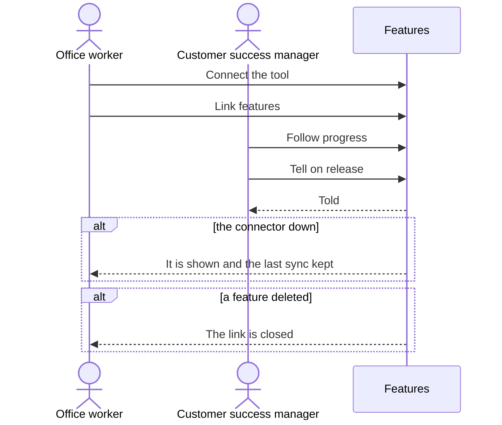

🏠 [Specs](../../../../README.md) › 🏷️ [Sectors](../../../README.md) › 💻 [SC14 IT and software](../../README.md) ›
📝 [Use cases](../README.md) › 📝 [Use cases: FL-SC14-04 Product delivery](README.md) ›
📝 UC-SC14-21 Follow features and products in the development tool

# 📝 UC-SC14-21 Follow features and products in the development tool

**Status:** ✅ specified

## Summary

An office worker connects the development tool, links features to requests and tickets, follows progress and tells
customers on release.

## Personas

- [U16 Office worker](../../../../01-users/personas/u16-office-worker.md)
- [U41 Customer success manager](../../../../01-users/personas/u41-customer-success-manager.md)

## Goal

Every request linked to its feature, both ways.

## Trigger

A request or a feature.

## Frequency

Daily.

## Preconditions

- The SC14 sector pack is installed for the company,
  [UC-F14-02](../../../../02-functional/f14-plugin-store/use-cases/01-find-and-install/uc-f14-02-install-a-plugin-or-sector-pack.md),
  and its users have their roles,
  [UC-F1-06](../../../../02-functional/f01-administration/use-cases/04-edit-a-role/uc-f01-06-edit-a-role-and-its-record-rules.md).

## Postconditions

- **Success:** links are kept and customers told.
- **Failed:** the last sync is kept.

## Main flow

1. The tool is connected on [S-SC14-21 Features](../../screens/04-product-delivery/s-sc14-21-features.md),
   [UC-F24-01](../../../../02-functional/f24-integrations-hub/use-cases/01-find-and-connect/uc-f24-01-browse-the-connector-catalogue.md).
2. Features are linked to requests ([BR-SC14-14](../../business-rules/br-sc14-14-features-linked-to-requests.md)).
3. Progress shows on customers' requests.
4. Customers are told ([UC-SC14-08](uc-sc14-08-publish-release-notes-to-customers.md)).

## Alternative flows

- 1a. Several tools: each tool is connected.

## Error flows

- 1e. The connector down: it is shown and the last sync kept.
- 2e. A feature deleted: the link is closed.
- Any step: a call to a service or an outside system fails: it is retried first
  ([BR-F3-32](../../../../02-functional/f03-assistant/business-rules/br-f03-32-retry-before-an-error.md)), then the
  error message pattern ([D122](../../../../06-decisions/ux/d122-error-message-standard.md)) says what failed; what was
  typed is kept.

## Business rules

- [BR-SC14-14 Features linked to requests](../../business-rules/br-sc14-14-features-linked-to-requests.md)

## Entities

- [E-SC14-16 Tracked feature](../../data/e-sc14-16-tracked-feature.md)
- [E-SC14-08 Software release note](../../data/e-sc14-08-software-release-note.md)

## Permissions

The office worker and customer success manager roles; the record rules of their role and site apply,
[UC-F1-06](../../../../02-functional/f01-administration/use-cases/04-edit-a-role/uc-f01-06-edit-a-role-and-its-record-rules.md).

## Notifications

None beyond the in-app updates of the records concerned.

## Audit events

Every creation, change and state change of tracked feature, release note records, with who, when and the values before
and after (T3).

## AI involvement

The AI assistant answers questions on the tracked feature, release note records of this use case, with links, and
prepares them as drafts the user confirms. It works within the user's rights,
[BR-F3-34](../../../../02-functional/f03-assistant/business-rules/br-f03-34-every-capability-is-reachable-from-the-assistant.md),
and never deletes or does anything irreversible without the user's confirmation,
[BR-F3-07](../../../../02-functional/f03-assistant/business-rules/br-f03-07-no-deletes-no-irreversible-acts.md).

## API, MCP and A2A exposure

Through the API and webhooks (T5) and the MCP and A2A gateway (T6), with the caller's rights,
[BR-F3-34](../../../../02-functional/f03-assistant/business-rules/br-f03-34-every-capability-is-reachable-from-the-assistant.md),
reading, creating and changing the records of this use case; nothing irreversible without a person's confirmation.

## Screens

- [S-SC14-21 Features](../../screens/04-product-delivery/s-sc14-21-features.md)

## Flowchart

See [FL-SC14-04 Product delivery](../../flows/fl-sc14-04-product-delivery.md#flowchart).

## Sequence diagram

## Acceptance criteria

1. **Given** the example software company's GitHub #412 CSV export linked to 7 requests **when** it closes **then** the
   7 requests show done.
2. **Given** GitHub unreachable **when** it syncs **then** it is shown and the last sync kept.

## Non-functional notes

[D408](../../../../06-decisions/technical/d408-performance-and-profiles.md)'s targets
([performance](../../../../05-non-functional/performance.md)): 95 % of screens within 1 second; lists paged on the
server, the first page within 1 second; reports within 5 seconds or in the background. WCAG 2.2 AA and RGAA
([D46](../../../../06-decisions/ux/d46-accessibility-standard.md)).

## Regulatory references

None specific to this use case; the sector's legal rules are listed in [SC14 regulatory](../../regulatory.md).

## Related use cases

- [UC-SC14-08 Publish release notes to customers](uc-sc14-08-publish-release-notes-to-customers.md)

## Open questions

None.

---

⬅️ [UC-SC14-20 Ask the AI assistant](../06-portal-and-metrics/uc-sc14-20-ask-the-assistant.md) · ⬆️ [Up](README.md) ·
➡️ [UC-SC14-22](../07-hardware-licences-and-tax-credits/uc-sc14-22-resell-and-lease-it-hardware.md)
