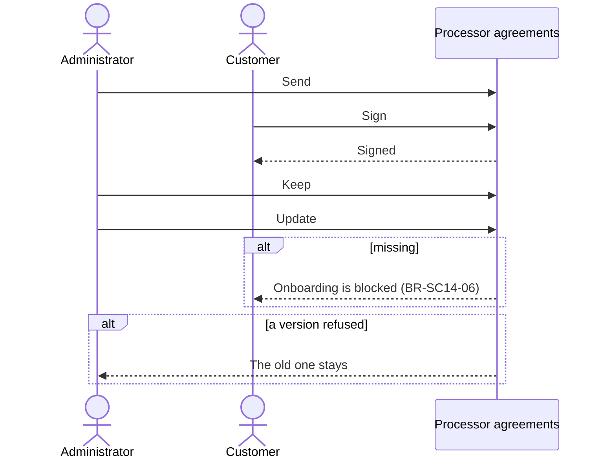

🏠 [Specs](../../../../README.md) › 🏷️ [Sectors](../../../README.md) › 💻 [SC14 IT and software](../../README.md) ›
📝 [Use cases](../README.md) › 📝 [Use cases: FL-SC14-05 Security and data compliance](README.md) ›
📝 UC-SC14-11 Sign data processing agreements

# 📝 UC-SC14-11 Sign data processing agreements

**Status:** ✅ specified

## Summary

The administrator sends the processor agreement; the customer signs; it is kept with the contract.

## Personas

- [U07 Administrator](../../../../01-users/personas/u07-administrator.md)
- [U09 Customer](../../../../01-users/personas/u09-customer.md)

## Goal

A signed agreement for every customer.

## Trigger

Onboarding.

## Frequency

Per customer.

## Preconditions

- The SC14 sector pack is installed for the company,
  [UC-F14-02](../../../../02-functional/f14-plugin-store/use-cases/01-find-and-install/uc-f14-02-install-a-plugin-or-sector-pack.md),
  and its users have their roles,
  [UC-F1-06](../../../../02-functional/f01-administration/use-cases/04-edit-a-role/uc-f01-06-edit-a-role-and-its-record-rules.md).

## Postconditions

- **Success:** the agreement is signed.
- **Failed:** onboarding is blocked.

## Main flow

1. The agreement is sent on
   [S-SC14-11 Processor agreements](../../screens/05-security-and-data-compliance/s-sc14-11-processor-agreements.md).
2. The customer signs,
   [UC-F2-14](../../../../02-functional/f02-no-code-configuration/use-cases/07-benchmark-additions/uc-f02-14-send-documents-for-e-signature.md).
3. It is kept with the contract.
4. A new version is sent when terms change.

## Alternative flows

- 1a. The customer's own template: it is reviewed and signed.

## Error flows

- 2e. Missing: onboarding is blocked
  ([BR-SC14-06](../../business-rules/br-sc14-06-processor-agreement-per-customer.md)).
- 4e. A version refused: the old one stays.
- Any step: a call to a service or an outside system fails: it is retried first
  ([BR-F3-32](../../../../02-functional/f03-assistant/business-rules/br-f03-32-retry-before-an-error.md)), then the
  error message pattern ([D122](../../../../06-decisions/ux/d122-error-message-standard.md)) says what failed; what was
  typed is kept.

## Business rules

- [BR-SC14-06 A processor agreement per customer](../../business-rules/br-sc14-06-processor-agreement-per-customer.md)

## Entities

- [E-SC14-10 Processor agreement](../../data/e-sc14-10-processor-agreement.md)

## Permissions

The administrator and customer roles; the record rules of their role and site apply,
[UC-F1-06](../../../../02-functional/f01-administration/use-cases/04-edit-a-role/uc-f01-06-edit-a-role-and-its-record-rules.md).

## Notifications

None beyond the in-app updates of the records concerned.

## Audit events

Every creation, change and state change of processor agreement records, with who, when and the values before and after
(T3).

## AI involvement

The AI assistant answers questions on the processor agreement records of this use case, with links, and prepares them as
drafts the user confirms. It works within the user's rights,
[BR-F3-34](../../../../02-functional/f03-assistant/business-rules/br-f03-34-every-capability-is-reachable-from-the-assistant.md),
and never deletes or does anything irreversible without the user's confirmation,
[BR-F3-07](../../../../02-functional/f03-assistant/business-rules/br-f03-07-no-deletes-no-irreversible-acts.md).

## API, MCP and A2A exposure

Through the API and webhooks (T5) and the MCP and A2A gateway (T6), with the caller's rights,
[BR-F3-34](../../../../02-functional/f03-assistant/business-rules/br-f03-34-every-capability-is-reachable-from-the-assistant.md),
reading, creating and changing the records of this use case; nothing irreversible without a person's confirmation.

## Screens

- [S-SC14-11 Processor agreements](../../screens/05-security-and-data-compliance/s-sc14-11-processor-agreements.md)

## Flowchart

See [FL-SC14-05 Security and data compliance](../../flows/fl-sc14-05-security-and-data-compliance.md#flowchart).

## Sequence diagram

## Acceptance criteria

1. **Given** the example software company's Acme agreement v3 **when** it is signed on 2 November **then** onboarding
   can start.
2. **Given** Acme without agreement **when** onboarding starts **then** onboarding is blocked
   ([BR-SC14-06](../../business-rules/br-sc14-06-processor-agreement-per-customer.md)).

## Non-functional notes

[D408](../../../../06-decisions/technical/d408-performance-and-profiles.md)'s targets
([performance](../../../../05-non-functional/performance.md)): 95 % of screens within 1 second; lists paged on the
server, the first page within 1 second; reports within 5 seconds or in the background. WCAG 2.2 AA and RGAA
([D46](../../../../06-decisions/ux/d46-accessibility-standard.md)).

## Regulatory references

Legal values from the France country pack:
[CR-FR-049 Processors and transfers outside the EU](../../../../10-country-packs/france/data-protection/cr-fr-049-processors-and-transfers.md).

## Related use cases

- [UC-SC14-14 Let customers switch and export their data](uc-sc14-14-let-customers-switch-and-export-their-data.md)

## Open questions

None.

---

⬅️ [UC-SC14-10 Run renewals and expansion](../02-licences-and-renewals/uc-sc14-10-run-renewals-and-expansion.md) ·
⬆️ [Up](README.md) · ➡️ [UC-SC14-12](uc-sc14-12-keep-the-software-bill-of-materials-and-handle-vulnerabilities.md)
